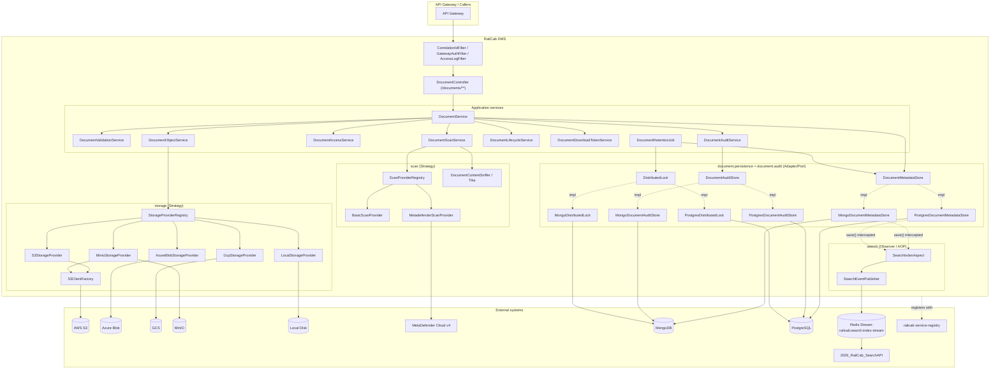

# RailCab DMS — High-Level Design

## 1. Purpose & Role

The Document Management Service (**DMS**, artifact `railcab-dms`, source root `2026_RailCab_DMS`) is the
platform's single service for uploading, storing, scanning, retrieving, and governing the lifecycle of
documents on behalf of the other RailCab services (bookings, admin, user account management, payments,
etc.). It is one of 14 services in the RailCab platform and is registered with the Eureka service
registry (`railcab-service-registry`) so the API Gateway can route to it by service id rather than a
hardcoded URL.

Concretely, DMS owns:

- Accepting a document upload (multipart file + category + owner id), running it through validation and
  malware scanning, storing the bytes with a pluggable cloud/on-prem storage backend, and persisting
  metadata + an audit trail entry.
- Serving documents back out, either via direct authenticated download, a storage-provider pre-signed
  URL, or a signed, time-limited application-level download token for cases where the backend cannot
  presign (e.g. local disk).
- Enforcing document lifecycle: retention windows, legal hold, and a scheduled purge job for soft-deleted
  metadata.
- Publishing document changes onto the platform's shared search-indexing stream so
  `2026_RailCab_SearchAPI` can keep its index current without DMS knowing anything about search internals.

DMS is a Spring Boot 3.3.5 / Java 21 REST service. It is intentionally storage-and-database agnostic at
the business-logic layer: `DocumentService` and friends depend only on small ports
(`StorageProvider`, `DocumentMetadataStore`, `DocumentAuditStore`, `DistributedLock`), never on a
concrete AWS/Azure/GCP/Mongo/Postgres SDK type.

## 2. Features

| Feature | Summary |
|---|---|
| Multi-cloud storage backend selection | `railcab.dms.storage.provider` selects AWS S3, Azure Blob, Google Cloud Storage, MinIO (S3-compatible), or local disk at runtime; all five implement one `StorageProvider` interface. |
| Malware / content scanning | Blocked-extension and blocked-content-type rejection, magic-byte content sniffing (Apache Tika) to catch spoofed file types, and a pluggable AV scan (`basic` EICAR-signature check or `metadefender` — real multi-engine cloud AV via MetaDefender Cloud v4). |
| Checksum verification | Optional caller-supplied SHA-256 checksum is verified against the actual uploaded bytes; a computed SHA-256 is always persisted in metadata regardless. |
| Document metadata & audit trail | Every document's metadata (owner, category, checksum, scan result, status, retention/legal-hold state) is persisted, and every upload/download/delete/legal-hold action is recorded as an immutable audit event, independently swappable between MongoDB and PostgreSQL. |
| Lifecycle management | Configurable default retention window applied at upload time; legal hold blocks deletion regardless of retention; a distributed-lock-guarded scheduled job purges soft-deleted metadata past a configurable age. |
| Owner/role-based access control | Every read/write is checked against the caller's identity (owner match or a privileged role) as forwarded by the gateway; a signed download token bypasses this check for the public one-time-link case. |
| Search indexing integration | An AOP aspect intercepts persistence-port `save(...)` calls and republishes an indexable projection of the saved entity onto a shared Redis Stream consumed by SearchAPI — completely decoupled from `DocumentService`. |
| Time-limited download URLs | Presigned URL from the active storage provider when supported (S3, Azure SAS, GCS V4 signing), else a signed HMAC app-level token redeemable at a public download endpoint. |

## 3. Tech Stack

Read directly from `build.gradle`:

- **Language / runtime**: Java 21 (toolchain-pinned), Spring Boot 3.3.5, Spring Cloud 2023.0.3 (Boot-3
  train — this service is explicitly *not* on the Boot-4 line some sibling services use, per comments in
  `build.gradle`).
- **Web**: `spring-boot-starter-web` (Tomcat, virtual threads enabled via
  `spring.threads.virtual.enabled=true` since upload/download requests spend most of their time blocked
  on storage I/O), plus `spring-boot-starter-webflux` solely to get a `WebClient.Builder` for the
  Metadefender outbound call (Boot 3.3.5 doesn't have the lean webclient-only starter Boot 4 has).
- **Persistence**: `spring-boot-starter-data-mongodb` and `spring-boot-starter-data-jpa` +
  `org.postgresql:postgresql` (runtime), both on the classpath simultaneously; only one is actually wired
  at startup based on `railcab.dms.persistence.provider`.
- **Security**: `spring-boot-starter-security` (stateless, gateway-forwarded-token model — no local
  login).
- **Validation**: `spring-boot-starter-validation`.
- **AOP**: `spring-boot-starter-aop` — powers `SearchIndexAspect`.
- **Messaging**: `spring-boot-starter-data-redis` (Lettuce) — used exclusively to publish onto a shared
  Redis Stream, not as a cache.
- **Storage SDKs**: AWS SDK v2 `software.amazon.awssdk:s3` (BOM-pinned 2.25.60, also backs MinIO),
  `com.azure:azure-storage-blob:12.27.0`, `com.google.cloud:google-cloud-storage:2.40.1`.
- **Content sniffing**: `org.apache.tika:tika-core:2.9.2`.
- **Resilience**: `io.github.resilience4j:resilience4j-spring-boot3:2.2.0` (circuit breaker + retry
  around the Metadefender outbound call).
- **Observability**: `micrometer-registry-prometheus`, `micrometer-tracing-bridge-otel` +
  `opentelemetry-exporter-otlp` (OTLP tracing export), Spring Boot Actuator.
- **API docs**: `springdoc-openapi-starter-webmvc-ui:2.6.0` (`/swagger-ui.html`, `/v3/api-docs`).
- **Service discovery**: `spring-cloud-starter-netflix-eureka-client`.
- **Codegen**: Lombok, Spring Boot configuration-processor.

## 4. Architecture Style

DMS is a **modular monolith / layered service** structured by vertical feature package
(`document.api` → `document.application` → `document.domain`/`document.persistence`/`document.audit`),
with three cross-cutting concerns pulled out as independent modules: `storage` (object storage
abstraction), `scan` (malware/content scanning abstraction), and `search` (AOP-based indexing observer).
Persistence is built on the **Ports & Adapters (Hexagonal) pattern**: three ports
(`DocumentMetadataStore`, `DocumentAuditStore`, `DistributedLock`) each have a Mongo and a Postgres
adapter, selected at startup via `@ConditionalOnProperty(railcab.dms.persistence.provider)` — never both
active at once, and `RailCabDmsApplication` explicitly excludes Boot's default DataSource/JPA
autoconfiguration so a MongoDB-only deployment never needs a reachable Postgres instance.

Storage and scanning use the **Strategy pattern** via a registry: `StorageProviderRegistry` and
`ScanProviderRegistry` each hold every Spring-managed implementation of their interface and pick the
active one at call time by asking each candidate `supports(providerName)`. See `LLD.md` for full class
detail.

Cross-cutting search indexing uses the **Observer pattern**, implemented as a Spring AOP
`@Aspect`/`@AfterReturning` advice (`SearchIndexAspect`) rather than explicit event listeners —
`DocumentService` and `DocumentRetentionJob` have no code-level awareness that indexing happens at all.

The service is stateless per request (`SessionCreationPolicy.STATELESS`); all caller identity is derived
from headers set by the upstream API Gateway (`GatewayAuthFilter`), never from a session or DMS-local
login.

## 5. External Dependencies

| Dependency | Used for | Selected by |
|---|---|---|
| AWS S3 | Object storage backend | `railcab.dms.storage.provider=aws` (or `aws-s3`/`s3`) |
| Azure Blob Storage | Object storage backend, incl. SAS-signed download URLs | `railcab.dms.storage.provider=azure` (or `azure-blob`) |
| Google Cloud Storage | Object storage backend, incl. V4-signed download URLs (best-effort — requires a signing-capable credential) | `railcab.dms.storage.provider=gcp` |
| MinIO (or any S3-compatible store) | Object storage backend via the AWS SDK against a custom endpoint (path-style access forced) | `railcab.dms.storage.provider=minio` |
| Local filesystem | Object storage backend for dev/on-prem (`railcab.dms.storage.local-root`) | `railcab.dms.storage.provider=local` (default) |
| MetaDefender Cloud v4 | Multi-engine antivirus scanning (upload + poll), behind Resilience4j circuit breaker/retry | `railcab.dms.scan.provider=metadefender` |
| MongoDB | Document metadata, audit trail, and distributed-lock storage | `railcab.dms.persistence.provider=mongo` (default) |
| PostgreSQL | Same three stores, JPA/Hibernate + HikariCP | `railcab.dms.persistence.provider=postgres` |
| Redis (shared stream, not a cache) | Publishing document-changed events onto `railcab:search:index-stream`, consumed by `2026_RailCab_SearchAPI`; the same broker/stream is shared with BookingsAPI/AdminAPI/UAM | Always active |
| Eureka (`railcab-service-registry`) | Service discovery / registration | Always active |
| OTLP collector | Distributed tracing export (non-fatal if absent) | Always active, 10% sampling by default |

## 6. Component Diagram

## 7. Deployment

- **Dockerfile** (`Dockerfile`): `eclipse-temurin:21-jre` base, timezone forced to `Asia/Kolkata`,
  copies the boot jar from `build/libs/*.jar`, exposes port `9001`, entrypoint
  `java -Duser.timezone=Asia/Kolkata -jar app.jar`. Note the container `EXPOSE`/local default port
  (`9001` in the Dockerfile, `9004` in `application.properties`'s `DMS_PORT` default) differs from the
  Kubernetes manifest's actual runtime port (`9006`, driven by the `DMS_PORT` env var at deploy time) —
  the effective port is always whatever `DMS_PORT` resolves to at runtime.
- **Kubernetes Deployment** (`ops/k8s/deployment.yaml`): 3 base replicas, secrets-backed env vars for
  Mongo URI, gateway forward key, download-token secret, and full AWS S3 credentials (this environment's
  configured storage provider is `s3`). Readiness probe hits `/api/v1/actuator/health` after a 20s
  initial delay; liveness probe after 60s. Resource requests 250m CPU / 512Mi memory, limits 1 CPU / 1Gi
  memory. A matching `Service` exposes port 9006.
- **HorizontalPodAutoscaler** (`ops/k8s/hpa.yaml`): **DMS is one of the few RailCab services with
  autoscaling configured** — min 3 / max 12 replicas, scaling on 65% CPU or 75% memory utilization, fast
  scale-up (up to +100% every 60s after a 60s stabilization window) and conservative scale-down (-25%
  every 60s after a 300s stabilization window). This is exactly why `DocumentRetentionJob` needs a
  `DistributedLock` — every one of up to 12 replicas runs the same `@Scheduled` cron expression.
- **MongoDB backup/restore** (`ops/k8s/mongo-backup-cronjob.yaml`, `ops/k8s/mongo-restore-job.yaml`):
  daily `mongodump --gzip` CronJob (01:00, `concurrencyPolicy: Forbid`) uploading the archive to an S3
  backup bucket; a companion restore Job template (`--drop`, intended for use only in an approved restore
  window per `docs/production-operations.md`).
- Service discovery: registers with Eureka at startup (`eureka.client.service-url.defaultZone`) so the
  API Gateway can route to it without a hardcoded address.

## 8. Non-Functional Characteristics

- **Observability**:
  - Every request gets an `X-Correlation-Id` (`CorrelationIdFilter`, highest filter precedence) —
    preserved if the caller sent one, generated otherwise, placed in MDC and echoed back in the response
    header.
  - `AccessLogFilter` (lowest filter precedence, so it wraps the whole chain) logs a structured
    `event=http_request` line per request with correlation id, method, path, status, duration, caller
    user id/role, and remote address.
  - Prometheus metrics at `/api/v1/actuator/prometheus`; a **committed Grafana dashboard**
    (`ops/grafana/railcab-dms-dashboard.json`) provides request rate, 5xx rate, p95 latency, JVM memory,
    CPU usage, and an HTTP-status-class breakdown — a real, checked-in observability artifact rather than
    an implied/undocumented one.
  - `ops/prometheus/alerts.yaml` defines four alert rules: service down (`up == 0` for 2m, critical),
    high 5xx rate (>5% for 5m, warning), high p95 latency (>2s for 10m, warning), and degraded readiness.
  - OTLP distributed tracing at 10% sampling by default (`management.tracing.sampling.probability`),
    non-fatal if no collector is reachable.
- **Resilience**: the only real outbound network dependency in the request path besides object storage
  itself — the MetaDefender scan call — is wrapped in a Resilience4j circuit breaker (10-call sliding
  window, 50% failure threshold, 30s open-state wait, 3 half-open trial calls) and a bounded retry (2
  attempts, 300ms wait). A `scanFallback` method governs fail-open vs. fail-closed behavior
  (`railcab.dms.scan.metadefender.fail-open`, default `false` — scans fail closed by default).
- **Security posture**: fails closed at every step of upload (validation → scan → access check →
  storage); constant-time HMAC verification for signed download tokens; per-object-key path traversal
  guards in every storage provider (`LocalStorageProvider.resolve` rejects any resolved path escaping its
  root; `DocumentService.safePathPart`/`safeFileName` strip everything outside `[A-Za-z0-9._-]` and
  reject any residual `..`).
- **Scalability**: virtual threads for request handling (upload/download is I/O-bound on external
  storage), autoscaling 3–12 replicas (see above), tuned connection pools for both backing stores
  (Mongo driver pool 10–100 via `MongoPoolConfig`; HikariCP 5–20 via `PostgresPersistenceConfig`).
- **Data protection**: SHA-256 checksums always computed and stored at upload time (and optionally
  verified against a caller-supplied checksum); soft-delete + legal hold + retention window model rather
  than immediate hard delete, with a scheduled, lock-guarded purge job for actual cleanup.
