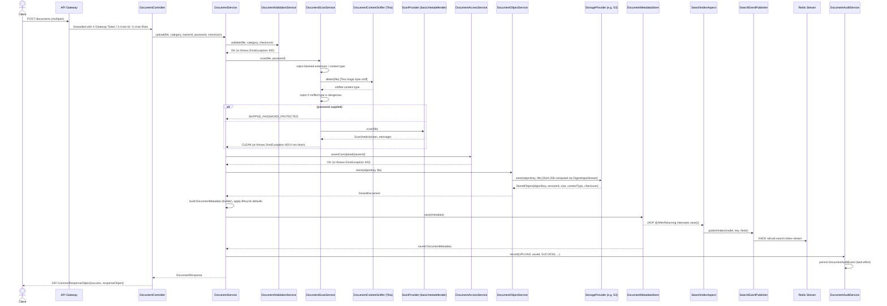
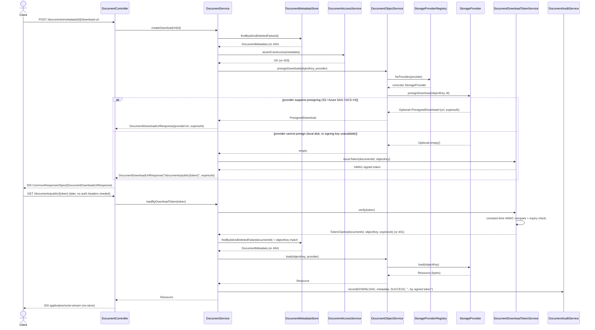

# RailCab DMS — Low-Level Design

All paths are relative to `2026_RailCab_DMS/`. Line numbers were verified against the current source tree.

## 1. Package Structure

```
src/main/java/com/railcab/dms/
├── RailCabDmsApplication.java        Boot entrypoint; excludes default DataSource/JPA autoconfig
├── common/
│   ├── dto/                          CommonRequestObject / CommonResponseObject envelope + shared enums
│   └── lock/                         DistributedLock port + mongo/postgres adapters (job-lock leasing)
├── config/                           DmsProperties (@ConfigurationProperties tree), AsyncConfig,
│                                      MongoPoolConfig, PostgresPersistenceConfig, RedisConfig
├── document/
│   ├── api/                          DocumentController — the single REST surface (/documents/**)
│   ├── application/                  Orchestration services (validation, scan, access, object,
│   │                                 lifecycle, audit, download-token, retention job) + DocumentService
│   ├── audit/                        DocumentAuditStore port + DocumentAuditEvent + mongo/postgres adapters
│   ├── domain/                       DocumentMetadata — framework-free domain model
│   ├── dto/                          Request/response DTOs (records) + RUpload cross-service shape
│   └── persistence/                  DocumentMetadataStore port + mongo/postgres adapters
├── exception/                        DmsException + GlobalExceptionHandler (@RestControllerAdvice)
├── observability/                    CorrelationIdFilter, AccessLogFilter
├── scan/                             ScanProvider port + registry, basic/metadefender adapters, Tika sniffer
├── search/                           SearchIndexable, SearchIndexAspect (Observer/AOP), SearchEventPublisher
├── security/                         GatewayAuthFilter, SecurityConfig, DmsPrincipal, DmsSecurityContext
└── storage/                          StorageProvider port + registry, aws/azure/gcp/minio/local adapters
```

This is a **package-by-feature** layout for the `document` slice (api → application → domain/persistence/audit),
with `storage`, `scan`, and `search` pulled out as independent, cross-cutting top-level packages because
each is reused conceptually outside the `document` feature (a future entity type could reuse the same
storage/scan/search machinery).

## 2. Key Classes (file:line)

| Class | Path:line | Role |
|---|---|---|
| `DocumentController` | `src/main/java/com/railcab/dms/document/api/DocumentController.java:45` | REST surface; thin — delegates every operation straight to `DocumentService` |
| `DocumentService` | `src/main/java/com/railcab/dms/document/application/DocumentService.java:22` | Orchestrates upload/download/list/delete/legal-hold across validation, scan, access, storage, audit, lifecycle |
| `DocumentValidationService` | `src/main/java/com/railcab/dms/document/application/DocumentValidationService.java:16` | Size/content-type/extension allowlist + optional SHA-256 checksum verification |
| `DocumentScanService` | `src/main/java/com/railcab/dms/document/application/DocumentScanService.java:15` | Blocklist + Tika-sniff dangerous-type rejection, then delegates to the active `ScanProvider` |
| `DocumentAccessService` | `src/main/java/com/railcab/dms/document/application/DocumentAccessService.java:16` | Owner-or-privileged-role authorization check |
| `DocumentObjectService` | `src/main/java/com/railcab/dms/document/application/DocumentObjectService.java:15` | Thin façade over `StorageProviderRegistry` for store/load/delete/presign |
| `DocumentLifecycleService` | `src/main/java/com/railcab/dms/document/application/DocumentLifecycleService.java:12` | Applies default retention; enforces legal-hold/retention delete guard |
| `DocumentDownloadTokenService` | `src/main/java/com/railcab/dms/document/application/DocumentDownloadTokenService.java:15` | HMAC-SHA256 signed, time-limited download token issuance/verification |
| `DocumentAuditService` | `src/main/java/com/railcab/dms/document/application/DocumentAuditService.java:16` | Best-effort audit-event recording (swallows failures, logs a warning) |
| `DocumentRetentionJob` | `src/main/java/com/railcab/dms/document/application/DocumentRetentionJob.java:24` | `@Scheduled` purge of soft-deleted metadata, guarded by `DistributedLock` |
| `DocumentMetadata` | `src/main/java/com/railcab/dms/document/domain/DocumentMetadata.java:24` | Framework-free domain model; also implements `SearchIndexable` |
| `StorageProvider` | `src/main/java/com/railcab/dms/storage/StorageProvider.java:9` | Strategy interface for object storage backends |
| `StorageProviderRegistry` | `src/main/java/com/railcab/dms/storage/StorageProviderRegistry.java:10` | Picks the active `StorageProvider` by `supports(name)` |
| `S3ClientFactory` | `src/main/java/com/railcab/dms/storage/aws/S3ClientFactory.java:25` | Lazy, cached S3 client/presigner builder; shared by AWS S3 and MinIO via composition |
| `ScanProvider` | `src/main/java/com/railcab/dms/scan/ScanProvider.java:5` | Strategy interface for malware scan backends |
| `ScanProviderRegistry` | `src/main/java/com/railcab/dms/scan/ScanProviderRegistry.java:9` | Picks the active `ScanProvider` by `supports(name)` |
| `DocumentMetadataStore` | `src/main/java/com/railcab/dms/document/persistence/DocumentMetadataStore.java:15` | Port for metadata persistence (Mongo/Postgres adapters) |
| `DocumentAuditStore` | `src/main/java/com/railcab/dms/document/audit/DocumentAuditStore.java:7` | Port for audit-event persistence (Mongo/Postgres adapters) |
| `DistributedLock` | `src/main/java/com/railcab/dms/common/lock/DistributedLock.java:10` | Port for the job-lock lease used by `DocumentRetentionJob` (Mongo/Postgres adapters) |
| `SearchIndexAspect` | `src/main/java/com/railcab/dms/search/SearchIndexAspect.java:19` | AOP `@AfterReturning` advice on `*Store.save(..)` / `*Repository.save(..)` |
| `SearchEventPublisher` | `src/main/java/com/railcab/dms/search/SearchEventPublisher.java:22` | Publishes index/delete events onto the shared Redis Stream |
| `GatewayAuthFilter` | `src/main/java/com/railcab/dms/security/GatewayAuthFilter.java:21` | Verifies `X-Gateway-Token`, builds the `DmsPrincipal` authentication from `X-User-Id`/`X-User-Role` |
| `DmsProperties` | `src/main/java/com/railcab/dms/config/DmsProperties.java:10` | Root `@ConfigurationProperties(prefix="railcab.dms")` tree (storage/persistence/validation/security/scan/lifecycle) |
| `GlobalExceptionHandler` | `src/main/java/com/railcab/dms/exception/GlobalExceptionHandler.java:16` | Maps `DmsException`/validation exceptions to the common response envelope |

## 3. Design Patterns

### 3.1 Strategy — Storage backend (`StorageProvider`)

`StorageProvider` (`storage/StorageProvider.java:9`) declares `supports(String)`, `store`, `load`,
`delete`, `isHealthy`, and an optional `presignDownload`. Five `@Component`-annotated implementations —
`S3StorageProvider`, `AzureBlobStorageProvider`, `GcpStorageProvider`, `MinioStorageProvider`,
`LocalStorageProvider` — are all injected as a `List<StorageProvider>` into
`StorageProviderRegistry` (`storage/StorageProviderRegistry.java:10-18`), which picks the active one at
call time:

```java
// StorageProviderRegistry.java:24-29
public StorageProvider forProvider(String providerName) {
    return providers.stream()
            .filter(candidate -> candidate.supports(providerName))
            .findFirst()
            .orElseThrow(() -> DmsException.badRequest("Unsupported DMS storage provider: " + providerName));
}
```

`currentProviderName()` reads `railcab.dms.storage.provider` from `DmsProperties`. `DocumentObjectService`
(`document/application/DocumentObjectService.java:51-53`) always resolves through the registry, never a
concrete provider type.

### 3.2 Strategy — Scan backend (`ScanProvider`)

Same shape, one level simpler (no registry-level fallback for "not configured" beyond throwing).
`ScanProvider` (`scan/ScanProvider.java:5`) has two implementations: `BasicScanProvider`
(EICAR-signature-only check, always available, matches `basic`/blank/null) and
`MetadefenderScanProvider` (real multi-engine AV via MetaDefender Cloud v4, matches `metadefender`).
`ScanProviderRegistry.current()` (`scan/ScanProviderRegistry.java:20-26`) selects by
`railcab.dms.scan.provider`.

### 3.3 Adapter / Port — three ports, each with Mongo + Postgres adapters

All three follow the identical shape: a small interface in a persistence-neutral package, with two
`@Component`-annotated adapters gated by mutually exclusive `@ConditionalOnProperty` on
`railcab.dms.persistence.provider` (`mongo`, `matchIfMissing = true`, vs. `postgres`) so exactly one is
ever active:

| Port | Interface | Mongo adapter | Postgres adapter |
|---|---|---|---|
| Document metadata | `document/persistence/DocumentMetadataStore.java:15` | `document/persistence/mongo/MongoDocumentMetadataStore.java:14` (delegates to `SpringDataDocumentMetadataRepository`, a plain `MongoRepository`) | `document/persistence/postgres/PostgresDocumentMetadataStore.java:16` (delegates to `DocumentMetadataJpaRepository`, a `JpaRepository`; generates a UUID id if absent — Mongo relies on its own `@Id` generation) |
| Audit trail | `document/audit/DocumentAuditStore.java:7` | `document/audit/mongo/MongoDocumentAuditStore.java:10` | `document/audit/postgres/PostgresDocumentAuditStore.java:13` (same UUID-if-absent pattern) |
| Job lock | `common/lock/DistributedLock.java:10` | `common/lock/mongo/MongoDistributedLock.java:19` (atomic `findAndModify` with an `upsert`+`lockedUntil` expiry check) | `common/lock/postgres/PostgresDistributedLock.java:16` (`INSERT ... ON CONFLICT DO UPDATE ... WHERE locked_until < now RETURNING owner`, plus a `@PostConstruct` that creates the lock table if missing) |

Each Postgres/Mongo model type (`DocumentMetadataJpaEntity`, `DocumentMetadataMongoDocument`,
`DocumentAuditJpaEntity`) owns its own `fromDomain`/`toDomain` mapping methods so the domain type
(`DocumentMetadata`, `DocumentAuditEvent`) never depends on a JPA or Spring Data Mongo annotation.
`RailCabDmsApplication` (`RailCabDmsApplication.java:20-25`) excludes Boot's default
`DataSourceAutoConfiguration`/`HibernateJpaAutoConfiguration`/etc. so the Postgres driver being on the
classpath doesn't force a DataSource to exist when the deployment is Mongo-only; `PostgresPersistenceConfig`
(`config/PostgresPersistenceConfig.java:32`) manually wires the Hikari `DataSource` + JPA
`EntityManagerFactory` + `PlatformTransactionManager`, itself gated by the same conditional property.

### 3.4 Observer — Search indexing via AOP (not explicit listeners)

`SearchIndexAspect` (`search/SearchIndexAspect.java:19-31`) is a Spring `@Aspect` with an
`@AfterReturning` advice matching a pointcut on **any** `*Store.save(..)` or `*Repository.save(..)`
method across the `com.railcab.dms` package tree:

```java
// SearchIndexAspect.java:23-31
@AfterReturning(
        pointcut = "execution(* com.railcab.dms..*Store.save(..)) || execution(* com.railcab.dms..*Repository.save(..))",
        returning = "result")
public void afterSave(Object result) {
    if (result instanceof SearchIndexable indexable) {
        searchEventPublisher.publishIndex(indexable.getSearchModel(), indexable.getSearchModelKey(),
                indexable.getSearchIndexFields());
    }
}
```

The pointcut deliberately matches both the `*Store` naming DMS itself uses and the `*Repository` naming
other RailCab services use, so it transparently covers whichever adapter (Mongo or Postgres) is active —
both return the same domain type, and any future `*Store`/`*Repository` whose saved type implements
`SearchIndexable` (`search/SearchIndexable.java:13`) is automatically picked up with zero code changes in
the persistence or application layers. `DocumentMetadata` is the only current implementer
(`document/domain/DocumentMetadata.java:24`, `getSearchModel()`/`getSearchModelKey()`/
`getSearchIndexFields()` at lines 56-88). `SearchEventPublisher` (`search/SearchEventPublisher.java:22`)
is the subject being notified — it fire-and-forgets a Redis Stream `XADD` and only logs on failure,
never throwing, so a broken search pipeline can never fail a document write.

### 3.5 Composition-based Factory + dedup fix — `S3ClientFactory`

`S3ClientFactory` (`storage/aws/S3ClientFactory.java:25`) is a lazily-initialized, double-checked-locking
factory/cache for one `(S3Client, S3Presigner)` pair. It is **not** inherited by `S3StorageProvider`/
`MinioStorageProvider` — both hold their own `S3ClientFactory` instance by composition
(`S3StorageProvider.java:34,38`; `MinioStorageProvider.java:37,41`), which is what lets one class contain
all the S3-wire-protocol logic while AWS and MinIO (an S3-compatible endpoint) stay as separate
`StorageProvider` beans with different `supports(...)` matches and different `DmsProperties` sub-config
(`AwsS3` vs. `Minio`, the latter extending the former to add `endpoint`).

**This session's dedup fix**: `buildClient` and `buildPresigner` previously duplicated the
region/credential/endpoint-override branching inline for each builder type. They now both call one shared
private method:

```java
// S3ClientFactory.java:97-113
private void configureCommonSettings(
        DmsProperties.AwsS3 settings,
        URI endpointOverride,
        Consumer<Region> regionSetter,
        Consumer<AwsCredentialsProvider> credentialsSetter,
        Consumer<URI> endpointOverrideSetter
) {
    regionSetter.accept(Region.of(settings.getRegion()));
    if (endpointOverride != null) {
        endpointOverrideSetter.accept(endpointOverride);
    }
    if (StringUtils.hasText(settings.getAccessKey()) && StringUtils.hasText(settings.getSecretKey())) {
        credentialsSetter.accept(StaticCredentialsProvider.create(
                AwsBasicCredentials.create(settings.getAccessKey(), settings.getSecretKey())
        ));
    }
}
```

Because `S3ClientBuilder` and `S3Presigner.Builder` don't share a common fluent supertype in the AWS SDK,
each caller (`buildClient` at line 61, `buildPresigner` at line 77) passes its own builder-specific
setters in as method references/lambdas — `builder::region`/`builder::credentialsProvider` plus an
endpoint-override lambda that differs only in whether it also forces path-style access
(`buildClient`'s `S3ClientBuilder.forcePathStyle(true)`) or sets an `S3Configuration` with
`pathStyleAccessEnabled(true)` (`buildPresigner`). This removes what was duplicated
region/credential/endpoint branching between the two build methods while still letting each keep its
builder-specific quirks.

### 3.6 Other patterns observed on this read

- **Builder** — `DocumentMetadata` uses Lombok `@Builder(toBuilder = true)`
  (`document/domain/DocumentMetadata.java:21`); `DocumentService.upload` (`DocumentService.java:66-83`)
  constructs the metadata entirely through the builder.
- **Registry** — both `StorageProviderRegistry` and `ScanProviderRegistry` are a Registry-over-Strategy
  variant: Spring's `List<Interface>` autowiring collects every bean implementing the strategy interface,
  and the registry is the single place that resolves "which one is active" from configuration.
- **Template-ish reuse via records** — `StorageProvider.StoredObject`/`PresignedDownload`
  (`storage/StorageProvider.java:33,36`) and `ScanProvider.ScanVerdict` (`scan/ScanProvider.java:11`) are
  small immutable value records shared as the interface's return contract across all Strategy
  implementations.
- **Circuit Breaker / Retry (Resilience4j)** — `MetadefenderScanProvider.scan`
  (`scan/metadefender/MetadefenderScanProvider.java:44-46`) is annotated `@CircuitBreaker(fallbackMethod
  = "scanFallback")` + `@Retry`, with the fallback (line 62) implementing the fail-open/fail-closed
  policy previously done as an inline try/catch.

## 4. REST API Contract

Base path: `/api/v1` (`server.servlet.context-path`) + controller mapping `/documents`.
All success responses are wrapped in `CommonResponseObject` (`{success, message, responseObject,
errorCode, timestamp}`) except the two byte-streaming download endpoints.

| Method | Path | Auth | Request | Response | Notes |
|---|---|---|---|---|---|
| `POST` | `/documents` | Gateway + owner/privileged | `multipart/form-data`: `file`, `category`, `ownerId`, optional `password`, optional `checksum` | `DocumentResponse` | Full pipeline: validate → scan → access check → store → persist metadata → audit. Fails closed at the first failing step. |
| `GET` | `/documents/metadata/{id}` | Gateway + owner/privileged | path `id` | `DocumentResponse` | 404 if not found/deleted. |
| `GET` | `/documents/metadata/{id}/rupload` | Gateway + owner/privileged | path `id` | `RUpload` | Same lookup, mapped to the shared cross-service `RUpload` shape; `base64EncodedData` always null. |
| `GET` | `/documents/metadata` | Gateway + owner/privileged | query `category`, `ownerId` | `List<DocumentResponse>` | Non-deleted, newest first. |
| `POST` | `/documents/metadata/search` | Gateway + owner/privileged | `CommonRequestObject` whose `requestObject` converts to `DocumentUploadRequest` (only `category`/`ownerId` read) | `List<DocumentResponse>` | Envelope-wrapped equivalent of the list endpoint. |
| `DELETE` | `/documents/metadata/{id}` | Gateway + owner/privileged | path `id` | `null` | Soft delete; blocked by legal hold or unexpired retention (400); removes the underlying object. |
| `POST` | `/documents/metadata/{id}/download-url` | Gateway + owner/privileged | path `id` | `DocumentDownloadUrlResponse` | Storage-provider pre-signed URL if supported, else an app-level signed token URL. |
| `PATCH` | `/documents/metadata/{id}/legal-hold` | Gateway + owner/privileged | path `id`, body `LegalHoldRequest{enabled}` | `DocumentResponse` | Toggles legal hold; records an audit event. |
| `GET` | `/documents/public/{token}` | **Public** (token is the credential) | path `token` | raw bytes, `application/octet-stream`, `Cache-Control: no-store` | Verifies HMAC signature + expiry; bypasses owner/role checks by design. |
| `GET` | `/documents/{*path}` | Gateway + owner/privileged | path = storage object key (`category/ownerId/storedFileName`) | raw bytes, `application/octet-stream`, `Cache-Control: private, max-age=3600` | Looks up metadata by object key, then streams. |

Error responses use the same `CommonResponseObject` envelope with `success=false`; `errorCode` is set to
`VALIDATION_ERROR` for field-level validation failures. HTTP status codes: `400` (validation/scan/blocked
type/checksum mismatch), `401` (bad/expired signed download token), `403` (not owner and not a
privileged role, or legal-hold/retention delete block), `404` (metadata not found or already deleted),
`500` (unexpected).

OpenAPI/Swagger UI is live at `/api/v1/swagger-ui.html` and `/api/v1/v3/api-docs`
(`springdoc.swagger-ui.path` / `springdoc.api-docs.path` in `application.properties:108-109`); every
endpoint in `DocumentController` carries full `@Operation`/`@ApiResponses` annotations that were used to
build the table above.

## 5. Domain Model

### 5.1 `DocumentMetadata` (`document/domain/DocumentMetadata.java:24`)

Framework-free (no persistence annotations); implements `SearchIndexable`. Fields:

| Field | Type | Meaning |
|---|---|---|
| `id` | `String` | Metadata id (Mongo `@Id` auto-generated; Postgres adapter assigns a `UUID` if absent) |
| `category` | `String` | Logical bucket, sanitized (`DocumentService.safePathPart`), also the first storage-path segment |
| `ownerId` | `String` | Owner identity, sanitized, second storage-path segment, and the access-control anchor |
| `originalFileName` | `String` | As uploaded by the client (unsanitized, display-only) |
| `storedFileName` | `String` | `{8-char UUID prefix}_{sanitized lowercase filename}` — collision-resistant, path-safe |
| `objectKey` | `String` | Full storage key: `category/ownerId/storedFileName` |
| `publicUrl` | `String` | `{railcab.dms.storage.public-base-url}/{objectKey}` |
| `provider` | `String` | Which `StorageProvider` actually stored this object (persisted per-document, not just globally-configured, so historical documents keep working after a provider migration) |
| `versionId` | `String` | Storage-provider version id if the backend supports object versioning (S3/GCS; null for Azure/local) |
| `checksumSha256` | `String` | Always computed at upload time via a `DigestInputStream` wrapped around the upload stream |
| `contentType` | `String` | Declared content type at upload time |
| `sizeBytes` | `long` | File size |
| `status` | `String` | `UPLOADED` → `DELETED` (free-form string, not an enum) |
| `uploadedBy` | `String` | Caller's user id at upload time |
| `scanStatus` / `scanMessage` | `String` | `CLEAN` / `SKIPPED` / `SKIPPED_PASSWORD_PROTECTED` + human-readable detail |
| `retentionUntil` | `Instant` | Set from `railcab.dms.lifecycle.default-retention-days` at upload time if > 0 |
| `legalHold`, `legalHoldChangedAt`, `legalHoldChangedBy` | — | Legal hold state + audit trail of the last toggle |
| `deleted`, `deletedAt`, `deletedBy` | — | Soft-delete marker consumed by `DocumentRetentionJob`'s purge query |
| `createdAt` | `Instant` | Upload timestamp |

`getSearchIndexFields()` (lines 69-88) projects this onto the platform's generic slot-keyed search
document shape (`text1..text7`, `number1`, `date1`, `date2`), nulls stripped.

### 5.2 Audit trail — `DocumentAuditEvent` (`document/audit/DocumentAuditEvent.java:12`)

One immutable event per action: `id`, `documentId`, `objectKey`, `ownerId`, `category`,
`action` (`DocumentAuditAction` enum: `UPLOAD`, `DOWNLOAD`, `DELETE`, `LEGAL_HOLD`), `actorId`,
`actorRole` (from `DmsSecurityContext.currentPrincipal()` at record time), `status` (free-form, currently
always `"SUCCESS"` from call sites), `message`, `occurredAt`. `DocumentAuditService.record(...)`
(`document/application/DocumentAuditService.java:26-44`) is called after every state-changing operation in
`DocumentService`; failures to persist an audit event are logged and swallowed, never thrown — auditing
is best-effort and must not break the primary operation.

### 5.3 Cross-service DTO — `RUpload` (`document/dto/RUpload.java:22`)

Maps `DocumentResponse` onto the platform-wide "stored document" shape (`name`, `fileType`, `size`,
`location`, `title`, `prefixFolder`, `base64EncodedData` (always null here), `modelKey`,
`retentionPolicy`, `versionId`). `retentionPolicy` is derived (not stored) by `retentionPolicyOf(...)`
(lines 62-74): legal hold → `MERCHANT_DOCUMENTS`; no retention date → `RETAIN_EVER`; else bucketed by
days-remaining into `RETAIN_SHORT` (≤90d) / `RETAIN_NORMAL` (≤365d) / `RETAIN_LONG`.

## 6. Sequence Diagrams

### 6.1 Upload → validate → scan → store → persist → index



### 6.2 Download-URL creation (pre-signed vs. signed app token) and redemption



## 7. Error Handling / Validation Approach

- **Single exception type for all business errors**: `DmsException` (`exception/DmsException.java:5`) is
  a `RuntimeException` carrying an `HttpStatus`, created only via static factories `badRequest`,
  `forbidden`, `unauthorized`, `notFound` — there is no public constructor, so every throw site
  self-documents its HTTP status.
- **Centralized translation**: `GlobalExceptionHandler` (`exception/GlobalExceptionHandler.java:16`) is a
  `@RestControllerAdvice` with three handlers: `DmsException` → its own status +
  `CommonResponseObject.failure(message)`; Bean Validation failures
  (`MethodArgumentNotValidException`/`ConstraintViolationException`) → `400` +
  `CommonResponseObject.validationFailure(fieldErrors)` with `errorCode=VALIDATION_ERROR`; anything else
  → `500` + a generic `"Unexpected DMS error"` message (the real exception is logged server-side via
  `log.error`, never leaked to the client).
- **Fail-closed pipeline order**: `DocumentService.upload` runs validation → scan → access-check → store
  → persist → audit in that fixed order (`DocumentService.java:56-88`), so a file that fails validation
  never reaches the (network-bound) scan step, and a file that fails scanning never reaches storage.
- **`DocumentValidationService`** (`document/application/DocumentValidationService.java:24-54`): rejects
  empty file; rejects size over `DmsProperties.validationFor(category)`'s (category-specific, falling
  back to global default via `ValidationRule.merge`) `maxFileSizeBytes`; rejects content type not in the
  allowlist; rejects filename extension not in the allowlist; if a checksum was supplied, computes SHA-256
  over the actual bytes and rejects on mismatch (checksum comparison strips non-alphanumeric characters
  from the caller-supplied value first, so common formats like `sha256:...` or spaced hex still match).
- **`DocumentScanService`**'s blocklist checks (`document/application/DocumentScanService.java:35-83`),
  in order:
  1. If scanning is globally disabled (`railcab.dms.scan.enabled=false`), short-circuits to `SKIPPED`.
  2. `rejectBlockedExtension` — case-insensitive suffix match against `railcab.dms.scan.blocked-extensions`
     (default `.exe,.dll,.bat,.cmd,.js,.sh,.jar`).
  3. `rejectBlockedContentType` — exact case-insensitive match against
     `railcab.dms.scan.blocked-content-types`.
  4. `rejectSniffedDangerousContentType` — independent of what the client declared, runs
     `DocumentContentSniffer.detect` (Apache Tika magic-byte detection) and rejects if the **actual**
     sniffed type is in `railcab.dms.scan.dangerous-content-types` (a broader list than the declared-type
     blocklist, including e.g. `application/x-dosexec`, `application/x-mach-binary`) — this is what stops
     a renamed/spoofed executable from passing the declared extension/content-type checks.
  5. If a password was supplied, the real AV scan step is skipped entirely (`SKIPPED_PASSWORD_PROTECTED`)
     since encrypted content can't be scanned — a deliberate, documented trade-off, not an oversight.
  6. Otherwise delegates to the active `ScanProvider`; a non-clean verdict throws `400` with the
     provider's message embedded.
- **Scan-provider-level resilience**: `MetadefenderScanProvider` wraps the real network call in
  Resilience4j `@CircuitBreaker`/`@Retry`; on exhaustion, `scanFallback` (line 62) applies
  `railcab.dms.scan.metadefender.fail-open` — `false` by default, so scan-infrastructure outages fail
  the upload rather than silently letting unscanned files through.
- **Path/identity safety**: `DocumentService.safePathPart`/`safeFileName`
  (`DocumentService.java:196-214`) strip every character outside `[A-Za-z0-9._-]` and explicitly reject
  any resulting value containing `..`; `LocalStorageProvider.resolve`
  (`storage/local/LocalStorageProvider.java:80-86`) additionally re-verifies the resolved absolute path
  still starts with the configured root, rejecting escapes with `403` even if a caller somehow bypassed
  the service-layer sanitization.
- **Access control**: `DocumentAccessService.assertOwnerOrPrivileged`
  (`document/application/DocumentAccessService.java:38-47`) throws `403` unless the caller's identity
  (from `DmsSecurityContext`, populated by `GatewayAuthFilter` off `X-User-Id`/`X-User-Role`) either
  equals the resource's `ownerId` or is a trusted internal service (`INTERNAL_SERVICE`). There is no list of
  privileged role names any more (`railcab.dms.security.privileged-roles` is a deprecated, empty-by-default
  escape hatch); staff reach document facts through the lifecycle endpoints, which the gateway guards by
  catalogue privilege. The owner check can be globally disabled via
  `railcab.dms.security.enforce-owner-access=false` for trusted internal-only deployments.
- **Download-token integrity**: `DocumentDownloadTokenService.verify`
  (`document/application/DocumentDownloadTokenService.java:32-51`) uses a byte-by-byte constant-time
  comparison (`constantTimeEquals`, lines 79-90) for the HMAC signature check to avoid timing side
  channels, and separately checks expiry against `Instant.now()` after signature verification succeeds.
