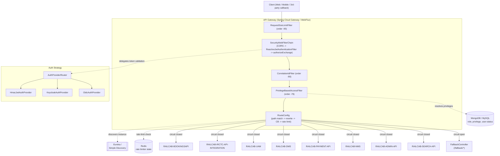

# API Gateway — High-Level Design

Module: `2026_RailCab_ApiGateway` · Artifact: `railcab-api-gateway` (`com.heuristiq.gateway`, version `1.0.0`)

## 1. Purpose & Role

The API Gateway is the **single entry point for all client traffic** into RailCab's microservice
platform. Every external caller (web app, mobile app, third-party payment-gateway postback,
IRCTC integration partner) talks to this service; it never talks to a downstream service directly.

Its responsibilities:

- **Routing** — maps public URL prefixes (`/api/bookings/**`, `/api/uam/**`, …) to the correct
  backend service, resolved dynamically through service discovery rather than hardcoded
  host:port pairs.
- **Authentication** — validates bearer tokens once, at the edge, so downstream services don't
  each need their own JWT-validation logic.
- **Authorization** — enforces fine-grained, data-driven RBAC before a request is allowed to
  reach a backend.
- **Resilience** — isolates the platform from a slow or failing downstream service via circuit
  breakers and fallback responses.
- **Traffic shaping** — rate-limits callers to protect backends from overload or abuse.
- **Cross-cutting concerns** — correlation IDs for tracing, request-size limiting, CORS, and
  security-header propagation, all applied once instead of duplicated per service.

Downstream services (BookingsAPI, IRCTC integration, UAM, DMS, PaymentAPI, NMS, AdminAPI,
SearchAPI) are written as if they are only ever reached through this gateway: they trust the
`X-User-Id` / `X-User-Role(s)` / `X-Gateway-Token` headers the gateway injects instead of
re-validating JWTs themselves.

## 2. Features

| Feature | Where implemented |
|---|---|
| Path-based routing to 9 downstream routes via Eureka `lb://` URIs | `config/RouteConfig.java` |
| Path rewriting per route (versioning, prefix stripping) | `RouteConfig` (`rewritePath` per route) |
| Multi-strategy bearer-token authentication (HMAC / Keycloak / OIDC) | `auth/provider/*`, `auth/filter/ReactiveJwtAuthenticationFilter.java` |
| Internal service-to-service auth (shared secret, bypasses JWT) | `ReactiveJwtAuthenticationFilter.handleInternalAuthentication` |
| Data-driven, privilege-catalog RBAC (not role-string comparison) | `filter/PrivilegeBasedAccessFilter.java`, `privilege/*`, `privilege.json` |
| Redis-backed rate limiting (per-user or per-IP token bucket) | `config/RateLimiterConfig.java`, `RouteConfig` |
| Circuit breaking with per-route fallback | `RouteConfig` (`circuitBreaker`), `web/FallbackController.java` |
| Correlation-ID propagation + structured access logging | `filter/CorrelationIdFilter.java` |
| Request body size limiting | `filter/RequestSizeLimitFilter.java` |
| CORS, incl. a dedicated allow-list for payment-gateway callbacks | `auth/security/GatewaySecurityConfig.java` |
| Account-active / role-privilege caching (Caffeine) to avoid a DB hit per request | `auth/service/UserStatusCacheService.java`, `privilege/RolePrivilegeCacheService.java` |
| Distributed tracing + Prometheus metrics | `build.gradle` (Micrometer/OTel), `application.properties` |

## 3. Tech Stack

Read from `build.gradle` and `settings.gradle`:

- **Language / runtime**: Java 21 (toolchain-pinned), virtual threads enabled for blocking calls.
- **Framework**: Spring Boot **4.0.7** — deliberately pinned below 4.1.0 because Spring Cloud
  2025.1.0 ("Oakwood")'s `CompatibilityVerifier` hard-fails on Boot 4.1.x. This is the only one of
  RailCab's 7 Spring Cloud–enabled services still held back for that reason (see `build.gradle`
  comment).
- **Spring Cloud**: 2025.1.0 (`spring-cloud-dependencies` BOM) — `spring-cloud-gateway-server-webflux`
  (reactive gateway core), `spring-cloud-starter-netflix-eureka-client` +
  `spring-cloud-starter-loadbalancer` (service discovery / `lb://` resolution).
- **Reactive stack**: Spring WebFlux on Netty (no servlet container); `spring-boot-starter-webclient`
  for outbound calls (Keycloak/OIDC introspection).
- **Security**: `spring-boot-starter-security` + WebFlux reactive security (`@EnableWebFluxSecurity`).
- **Resilience**: `spring-cloud-starter-circuitbreaker-reactor-resilience4j` +
  `resilience4j-spring-boot4:2.4.0` (Boot-4-compatible artifact, pinned explicitly since its BOM
  entry was initially missing). The transitive `resilience4j-spring-boot3` module is excluded to
  avoid duplicate bean definitions against `-spring-boot4`.
- **Rate limiting**: `spring-boot-starter-data-redis-reactive` backing Spring Cloud Gateway's
  `RedisRateLimiter` filter.
- **Persistence**: MongoDB (`spring-boot-starter-data-mongodb`, blocking `MongoTemplate` wrapped
  in a virtual-thread scheduler) as the default backend for role/privilege/user-status lookups;
  an alternate JPA/MySQL backend (`spring-boot-starter-data-jpa` + `mysql-connector-j`) selectable
  via the `mysql` Spring profile — read-only from the gateway's side (UAM owns the schema).
- **JWT**: `io.jsonwebtoken:jjwt-api/-impl/-jackson:0.12.6` (HMAC-SHA256), the same library used
  by AdminAPI/BookingsAPI.
- **External IdP support**: `keycloak-admin-client:26.0.0` + Jersey client stack (on the classpath
  always; only exercised when configured active), Caffeine for introspection-result caching.
- **Observability**: Micrometer + `micrometer-registry-prometheus`, `spring-boot-starter-opentelemetry`
  (OTLP tracing), `spring-boot-starter-actuator`.
- **API docs**: `springdoc-openapi-starter-webflux-ui:2.6.0` (reactive variant — documents mainly
  `FallbackController`, since this service is a router, not a business API).
- **Build**: Gradle wrapper, `org.springframework.boot` 4.0.7 plugin, Lombok, `spring-boot-configuration-processor`.

## 4. Architecture Style

**Reactive API Gateway / Backend-for-Frontend edge tier**, implemented as a Spring Cloud Gateway
application (not Spring MVC / Zuul):

- Fully non-blocking request path on Netty's event loop; the only blocking calls (Mongo/JPA
  privilege lookups, Keycloak/OIDC HTTP introspection) are explicitly pushed onto a dedicated
  virtual-thread-backed Reactor `Scheduler` (`config/VirtualThreadSchedulerConfig.java`,
  `blockingOpsScheduler` bean) rather than blocking the event loop or falling back to
  `Schedulers.boundedElastic()`.
- **Chain of Responsibility** for cross-cutting request processing (global filters in priority
  order, detailed in the LLD).
- **Strategy pattern** for pluggable identity-provider validation (HMAC vs Keycloak vs generic
  OIDC), selected by configuration rather than by Spring profile.
- **Builder pattern** for route assembly (`RouteLocatorBuilder` DSL plus a local
  `standardRoute`/`applyResilience`/`applyRateLimiterIfEnabled` helper chain that composes the
  per-route filter pipeline instead of repeating it 9 times).
- Stateless at the HTTP layer (`NoOpServerSecurityContextRepository` — no server-side session);
  all caller identity is re-derived from the bearer token (or internal secret key) on every
  request, with short-TTL Caffeine caches absorbing the repeated DB lookups this implies.

## 5. External Dependencies

**Downstream services routed to** (all resolved via Eureka `lb://<SERVICE-ID>`, service-id =
target's `spring.application.name` upper-cased):

| Route prefix | Service ID | Purpose |
|---|---|---|
| `/api/bookings/**` | `RAILCAB-BOOKINGSAPI` | Bookings domain |
| `/api/irctc/**` | `RAILCAB-IRCTC-API-INTEGRATION` | IRCTC integration (2 routes: health/ops + business API) |
| `/api/uam/**` | `RAILCAB-UAM` | User Access Management / identity |
| `/api/dms/**` | `RAILCAB-DMS` | Document Management System |
| `/api/payment/**` | `RAILCAB-PAYMENT-API` | Payments |
| `/api/nms/**`, `/api/v1/nms/**` | `RAILCAB-NMS` | Notification Management |
| `/api/admin/**` | `RAILCAB-ADMIN-API` | Admin backoffice |
| `/api/search/**` | `RAILCAB-SEARCH-API` | Search |

**Infrastructure dependencies:**

- **Eureka (railcab-service-registry)** — service discovery for every `lb://` route URI.
  Disabled in the `prod` Kubernetes profile in favor of Spring Cloud's Simple Discovery Client
  (static `spring.cloud.discovery.client.simple.instances.*` map), since the K8s deployment shape
  uses in-cluster Services + an nginx Ingress instead of a deployed Eureka server.
- **Redis** — backs the `RedisRateLimiter` (two limiter beans: general API, auth endpoints).
  Rate limiting is skippable entirely via `railcab.gateway.rate-limit.enabled=false`.
- **MongoDB** — default backend for `RolePrivilegeRepository` and `UamUserStatusRepository`
  (three logical URIs: default/admin, bookings, UAM — see `application.properties`).
- **MySQL** (alternate, `mysql` profile) — JPA read-only access to the same role/privilege/user
  tables, owned by UAM.
- **Identity providers**: UAM itself (issues the HMAC JWTs almost every real login produces),
  Keycloak (realm token introspection), and any RFC 7662–compatible generic OIDC provider
  (Auth0/Okta/Azure AD).
- **Payment gateway callbacks**: Razorpay / PayU / Toucan postback origins, allow-listed
  separately in CORS config (`railcab.gateway.cors.payment-callback-allowed-origins`) because
  these arrive with `null` or third-party origins that shouldn't be trusted platform-wide.

## 6. Component / Routing Diagram

## 7. Deployment

- **Container**: Multi-stage `Dockerfile` — `eclipse-temurin:21-jdk-alpine` builder (Gradle
  `bootJar`, tests skipped in the image build), `eclipse-temurin:21-jre-alpine` runtime, non-root
  `gateway` user, `EXPOSE 8999`, JVM heap `-Xms256m -Xmx512m`, container-aware GC.
- **Kubernetes** (`ops/k8s/deployment.yaml`): `Deployment` (`railcab-api-gateway`, 3 replicas) +
  a `Service` fronting it on port 8999.
  - Config via env vars, secrets pulled from `railcab-gateway-secrets` (Mongo URIs, JWT/customer
    JWT secrets, gateway-forward key, internal secret keys, Redis password).
  - `SPRING_PROFILES_ACTIVE=prod` — activates `application-prod.properties`. The Eureka client
    follows `GATEWAY_DISCOVERY_ENABLED` like in every profile; the manifest sets it to `false`, so
    the client is off and the Simple Discovery Client's static instance map answers `lb://` (the K8s
    deployment shape relies on in-cluster Services/nginx Ingress instead of a deployed Eureka
    server). A Docker deployment with a service registry leaves the flag at its default (`true`).
  - Liveness/readiness probes hit `/actuator/health`; Prometheus scrape annotations point at
    `/actuator/prometheus` on port 8999.
  - Resource requests/limits: 250m–1 CPU, 512Mi–1Gi memory.
- **docker-compose.yml** (local/dev-only, appears stale relative to the current design — see
  §9 note) — brings up MongoDB, Redis, and the gateway container together; still references only
  three legacy downstream env vars (`ADMIN_SERVICE_URL`, `BOOKINGS_SERVICE_URL`,
  `IRCTC_SERVICE_URL`) and exposes port **8080**, not the 8999 used everywhere else (Dockerfile,
  k8s Service, `application.properties` default).

## 8. Non-Functional Characteristics

**Resilience (per route)** — every route except the two IRCTC ones share one
`resilience4j.circuitbreaker.configs.default` profile (`application.properties`):
sliding window 10 calls, minimum 5 calls before evaluating, 50% failure-rate threshold, 10s wait
in open state, 3 permitted calls in half-open, automatic open→half-open transition. A matching
`resilience4j.timelimiter` default applies a 10s call timeout. Named instances:
`admin-cb`, `bookings-cb`, `irctc-cb`, `uam-cb`, `dms-cb`, `nms-cb`, `pay-cb`, `search-cb` — every
one of the 8 CB-protected routes falls back to `forward:/fallback/<service>`, returning a 503 JSON
body instead of propagating a connection error to the client. (`irctc-health` is intentionally
excluded — see LLD route table.)

**Security posture:**
- Stateless (`NoOpServerSecurityContextRepository`); every non-public path requires either a
  valid bearer token or a valid `X-Internal-Secret-Key`.
- Identity headers (`X-User-Id`, `X-User-Role`, `X-User-Roles`, `X-Gateway-Token`,
  `X-Internal-Secret-Key`) are always stripped from the *incoming* request before any other
  processing, closing the header-spoofing hole where a client could otherwise impersonate a user
  by setting these headers itself.
- HMAC-signed tokens are attempted first for *every* request regardless of the configured active
  provider, because UAM issues that same token shape for every login mechanism (local, OTP,
  Google, Keycloak/OIDC-bridged); Keycloak/OIDC introspection is the fallback path for a raw
  external-IdP token presented directly.
- Account-active status and role→privilege sets are cached (Caffeine, default 60s / 30s TTLs
  respectively) — a deactivated account or revoked privilege can remain effective for up to one
  TTL window, a deliberate security-vs-load trade-off documented in the source.
- CORS is origin-allow-listed, with a narrower allow-list specifically for
  `/api/payment/callback/**` (must be registered *before* the `/**` catch-all in
  `UrlBasedCorsConfigurationSource`, since it matches in registration order).

**Rate-limit config** — Redis token buckets, key = `X-User-Id` if present else remote IP
(`RateLimiterConfig.userOrIpKeyResolver`): general API 50 req/s (burst 100), auth endpoints
5 req/s (burst 10). Gateway-wide toggle: `railcab.gateway.rate-limit.enabled` (default `true`);
each route only attaches the `requestRateLimiter` filter when the toggle is on **and** both the
`RedisRateLimiter` bean and `KeyResolver` bean actually resolved (`RouteConfig.railCabRoutes`).

**Request size limiting** — `railcab.gateway.request.max-body-size-bytes` (default 10 MiB),
enforced only when `Content-Length` is present (chunked/streaming uploads are not covered by this
filter).

**Notable observed inconsistency**: in `application-prod.properties`, the Simple Discovery Client
static instance map for Kubernetes routes both `RAILCAB-DMS` and `RAILCAB-PAYMENT-API` to
**the same port, 9006** (different hostnames: `railcab-dms:9006` and `railcab-payment-api:9006`).
Since routing goes through a Kubernetes Service (its own DNS name + port), this is not a live
routing conflict, but the literal port value for one of the two entries looks like a copy/paste
artifact and is worth confirming against DMS's/PaymentAPI's actual `server.port`.
