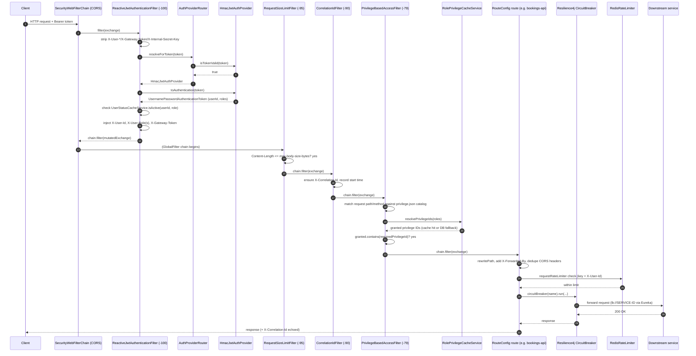
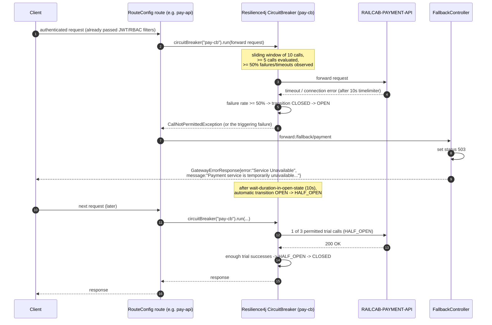

# API Gateway — Low-Level Design

Module: `2026_RailCab_ApiGateway` · Base package: `com.heuristiq.gateway`

All file:line citations below were read directly from the current source tree on this pass.

## 1. Package Structure (annotated)

```
com.heuristiq.gateway
├── RailCabApiGatewayApplication.java        Boot entry point (@EnableAsync, @EnableConfigurationProperties)
│
├── auth
│   ├── filter
│   │   └── ReactiveJwtAuthenticationFilter.java   Primary auth WebFilter (see §3)
│   ├── provider                              Strategy family — pluggable IdP validation (§4)
│   │   ├── IAuthProvider.java                 Strategy interface
│   │   ├── AuthProviderType.java              enum: HMAC | KEYCLOAK | OIDC
│   │   ├── AuthProviderRouter.java            Strategy selector/context
│   │   ├── HmacJwtAuthProvider.java           Concrete strategy — HMAC-SHA256 (jjwt)
│   │   ├── KeycloakAuthProvider.java          Concrete strategy — Keycloak introspection
│   │   └── OidcAuthProvider.java              Concrete strategy — generic RFC 7662 introspection
│   ├── security
│   │   └── GatewaySecurityConfig.java         SecurityWebFilterChain, CORS, public-path allow-list
│   ├── service
│   │   └── UserStatusCacheService.java        Caffeine-cached account-active lookup
│   └── util
│       ├── AuthErrorMapping.java              HTTP status -> {status,error,message} lookup
│       └── SecurityUtils.java                 Constant-time internal-key comparison
│
├── common
│   ├── constants
│   │   ├── GatewayConstants.java              Header names, role constants, JSON keys
│   │   └── MessageConstants.java              User-facing error message strings
│   └── dto
│       └── GatewayErrorResponse.java          record(error, message) — fallback/error body shape
│
├── config
│   ├── GatewayProperties.java                 @ConfigurationProperties("railcab.gateway") — all typed config
│   ├── PathMatchersConfig.java                @ConfigurationProperties("pathmatchers") — public path patterns
│   ├── RouteConfig.java                       RouteLocator bean — the 9 routes (§2, Builder pattern §5)
│   ├── RateLimiterConfig.java                 RedisRateLimiter + KeyResolver beans (conditional)
│   ├── VirtualThreadSchedulerConfig.java      blockingOpsScheduler bean (virtual-thread Reactor Scheduler)
│   ├── MongoConfiguration.java                Multi-URI Mongo client/template wiring
│   └── JacksonConfig.java                     ObjectMapper customization
│
├── filter                                     Global filters — Chain of Responsibility (§3)
│   ├── RequestSizeLimitFilter.java             order -95
│   ├── PrivilegeBasedAccessFilter.java          order -79
│   └── CorrelationIdFilter.java                 order -90
│
├── identity, privilege, role                  Data access for auth decisions (Mongo primary / JPA-MySQL alternate)
│   ├── identity/UamUserStatusRepository.java + persistence/{jpa,mongo} + repository/{jpa,mongo}
│   ├── privilege/{PrivilegeEntry, PrivilegeCatalogLoader, RolePrivilegeRepository,
│   │               RolePrivilegeCacheService} + persistence/{jpa,mongo} + repository/jpa
│   └── role/persistence/{jpa,mongo} + repository/{jpa,mongo}
│
└── web
    └── FallbackController.java                Circuit-breaker fallback endpoints (§7)
```

`identity`/`privilege`/`role` each follow the same shape: a `persistence.*` entity/document,
a `repository.*` Spring Data interface, and (for privilege/role) an adapter implementing the
package-root repository interface against either Mongo or JPA — selected at runtime by
`railcab.gateway.persistence.type` (`mongo` default, `mysql` via profile), toggled in lockstep
with `spring.autoconfigure.exclude` in `application.properties`.

## 2. Key Classes

| Class | File : line | Role |
|---|---|---|
| `RouteConfig` | `src/main/java/com/railcab/gateway/config/RouteConfig.java:45` | Declares all 9 routes; hosts the Builder-style helpers |
| `ReactiveJwtAuthenticationFilter` | `src/main/java/com/railcab/gateway/auth/filter/ReactiveJwtAuthenticationFilter.java:83` | Primary auth `WebFilter`, order -100 |
| `CorrelationIdFilter` | `src/main/java/com/railcab/gateway/filter/CorrelationIdFilter.java:23` | `GlobalFilter`, order -90 |
| `RequestSizeLimitFilter` | `src/main/java/com/railcab/gateway/filter/RequestSizeLimitFilter.java:31` | `GlobalFilter`, order -95 |
| `PrivilegeBasedAccessFilter` | `src/main/java/com/railcab/gateway/filter/PrivilegeBasedAccessFilter.java:58` | `GlobalFilter`, order -79 |
| `GatewaySecurityConfig` | `src/main/java/com/railcab/gateway/auth/security/GatewaySecurityConfig.java:37` | `SecurityWebFilterChain` bean, CORS, public paths |
| `IAuthProvider` | `src/main/java/com/railcab/gateway/auth/provider/IAuthProvider.java:28` | Strategy interface |
| `AuthProviderRouter` | `src/main/java/com/railcab/gateway/auth/provider/AuthProviderRouter.java:21` | Strategy context/selector |
| `AuthProviderType` | `src/main/java/com/railcab/gateway/auth/provider/AuthProviderType.java:16` | Strategy discriminator enum |
| `HmacJwtAuthProvider` | `src/main/java/com/railcab/gateway/auth/provider/HmacJwtAuthProvider.java:41` | Concrete strategy |
| `KeycloakAuthProvider` | `src/main/java/com/railcab/gateway/auth/provider/KeycloakAuthProvider.java:38` | Concrete strategy |
| `OidcAuthProvider` | `src/main/java/com/railcab/gateway/auth/provider/OidcAuthProvider.java:42` | Concrete strategy |
| `RateLimiterConfig` | `src/main/java/com/railcab/gateway/config/RateLimiterConfig.java:32` | Redis rate-limiter beans |
| `FallbackController` | `src/main/java/com/railcab/gateway/web/FallbackController.java:19` | 8 fallback endpoints |
| `AuthErrorMapping` | `src/main/java/com/railcab/gateway/auth/util/AuthErrorMapping.java:8` | Status→message lookup for auth errors |
| `UserStatusCacheService` | `src/main/java/com/railcab/gateway/auth/service/UserStatusCacheService.java:32` | Caffeine cache over account-active check |
| `RolePrivilegeCacheService` | `src/main/java/com/railcab/gateway/privilege/RolePrivilegeCacheService.java:23` | Caffeine cache over role→privilege-id resolution |
| `PrivilegeCatalogLoader` | `src/main/java/com/railcab/gateway/privilege/PrivilegeCatalogLoader.java:18` | Loads `privilege.json` off classpath |
| `VirtualThreadSchedulerConfig` | `src/main/java/com/railcab/gateway/config/VirtualThreadSchedulerConfig.java:22` | `blockingOpsScheduler` bean |
| `GatewayProperties` | `src/main/java/com/railcab/gateway/config/GatewayProperties.java:13` | Root typed config (`railcab.gateway.*`) |

## 3. Design Pattern — Chain of Responsibility

Two distinct chains cooperate, both real (verified against source, not just doc claims):

**A. GlobalFilter chain** (Spring Cloud Gateway's own filter chain, ordered ascending by
`Ordered.getOrder()` — lower runs first):

| Order | Filter | File : line | Responsibility |
|---|---|---|---|
| `-100` | `ReactiveJwtAuthenticationFilter` | `ReactiveJwtAuthenticationFilter.java:139` (`getOrder()`) | Strips forgeable identity headers, authenticates (internal key or bearer token), injects `X-User-Id`/`X-User-Role(s)`/`X-Gateway-Token`. Runs as a `WebFilter` *inside* the `SecurityWebFilterChain* (see §3 note below), not registered as an independent `@Component` global filter — deliberately, to avoid double execution (documented at `ReactiveJwtAuthenticationFilter.java:42-54`). |
| `-95` | `RequestSizeLimitFilter` | `RequestSizeLimitFilter.java:37` | Rejects requests whose `Content-Length` exceeds `railcab.gateway.request.max-body-size-bytes` with a 413 |
| `-90` | `CorrelationIdFilter` | `CorrelationIdFilter.java:29` | Ensures `X-Correlation-Id` on request+response; logs a structured access line on completion |
| `-79` | `PrivilegeBasedAccessFilter` | `PrivilegeBasedAccessFilter.java:89` | Data-driven RBAC — matches request path/method against `privilege.json`, denies with 403 if the caller's roles lack the resolved privilege |

**B. SecurityWebFilterChain** (Spring Security's own reactive filter chain, built by
`GatewaySecurityConfig.securityWebFilterChain`, `GatewaySecurityConfig.java:47`): CSRF/basic-auth/
form-login disabled, CORS filter, then `ReactiveJwtAuthenticationFilter` inserted via
`addFilterBefore(jwtFilter, SecurityWebFiltersOrder.AUTHENTICATION)` (`GatewaySecurityConfig.java:78`),
then `authorizeExchange` (public-path allow-list vs. `anyExchange().authenticated()`).

Net effect: a request passes through CORS → `ReactiveJwtAuthenticationFilter` (security-chain
position) → Spring Security's authorization decision → **then** the ordered GlobalFilter chain
(`RequestSizeLimitFilter` → `CorrelationIdFilter` → `PrivilegeBasedAccessFilter`) → the matched
route's own per-route filters (rewrite, headers, circuit breaker, rate limiter) → the downstream
service. Each link only knows "call the next thing" (`GatewayFilterChain.filter(exchange)` /
`WebFilterChain.filter(exchange)`) — the textbook Chain-of-Responsibility shape.

## 4. Design Pattern — Strategy

`IAuthProvider` (`IAuthProvider.java:28`) is the strategy interface: `isTokenValid`,
`isTokenExpired`, `extractUserId`, `extractRole`/`extractRoles`, `toAuthentication`,
`isExternallyManagedToken`. Three concrete strategies, **all three always registered as Spring
beans** (no `@Profile` gating):

- `HmacJwtAuthProvider` (`AuthProviderType.HMAC`) — validates jjwt HMAC-SHA256 tokens, trying the
  admin secret first and falling back to the customer secret only on a `SignatureException`
  (`HmacJwtAuthProvider.java:143-150`).
- `KeycloakAuthProvider` (`AuthProviderType.KEYCLOAK`) — realm token introspection over
  `WebClient`, Caffeine-cached 15s, hardcoded `realm_access.roles` → RailCab role map.
- `OidcAuthProvider` (`AuthProviderType.OIDC`) — generic RFC 7662 introspection, fully
  config-driven (introspection URI, subject claim, roles claim, role map) via
  `railcab.gateway.oidc.*`.

`AuthProviderRouter` (`AuthProviderRouter.java:21`) is the strategy context: it builds a
`Map<AuthProviderType, IAuthProvider>` from every injected `IAuthProvider` bean, resolves the
**default/configured** strategy from `railcab.gateway.identity-provider.type`
(`AuthProviderRouter.java:33`, via `AuthProviderType.from(...)`, default `hmac`), and exposes:

- `resolve()` → the statically configured provider.
- `resolveForToken(token)` (`AuthProviderRouter.java:60`) → **per-request** strategy selection:
  tries the HMAC provider first regardless of configured type (since UAM mints every login
  mechanism as an HMAC token now), falling back to the configured provider only if the token
  doesn't verify as HMAC at all. This is a runtime, per-call strategy pick layered on top of the
  static config-selected one — verified accurate on this read.

`ReactiveJwtAuthenticationFilter` is the strategy client — it never references a concrete
provider class, only `authProviderRouter.resolveForToken(token)` and the `IAuthProvider` interface
(`ReactiveJwtAuthenticationFilter.java:185`).

## 5. Design Pattern — Builder (route assembly)

`RouteConfig.railCabRoutes` (`RouteConfig.java:74`) uses Spring Cloud Gateway's own
`RouteLocatorBuilder`/`GatewayFilterSpec` builder DSL, plus three private helper methods that
compose the filter chain shared by every route instead of repeating the same five steps nine
times:

```java
private GatewayFilterSpec standardRoute(GatewayFilterSpec f, String rewriteRegex,
        String rewriteReplacement, String circuitBreakerName, String fallbackPath,
        boolean rateLimitEnabled)                                    // RouteConfig.java:165

private GatewayFilterSpec applyResilience(GatewayFilterSpec f,
        String circuitBreakerName, String fallbackPath)              // RouteConfig.java:178

private void applyRateLimiterIfEnabled(GatewayFilterSpec f,
        boolean rateLimitEnabled)                                    // RouteConfig.java:190
```

`standardRoute` = `rewritePath` → `applyResilience` (adds `X-Forwarded-By`, dedupes CORS response
headers, attaches the named circuit breaker + fallback URI) → `applyRateLimiterIfEnabled`
(attaches `requestRateLimiter` only when the gateway-wide flag and both required beans are
present). Each helper takes the in-progress `GatewayFilterSpec`, mutates and returns it, so calls
chain fluently into `.uri(...)` — confirmed still accurate on this pass: 7 of the 9 routes
(`bookings-api`, `irctc-api`, `uam-api`, `dms-api`, `pay-api`, `admin-api`, `search-api`) call
`standardRoute` directly; `nms-api` calls `applyResilience` + `applyRateLimiterIfEnabled`
individually (no path rewrite, plus a conditional `X-NMS-API-Key` header in between); `irctc-health`
is the one route that opts out of the shared chain entirely (no circuit breaker, no rate limiter —
see §6 note).

**Other patterns observed:**
- **Adapter** — `UamUserStatatusRepository`/`RolePrivilegeRepository` each have Mongo and JPA
  adapter implementations behind one interface, selected by `railcab.gateway.persistence.type`
  (e.g. `identity/repository/{jpa,mongo}/*Adapter.java`).
- **Cache-aside** — `UserStatusCacheService` and `RolePrivilegeCacheService` both wrap a
  repository behind a Caffeine cache with the identical get-or-load-and-populate shape.
- **Facade-ish config objects** — `GatewayProperties` nests nine `@Data` static inner classes
  (`Auth`, `IdentityProvider`, `Oidc`, `Internal`, `Cors`, `Rbac`, `RateLimit`, `Request`, `Cache`)
  under one `@ConfigurationProperties(prefix = "railcab.gateway")` root.

## 6. Full Route Table

Source: `RouteConfig.railCabRoutes` (`RouteConfig.java:82-148`) and
`application.properties` (Resilience4j instance names, lines 124-140).

| Route ID | Path predicate(s) | Target (`lb://`) | Rewrite | Filters | Circuit breaker | Fallback | Rate limit |
|---|---|---|---|---|---|---|---|
| `bookings-api` | `/api/bookings/**` | `RAILCAB-BOOKINGSAPI` | `/api/bookings/(?<segment>.*)` → `/api/v1/${segment}` | X-Forwarded-By, CORS dedupe, CB, rate limiter | `bookings-cb` | `/fallback/bookings` | yes (if enabled) |
| `irctc-health` | `/api/irctc/health/**`, `/api/irctc/api/**`, `/api/irctc/admin/reconciliation/**` | `RAILCAB-IRCTC-API-INTEGRATION` | `/api/irctc/(?<segment>.*)` → `/${segment}` (unversioned) | X-Forwarded-By only | **none** | **none** | **no** |
| `irctc-api` | `/api/irctc/**` | `RAILCAB-IRCTC-API-INTEGRATION` | `/api/irctc/(?<segment>.*)` → `/api/v1/${segment}` | X-Forwarded-By, CORS dedupe, CB, rate limiter | `irctc-cb` | `/fallback/irctc` | yes (if enabled) |
| `uam-api` | `/api/uam/**` | `RAILCAB-UAM` | `/api/uam/(?<segment>.*)` → `/api/v1/uam/${segment}` | X-Forwarded-By, CORS dedupe, CB, rate limiter | `uam-cb` | `/fallback/uam` | yes (if enabled) |
| `dms-api` | `/api/dms/**` | `RAILCAB-DMS` | `/api/dms/(?<segment>.*)` → `/api/v1/${segment}` | X-Forwarded-By, CORS dedupe, CB, rate limiter | `dms-cb` | `/fallback/dms` | yes (if enabled) |
| `pay-api` | `/api/payment/**` | `RAILCAB-PAYMENT-API` | `/api/payment/(?<segment>.*)` → `/api/v1/payments/${segment}` | X-Forwarded-By, CORS dedupe, CB, rate limiter | `pay-cb` | `/fallback/payment` | yes (if enabled) |
| `nms-api` | `/api/nms/**`, `/api/v1/nms/**` | `RAILCAB-NMS` | none (dual-mapped downstream, both paths accepted natively) | X-Forwarded-By, CORS dedupe, CB, conditional `X-NMS-API-Key`, rate limiter | `nms-cb` | `/fallback/nms` | yes (if enabled) |
| `admin-api` | `/api/admin/**` | `RAILCAB-ADMIN-API` | `/api/admin/(?<segment>.*)` → `/api/${segment}` | X-Forwarded-By, CORS dedupe, CB, rate limiter | `admin-cb` | `/fallback/admin` | yes (if enabled) |
| `search-api` | `/api/search/**` | `RAILCAB-SEARCH-API` | `/api/search/(?<segment>.*)` → `/api/v1/${segment}` | X-Forwarded-By, CORS dedupe, CB, rate limiter | `search-cb` | `/fallback/search` | yes (if enabled) |

Notes:
- "Rate limit: yes (if enabled)" means the filter is attached only when
  `railcab.gateway.rate-limit.enabled=true` **and** both the `apiRateLimiter` bean and
  `userOrIpKeyResolver` bean resolved (`RouteConfig.java:79-80`) — computed once per
  `railCabRoutes()` call, applied uniformly to every standard route.
- `irctc-health` is declared **before** `irctc-api` so its more-specific path predicates win the
  route match for health/ops/reconciliation-admin traffic; it deliberately carries none of the
  resilience/rate-limit filters the other 8 routes share, since it's treated as unversioned
  infra-monitoring surface rather than business API traffic (comment at `RouteConfig.java:90-94`).
- All 8 CB-protected routes forward to `FallbackController`'s matching `/fallback/<name>` endpoint,
  which returns HTTP 503 with a `GatewayErrorResponse` JSON body.
- Every circuit breaker instance (`admin-cb`, `bookings-cb`, `irctc-cb`, `uam-cb`, `dms-cb`,
  `nms-cb`, `pay-cb`, `search-cb`) inherits the same `default` Resilience4j config
  (`application.properties:118-140`): sliding window 10, minimum 5 calls, 50% failure threshold,
  10s wait-in-open, 3 half-open trial calls, 10s call timeout (timelimiter).

## 7. Sequence Diagrams

### 7.1 Authenticated request through the full filter chain to a downstream service



### 7.2 Circuit breaker trips and falls back



## 8. Error Handling

- **`FallbackController`** (`web/FallbackController.java:19`) — one `@RequestMapping` method per
  downstream service (`adminFallback`, `bookingsFallback`, `irctcFallback`, `uamFallback`,
  `dmsFallback`, `nmsFallback`, `paymentFallback`, `searchFallback`), all returning
  `Mono<GatewayErrorResponse>` with HTTP 503 and a service-specific message. Reached only via the
  internal `forward:/fallback/<name>` URI set on each route's `circuitBreaker(...)` spec — not
  meant to be called directly, and registered as a public path in both
  `GatewaySecurityConfig.resolvePublicPaths()` and
  `ReactiveJwtAuthenticationFilter`'s `publicPathPatterns` so the forwarded internal call itself
  never gets blocked by auth.
- **`AuthErrorMapping`** (`auth/util/AuthErrorMapping.java:8`) — a `Map<Integer, ErrorDetails>`
  keyed by HTTP status code (401, 403, 400 explicitly; anything else defaults to 500), each
  mapping to an `ErrorDetails(status, error, message)` record built from `MessageConstants`.
  Consumed by `ReactiveJwtAuthenticationFilter.handleAuthError` (line 318) when a downstream call
  made during authentication (e.g. a `WebClientResponseException` from Keycloak/OIDC introspection)
  fails, translating the raw HTTP status of that failed call into the gateway's standard error
  shape.
- **Inline auth failures** in `ReactiveJwtAuthenticationFilter.filter` are handled without going
  through `AuthErrorMapping` at all — token-validation outcomes are mapped directly via a
  `switch` on a string code (`"EXPIRED"` → 401 + `TOKEN_EXPIRED`, `"INVALID"` → 401 +
  `INVALID_TOKEN`, `"INACTIVE"` → 401 + `ACCESS_NOT_ALLOWED`, anything else → 500 +
  `AUTH_FAILURE`) at lines 206-216; `AuthErrorMapping` is reserved for exceptions thrown *during*
  that evaluation (network/provider errors), not for the expected invalid/expired/inactive
  outcomes.
- **`PrivilegeBasedAccessFilter.sendForbidden`** (line 147) and
  **`RequestSizeLimitFilter.filter`** (line 46) each build their own ad-hoc JSON error body
  (`Map.of(GatewayConstants.JSON_ERROR_KEY, ..., GatewayConstants.JSON_MESSAGE_KEY, ...)`) rather
  than going through `AuthErrorMapping` or `GatewayErrorResponse` — three slightly different error
  body constructions exist in the codebase for what is conceptually the same
  `{error, message}` shape (`GatewayErrorResponse` record, `AuthErrorMapping`'s `ErrorDetails`,
  and these two filters' inline `Map.of`).
- **`GatewaySecurityConfig`**'s `exceptionHandling` (line 63) covers the two cases Spring
  Security's own machinery raises independently of the custom JWT filter: an unauthenticated
  access attempt on a protected path with no way to authenticate at all (401,
  `authenticationEntryPoint`) and an authenticated-but-not-authorized exchange (403,
  `accessDeniedHandler`) — both bodies are empty (`Mono.empty()`), status-code-only.

## 9. Testing Coverage (observed)

`src/test/java/com/railcab/gateway/` contains unit tests for
`ReactiveJwtAuthenticationFilterTest`, `HmacJwtAuthProviderTest`, `UserStatusCacheServiceTest`,
`SecurityUtilsTest`, `CorrelationIdFilterTest`, `RequestSizeLimitFilterTest`, and
`RolePrivilegeCacheServiceTest` — i.e. the auth/filter/cache layer is covered; `RouteConfig`,
`PrivilegeBasedAccessFilter`, `FallbackController`, and the Keycloak/OIDC providers have no
dedicated test class in this tree.
