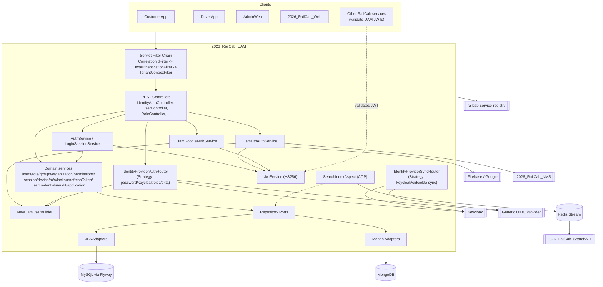

# High-Level Design — 2026_RailCab_UAM

## 1. Purpose & Role

**2026_RailCab_UAM** ("User Access Management") is the RailCab platform's **single identity and authentication provider**. Every other RailCab microservice (BookingsAPI, PaymentAPI, AdminAPI, NMS, SearchAPI, ApiGateway, ...) trusts JWTs *minted by this service* — UAM is the one place a caller's identity, tenant, and roles are established, and the one place that trust chain terminates.

Concretely, UAM owns:

- **Account lifecycle** for every persona in the platform — customers, drivers, vendors, and internal admin/ops/business/security staff — under one `UamUser` model (`src/main/java/com/railcab/uam/users/UamUser.java`).
- **Authentication** — local username/password, Google Sign-In (Firebase-verified ID tokens), and external identity providers (Keycloak, generic OIDC, Okta) — all funneled through **one unified endpoint** (`POST /identity/auth/login`).
- **JWT issuance** — every service downstream validates a UAM-signed (or, in external-IdP mode, UAM-brokered) JWT; UAM is therefore the root of trust for the whole platform's authorization model.
- **Authorization scaffolding** — roles, permissions, groups, tenants (organizations), API clients, and security policies that other services read via the JWT's claims or via UAM's REST API.
- **Session/device/security hygiene** — refresh-token rotation, device fingerprinting, login-attempt lockout, MFA (TOTP/OTP), password history, audit logging.
- **External identity sync** — pushing UAM's own users/roles/permissions/groups out to an external IdP (Keycloak today) so the IdP and UAM stay consistent when `identity-provider.enabled=true`.

## 2. Features

| Area | Capability |
|---|---|
| Registration | Generic self-service registration for any `UserType` (`POST /identity/auth/register`), admin-created users (`POST /users`), bootstrap super-admin seeding at startup |
| Login (local) | Username/email/phone + password, with optional TOTP MFA challenge/resubmit, account lockout after repeated failures |
| Login (Google) | Firebase-verified Google ID token → bridges to a local `UamUser` + UAM JWT, auto-provisioning the account on first sign-in |
| Login (external IdP) | Keycloak / generic OIDC / Okta — password or authorization_code grant, bridged to a local `UamUser` + UAM JWT so the caller never has to speak the provider's own token format to the rest of the platform |
| OTP auth | SMS and email OTP send/verify (used for phone/email verification and forgot-password) |
| JWT issuance | HS256 JWTs (`JwtService`) carrying subject, tenant, username, email, full name, resolved `userType`, primary `role`, and full `roles` list |
| Multi-persona users | One `UamUser` model spans CUSTOMER / DRIVER / VENDOR / ADMIN / SUPER_ADMIN / OPS / BUSINESS / SECURITY via `roles` + `UserTypeResolver` |
| External identity sync | Push-sync of organizations, clients, users, roles, permissions, groups, passwords, and TOTP-required flags out to Keycloak (or a no-op/unsupported adapter for OIDC/Okta) |
| Tenant context | Every authenticated request carries a resolved tenant id (`TenantContext`/`TenantContextFilter`), enforced on ID-based lookups by `TenantGuard` |
| Session/device mgmt | Per-user sessions, device fingerprinting/trust/blocking, rotating refresh tokens |
| MFA | TOTP enrollment/verification, admin-forced TOTP requirement |
| RBAC | Roles, permissions (module/resource/action), groups, per-application/API-client registration |
| Audit | Structured audit log + dedicated auth-event audit trail |
| Search integration | Every `*Repository.save(..)` on a `SearchIndexable` entity (e.g. `UamUser`) is transparently reindexed onto a shared Redis Stream consumed by `2026_RailCab_SearchAPI` |

## 3. Tech Stack

Read from `build.gradle`:

| Concern | Choice |
|---|---|
| Language / runtime | Java 21 (toolchain-pinned) |
| Framework | Spring Boot **4.1.0**, Spring Cloud **2025.1.0** (compatibility verifier disabled — Spring Cloud only officially supports Boot 4.0.x) |
| Web | Spring MVC (`spring-boot-starter-web`) + a dedicated WebClient starter (`spring-boot-starter-webclient`) for outbound calls to Keycloak/OIDC/NMS |
| Security | `spring-boot-starter-security` + `spring-boot-starter-oauth2-resource-server` (for external-IdP JWT validation mode) |
| JWT | `io.jsonwebtoken:jjwt-api/impl/jackson` **0.12.6** |
| Persistence | `spring-boot-starter-data-mongodb` (default) **and** `spring-boot-starter-data-jpa` + `mysql-connector-j` + Flyway (`flyway-core`, `flyway-mysql`) — selectable per `railcab.uam.persistence.type` |
| External IdP admin | `org.keycloak:keycloak-admin-client:26.0.0` |
| Google Sign-In | `com.google.firebase:firebase-admin:9.4.1` (Firebase Admin SDK verifies Google ID tokens) |
| MFA | `dev.samstevens.totp:totp:1.7.1` |
| Resilience | `io.github.resilience4j:resilience4j-spring-boot4:2.4.0` — circuit breaker + retry + bulkhead around every outbound call (Keycloak, OIDC, NMS, Google/Firebase) |
| Service discovery | `spring-cloud-starter-netflix-eureka-client` (registers with `railcab-service-registry`) |
| Caching/eventing | `spring-boot-starter-data-redis` — used only to publish search-index events onto a shared Redis Stream, not as a cache |
| AOP | `org.aspectj:aspectjweaver` directly (Boot 4 dropped `spring-boot-starter-aop`) — powers `SearchIndexAspect` |
| Observability | Actuator + Micrometer Prometheus registry + `spring-boot-starter-opentelemetry` (OTLP tracing) |
| API docs | springdoc-openapi 2.6.0 (`/swagger-ui.html`, `/v3/api-docs`) |
| Device parsing | `eu.bitwalker:UserAgentUtils:1.21` |
| Build | Gradle (wrapper), Lombok 1.18.30 |

## 4. Architecture Style

**Layered / hexagonal (ports-and-adapters) modular monolith**, one Spring Boot application, organized as ~30 feature packages under `com.heuristiq.uam` (users, auth, identity, security, organization, groups, permissions, role, session, device, mfa, lockout, refreshToken, usercredentials, userpreference, passwordsHistory, securitypolicy, audit, application(+client), bootstrap, otp, google, notification, search, common, config, helper, enums, util).

Each domain module follows the same shape:

```
<module>/
  <Entity>.java                    -- pure domain model (Lombok @Data/@Builder)
  <Entity>Service(UseCase).java     -- use-case interface + implementation (input/output records)
  <Entity>Controller.java           -- REST adapter
  repository/<Entity>Repository.java (port interface)
  repository/jpa/...JpaRepositoryAdapter    (@ConditionalOnProperty persistence.type=mysql)
  repository/mongo/...MongoRepositoryAdapter (@ConditionalOnProperty persistence.type=mongo, default)
  persistence/jpa/<Entity>Entity.java
  persistence/mongo/<Entity>Document.java
```

This is a deliberate **Adapter pattern applied uniformly**: the domain/service layer only ever depends on the repository *port* interface; the JPA and Mongo adapters are interchangeable, selected at runtime by a single Spring property (`railcab.uam.persistence.type`), with zero conditional logic anywhere in business code. See LLD for details and citations.

Cross-cutting concerns are handled via:
- **Servlet filter chain** (Chain of Responsibility) for correlation IDs, JWT authentication, and tenant-context resolution — see LLD.
- **AOP aspect** (`SearchIndexAspect`) transparently reindexing any `SearchIndexable` entity after any repository `save(..)`, without a single call site knowing about search.
- **Resilience4j** annotations (`@CircuitBreaker`/`@Retry`/`@Bulkhead`) wrapping every outbound HTTP call (Keycloak, OIDC, Google/Firebase, NMS).

## 5. External Dependencies

| Dependency | Direction | Purpose |
|---|---|---|
| **Keycloak** | Outbound (WebClient token endpoint + `keycloak-admin-client` REST admin API) | External IdP: password/authorization_code login, token refresh/logout, user/role/group/client provisioning sync |
| **Generic OIDC provider** | Outbound (WebClient) | External IdP login/refresh/logout + userinfo fetch; sync side is a no-op adapter today |
| **Okta** | Configured as an `IdentityProviderType` value; sync adapter (`UnsupportedIdentityProviderSyncService`) exists but deliberately throws — no live Okta integration is wired yet |
| **Google (Firebase Admin SDK)** | Outbound | Verifies Google ID tokens server-side for Google Sign-In; requires `firebase-service-account.json` or a base64 env var |
| **2026_RailCab_NMS** | Outbound (WebClient, fire-and-forget, `@Async`) | OTP delivery (SMS/email) and account-created notifications |
| **Redis (shared stream)** | Outbound (publish only) | `railcab:search:index-stream` consumed by `2026_RailCab_SearchAPI` — shared bus, not a private cache |
| **MongoDB / MySQL** | Data store | Selected via `railcab.uam.persistence.type` (mongo default, mysql via Flyway-migrated schema) |
| **railcab-service-registry (Eureka)** | Registration | Lets `ApiGateway` route to UAM by service id |
| **OTLP collector** | Outbound (tracing) | Distributed tracing spans, non-fatal if absent |
| **Every other RailCab service** (BookingsAPI, PaymentAPI, AdminAPI, ApiGateway, ...) | Inbound trust | Validate UAM-issued JWTs (HS256, shared secret) or, in `token-validation=jwt` mode, validate via the OAuth2 resource-server / external IdP's issuer |

## 6. Component Diagram



## 7. Deployment

- **Dockerfile** (`Dockerfile`): multi-stage build — `eclipse-temurin:21-jdk-alpine` builds a bootJar with Gradle (dependency-layer cached), runtime image is `eclipse-temurin:21-jre-alpine`, runs as a non-root user (`uam:railcab`), exposes port **9003**. JVM is heap-bounded (`-Xms256m -Xmx512m`) and container-aware (`-XX:+UseContainerSupport`) to stay under the k8s memory limit.
- **Kubernetes** (`ops/k8s/deployment.yaml`): `Deployment` with **3 replicas**, container port 9003, Prometheus scrape annotations pointed at `/api/v1/uam/actuator/prometheus`. Secrets (`railcab-uam-secrets`) inject `UAM_MONGODB_URI`, `GATEWAY_FORWARD_KEY`, `JWT_SECRET`, bootstrap admin username/password/email, and the base64 Firebase credentials — none of these are baked into the image or checked in. Readiness probe hits `/api/v1/uam/actuator/health` at 20s initial delay/10s period; liveness at 60s initial delay/20s period. Resources: requests 250m CPU / 512Mi, limits 1 CPU / 1Gi. A matching `Service` exposes port 9003.
- **Service discovery**: registers with Eureka (`railcab-service-registry`) so `ApiGateway` routes by service id rather than a hardcoded URL; Spring Cloud's compatibility verifier is explicitly disabled since Spring Cloud 2025.1.0 only certifies Boot 4.0.x.
- **Context path**: `/api/v1/uam` (`server.servlet.context-path`), port default `9003` (`UAM_PORT`).
- **Profiles**: `application.properties` (base/dev defaults), `application-dev.properties`, `application-local.properties`, `application-mysql.properties` (flips the JPA/MySQL persistence flag + Flyway), `application-prod.properties` (leaner, no Eureka/virtual-threads/tracing/resilience overrides — relies on base defaults being supplied via env).

## 8. Non-Functional Characteristics

- **JWT configuration** (`UamProperties.Auth`, `application.properties`): HS256 signing key from `railcab.uam.auth.jwt-secret` (env `JWT_SECRET`, **must** be overridden in production — the checked-in default literally says "change-in-production"), `expiry-minutes` default 60, `refresh-expiry-days` default 30, `issuer` default `railcab-uam`. Refresh tokens are cryptographically random (32 bytes, `SecureRandom`), and **only their SHA-256 hash is ever persisted** — same treatment as passwords.
- **Multi-provider auth posture**: local password auth is always available; Keycloak/OIDC/Okta are opt-in via `railcab.uam.identity-provider.enabled` + `.type`, and `token-validation` independently controls whether inbound requests are authenticated by UAM's own `JwtAuthenticationFilter` (local HS256 verification) or Spring's OAuth2 resource-server (`jwt` mode, external-IdP-issued tokens verified against `issuer-uri`). This means UAM can front either its *own* tokens or a *third party's* tokens without changing any downstream code that just calls `SecurityContextHolder`.
- **Resilience**: every outbound dependency (Keycloak, OIDC, NMS, Google/Firebase) is wrapped in circuit breaker + retry + bulkhead (Resilience4j), each with its own named instance and fallback method — an unreachable Keycloak fails *login* loudly (503) but fails *logout* silently (best-effort, never blocks a caller's local logout).
- **Account security**: BCrypt (strength 12) password hashing (`PasswordService`), login-attempt lockout (`LoginAttemptService`), password history, optional TOTP MFA, device trust/block, tenant isolation via `TenantGuard` (non-super-admin callers can't read/modify another tenant's records by guessing IDs).
- **Threading**: Tomcat virtual threads enabled (`spring.threads.virtual.enabled=true`) — auth/identity endpoints are I/O-bound (Mongo/MySQL/Keycloak/OIDC/NMS), a good fit for cheap-to-park virtual threads instead of a fixed platform-thread pool.
- **Observability**: correlation ID propagated end-to-end via `CorrelationIdFilter` + MDC, Micrometer/Prometheus metrics, OTLP tracing (10% sampling by default), structured audit log + dedicated auth-event audit trail.
