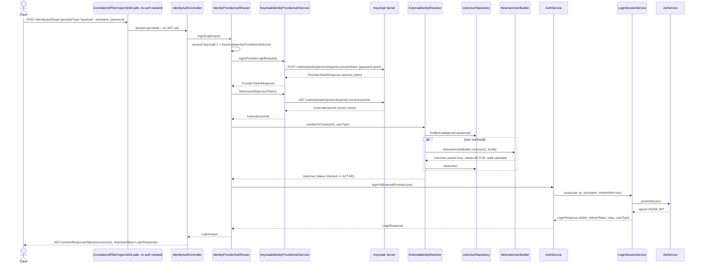

# Low-Level Design — 2026_RailCab_UAM

All paths are relative to `src/main/java/com/railcab/uam/` unless stated otherwise. Line numbers are as of this writing; re-check on drift.

## 1. Package Structure (annotated)

```
com.heuristiq.uam
├── RailCabUamApplication.java        Boot entry point
├── application/                      Application (OAuth client) registrations + client/ sub-package (ApiClient)
├── audit/                            AuditLog (domain model) + authevent/ (AuthAuditService: login logging and metrics only); centralaudit/ publishes to Rider_AuditService
├── auth/                             AuthService (login decision), LoginSessionService (session/token issuance),
│                                      IdentityAuthController (single REST facade for every login mechanism)
├── bootstrap/                        UamBootstrapRunner (CommandLineRunner: seeds permissions/roles/super-admin)
├── common/                           Cross-cutting request/response envelopes, GlobalExceptionHandler, UamException
├── config/                           UamProperties (@ConfigurationProperties), CorrelationIdFilter, CORS/Jackson/Mongo/Redis config
├── device/                           UserDevice fingerprinting/trust
├── dto/                              REST request/response records (LoginRequest/Response, UpsertUserRequest, ...)
├── enums/                            UamEnums — every domain enum in one file (UserType, UserStatus, AuthProvider, ...)
├── feature/                          management/ (pagination helper), observability/ (custom health indicator)
├── google/                           Google Sign-In: UamGoogleAuthService, FirebaseGoogleIdentityTokenVerifier
├── groups/                           Group (RBAC grouping)
├── helper/                           Embeddable value objects: AuditInfo, RName, RPhoneNumber, RUpload, *Policy, *Preference
├── identity/                         External IdP abstraction: routers, provider services/sync adapters (Strategy x2)
│   ├── keycloak/                     Keycloak auth + sync implementations
│   └── oidc/                         Generic-OIDC auth + sync implementations
├── lockout/                          LoginAttemptService (lockout), UserLoginSecurity (per-user security posture)
├── mfa/                              UserMfa (TOTP/OTP enrollment/verification)
├── notification/                     NmsNotificationService (fire-and-forget NMS client) + dto/
├── organization/                     Tenant (multi-tenancy)
├── otp/                              OTP store + UamOtpAuthService (phone/email OTP login & reset)
├── passwordsHistory/                 PasswordHistory (reuse prevention)
├── permissions/                      Permission (module/resource/action)
├── refreshToken/                     RefreshToken (rotating, hash-only persisted)
├── registration/                     UserRegistrationService (generic self-service registration)
├── role/                             UamRole (permission bundle assigned to users)
├── search/                           SearchIndexable + SearchIndexAspect + SearchEventPublisher (AOP reindex fan-out)
├── security/                         SecurityConfig, JwtAuthenticationFilter, JwtService, TenantContext(Filter),
│                                      TenantGuard, PasswordService — the Chain-of-Responsibility + JWT core
├── securitypolicy/                   SecurityPolicy (configurable password/session/MFA rules)
├── session/                          UserSession (active login sessions)
├── usercredentials/                  UserCredential (password hash + external-provider linkage, e.g. GOOGLE)
├── userpreference/                   UserPreference (UI/notification/regional preferences)
├── users/                            UamUser domain + NewUamUserBuilder (the Builder), UserController/UserProfileController
└── util/                             AbstractJsonAttributeConverter + concrete converters, UserTypeResolver, listeners
```

Each domain module below `common/config/helper/enums/util` repeats the same ports-and-adapters shape (service/UseCase interface → JPA/Mongo adapters selected by `railcab.uam.persistence.type`) — see §3.3.

## 2. Key Classes (file:line)

| Class | File | Role |
|---|---|---|
| `RailCabUamApplication` | `RailCabUamApplication.java` | Boot entry point |
| `SecurityConfig` | `security/SecurityConfig.java:30-117` | Wires the filter chain + JWT authorities converter |
| `JwtAuthenticationFilter` | `security/JwtAuthenticationFilter.java:20-54` | Parses local JWT, populates `SecurityContextHolder` |
| `JwtService` | `security/JwtService.java:18-54` | HS256 sign/verify (`generate`, `parse`) |
| `TenantContextFilter` / `TenantContext` / `TenantGuard` | `security/TenantContextFilter.java`, `TenantContext.java`, `TenantGuard.java` | Resolves + enforces tenant scoping |
| `CorrelationIdFilter` | `config/CorrelationIdFilter.java:25-45` | X-Correlation-ID → MDC, servlet-level, `@Order(HIGHEST_PRECEDENCE)` |
| `IdentityAuthController` | `auth/IdentityAuthController.java:54-240` | Single REST surface: login/register/otp/refresh/logout for every mechanism |
| `AuthService` | `auth/AuthService.java:33-186` | Local login decision: lockout, credentials, MFA gating, audit |
| `LoginSessionService` | `auth/LoginSessionService.java:40-227` | Device fingerprint, session, refresh-token issuance/rotation, JWT minting |
| `IdentityProviderAuthRouter` | `identity/IdentityProviderAuthRouter.java:22-92` | Strategy #1 dispatcher (auth) |
| `IdentityProviderSyncRouter` | `identity/IdentityProviderSyncRouter.java:22-125` | Strategy #2 dispatcher (sync) |
| `ExternalIdentityResolver` | `identity/ExternalIdentityResolver.java:21-52` | Bridges external identity → local `UamUser` (Builder call site #3) |
| `UamGoogleAuthService` | `google/UamGoogleAuthService.java:28-150` | Google Sign-In login/provision (Builder call site #2) |
| `UamOtpAuthService` | `otp/UamOtpAuthService.java:24-196` | Phone/email OTP send/verify, forgot-password |
| `UserRegistrationService` | `registration/UserRegistrationService.java:19-77` | Generic self-service registration (Builder call site #1) |
| `UamUserService` | `users/UamUserService.java:25-244` | Admin CRUD on users (Builder call site #4) |
| `UamBootstrapRunner` | `bootstrap/UamBootstrapRunner.java:26-182` | Seeds permissions/roles/super-admin at boot (Builder call site #5) |
| `NewUamUserBuilder` | `users/NewUamUserBuilder.java:33-92` | The Builder under review — see §3.4 |
| `UamUser` | `users/UamUser.java:31-177` | Domain model — see §5 |
| `UamUserRepository` (port) | `users/repository/UamUserRepository.java:11-29` | Repository port |
| `UamUserJpaRepositoryAdapter` / `UamUserMongoRepositoryAdapter` | `users/repository/jpa/…`, `users/repository/mongo/…` | Adapter implementations — see §3.3 |
| `GlobalExceptionHandler` | `common/GlobalExceptionHandler.java:17-69` | Central exception→HTTP mapping — see §7 |
| `SearchIndexAspect` | `search/SearchIndexAspect.java:19-30` | AOP reindex fan-out after any repository save |

## 3. Design Patterns

### 3.1 Chain of Responsibility — the servlet filter pipeline

Order (earliest to latest), confirmed by reading `SecurityConfig` and each filter's registration:

1. **`CorrelationIdFilter`** — `config/CorrelationIdFilter.java:23-25` — plain `@Component` + `@Order(Ordered.HIGHEST_PRECEDENCE)`, registered by Spring Boot at the servlet-container filter level (outside `SecurityConfig`), so it runs even for a request Spring Security later rejects. Generates/propagates `X-Correlation-ID`, puts it in MDC.
2. **`JwtAuthenticationFilter`** — added `http.addFilterBefore(jwtFilter.getObject(), UsernamePasswordAuthenticationFilter.class)` at `security/SecurityConfig.java:53` (only when `usesExternalJwtValidation()` is false, i.e. local JWT mode). Parses the `Bearer` token via `JwtService.parse`, sets a `UsernamePasswordAuthenticationToken` (roles as `SimpleGrantedAuthority`, tenant id stashed in `.setDetails(...)`) on `SecurityContextHolder`.
3. **`TenantContextFilter`** — added `http.addFilterAfter(tenantContextFilter.getObject(), JwtAuthenticationFilter.class)` at `security/SecurityConfig.java:54` (local mode) or `addFilterAfter(..., BearerTokenAuthenticationFilter.class)` at line 49 (external-JWT / OAuth2 resource-server mode). Reads whatever `Authentication` the *previous* filter in the chain produced (either a `JwtAuthenticationToken` from Spring's resource server, or the `UsernamePasswordAuthenticationToken` from step 2) and populates `TenantContext` (a `ThreadLocal`), always clearing it in a `finally` block.

Each filter only knows about the next link via `FilterChain.doFilter(...)`; none of them know about each other directly — a textbook Chain of Responsibility, made concrete by Spring Security's filter-chain builder rather than a hand-rolled linked list.

### 3.2 Strategy — two independent instances

**#1: External auth providers** (`identity/IdentityProviderAuthRouter.java:22-92`)
- Strategy interface: `IdentityProviderAuthService` (`identity/IdentityProviderAuthService.java:8-22`) — `login`, `refresh`, `logout`, `fetchUserInfo`.
- Concrete strategies: `KeycloakIdentityProviderAuthService` (`identity/keycloak/KeycloakIdentityProviderAuthService.java:28`), `OidcIdentityProviderAuthService` (`identity/oidc/OidcIdentityProviderAuthService.java:28`), `NoopIdentityProviderAuthService` (`identity/NoopIdentityProviderAuthService.java:11`, backs `IdentityProviderType.NONE`, always throws 503).
- Resolution: constructor collects `List<IdentityProviderAuthService>` and folds it into an unmodifiable `Map<IdentityProviderType, IdentityProviderAuthService>` keyed by `providerType()` (lines 28-37); `resolve(String)` (lines 73-91) looks the strategy up by requested-or-configured provider type, throwing `ProviderAuthException(400)` on a miss.
- After the strategy authenticates, the router **bridges** the result onto a local `UamUser` + UAM-signed JWT via `ExternalIdentityResolver` + `AuthServiceUseCase.loginViaExternalProvider` (lines 39-51/65-71) — callers of UAM never see the provider's own token.

**#2: External sync adapters** (`identity/IdentityProviderSyncRouter.java:22-125`)
- Strategy interface: `IdentityProviderSyncAdapter extends IdentityProviderSyncService` (`identity/IdentityProviderSyncAdapter.java:3-9`) — 14 operations (sync/delete organization, client, user, password, TOTP flag, role, permission, group).
- Concrete strategies: `KeycloakIdentityProviderSyncService` (`identity/keycloak/KeycloakIdentityProviderSyncService.java:42`, full Keycloak Admin REST implementation, ~450 lines), `OidcIdentityProviderSyncService` (`identity/oidc/OidcIdentityProviderSyncService.java:15`, every op is a no-op and `supports()` returns `false`), `NoopIdentityProviderSyncService` (`identity/NoopIdentityProviderSyncService.java:12`, backs `NONE`), `UnsupportedIdentityProviderSyncService` (`identity/UnsupportedIdentityProviderSyncService.java:12`, backs `OKTA` — every op throws, since no live Okta sync implementation exists yet).
- Resolution: same map-of-strategies-by-enum shape (lines 26-32), but only **one active adapter at a time** (whichever `identity-provider.type` is configured), not a per-request choice — `resolve()` (lines 102-114). `execute()` (lines 93-100) additionally checks `adapter.supports(operation)`; if unsupported, `handleUnsupported()` (lines 116-124) either silently skips (`unsupported-sync-action=skip`) or throws, per config.
- `@Primary` on the router (line 21) makes it the sole implementation of `IdentityProviderSyncService` seen by every domain service (`UamUserService`, `UamGoogleAuthService`, role/group/tenant/client services) — those services depend only on the `IdentityProviderSyncService` interface, never on the router or a specific adapter.

### 3.3 Adapter — persistence layer

Every domain module (users, roles, groups, tenants, permissions, applications/clients, audit, mfa, lockout, sessions, refresh tokens, credentials, preferences, password history, devices, security policies) repeats this shape:

- A **repository port** interface in `<module>/repository/` (e.g. `UamUserRepository`, `users/repository/UamUserRepository.java:11-29`) — the only thing domain services depend on.
- A **JPA adapter**, package-private, `@ConditionalOnProperty(prefix = "railcab.uam.persistence", name = "type", havingValue = "mysql")` — e.g. `UamUserJpaRepositoryAdapter` (`users/repository/jpa/UamUserJpaRepositoryAdapter.java:16-17`), wrapping a Spring Data JPA repository and translating `UamUserEntity` ⇄ `UamUser` via private `toDomain`/`toEntity` methods (lines 69-96, 98-125).
- A **Mongo adapter**, package-private, `@ConditionalOnProperty(..., havingValue = "mongo", matchIfMissing = true)` — e.g. `UamUserMongoRepositoryAdapter` (`users/repository/mongo/UamUserMongoRepositoryAdapter.java:16-17`), same shape against `UamUserDocument`, translating via `toDomain`/`toDocument` (lines 69-96, 98-125).

Both adapters implement the same port; Spring's conditional-bean-registration means exactly one is ever active, selected by the single `railcab.uam.persistence.type` property (`mongo` default, `mysql` via the `mysql` profile) — no `if`/`switch` on persistence type appears anywhere in business logic. This is the textbook GoF Adapter pattern (translating between the domain model and each store's native representation) applied uniformly, not just for `UamUser`.

### 3.4 Builder — `NewUamUserBuilder` (verified fresh, all 5 sites)

`users/NewUamUserBuilder.java:33-92`. Wraps Lombok's generated `UamUser.builder()` (`delegate`, line 35) purely to centralize **three provisioning defaults** that were previously hand-duplicated at every user-creation call site:

```java
public UamUser build() {                                   // NewUamUserBuilder.java:85-91
    LocalDateTime now = LocalDateTime.now();
    delegate.status(status != null ? status : UamEnums.UserStatus.ACTIVE);
    delegate.active(true);
    delegate.audit(AuditInfo.builder().createdAt(now).updatedAt(now).build());
    return delegate.build();
}
```

Fluent setters (`userName`, `email`, `phoneNumber`, `fullName`, `profileImage`, `status`, `roles`) forward straight to the Lombok delegate; only `status` is special-cased (optional, defaults to `ACTIVE`). Confirmed all **5 adoption sites**, each supplying a different subset of identity fields:

| # | Call site | File:line | Fields supplied |
|---|---|---|---|
| 1 | `UserRegistrationService.createUser` | `registration/UserRegistrationService.java:57-63` | userName, email, phoneNumber, fullName, roles |
| 2 | `UamGoogleAuthService.createGoogleUser` | `google/UamGoogleAuthService.java:124-130` | userName, email, fullName, profileImage, roles |
| 3 | `ExternalIdentityResolver.createUser` | `identity/ExternalIdentityResolver.java:44-49` | userName, email, fullName, roles (no phone/image) |
| 4 | `UamUserService.create` | `users/UamUserService.java:47-54` | userName, email, phoneNumber, fullName, **status** (admin-pinned), roles |
| 5 | `UamBootstrapRunner.seedBootstrapAdmin` | `bootstrap/UamBootstrapRunner.java:174-179` | userName, email, fullName, roles=[SUPER_ADMIN] |

Only site #4 (admin-created users) ever pins an explicit `status`; every self-service/identity-provider path relies on the `ACTIVE` default — matching the Javadoc on `NewUamUserBuilder.status(...)` (lines 70-74). Field assembly itself is still Lombok's job; `NewUamUserBuilder` only owns the provisioning-defaults *policy*.

### 3.5 Additional patterns found on this read

- **Template Method (generic converter base)** — `util/AbstractJsonAttributeConverter.java:14-46`. A single `AttributeConverter<T,String>` base implements both `convertToDatabaseColumn`/`convertToEntityAttribute` against a shared Jackson `ObjectMapper`; ~10 concrete converters (`AccountPolicyAttributeConverter`, `PasswordPolicyAttributeConverter`, `NotificationPreferenceAttributeConverter`, etc.) supply only their target `Class<T>` via the constructor — the serialize/deserialize algorithm is fixed once in the base.
- **AOP interceptor / fan-out** — `search/SearchIndexAspect.java:19-30`. One `@AfterReturning` pointcut (`execution(* com.heuristiq.uam..*Repository.save(..))`) reindexes *any* `SearchIndexable` entity after *any* repository's `save(..)`, without a single calling service (`UamUserService`, `UamRoleService`, `TenantService`, `GroupService`, ...) knowing search exists — a cross-cutting concern woven in declaratively rather than called explicitly.
- **Facade over multiple auth mechanisms** — `IdentityAuthController.login` (`auth/IdentityAuthController.java:88-105`) is a single endpoint that inspects which fields are populated on `UnifiedLoginRequest` (`idToken` → Google, `providerType` → external IdP, else → local) and dispatches to three otherwise-unrelated services, presenting one contract to every client (CustomerApp/DriverApp/AdminWeb/Web) instead of three.
- **Circuit Breaker / Retry / Bulkhead** (Resilience4j annotations, not GoF but structurally significant) wrap every outbound call: Keycloak (`KeycloakIdentityProviderAuthService`), OIDC (`OidcIdentityProviderAuthService`), Google/Firebase (`FirebaseGoogleIdentityTokenVerifier`), and NMS (`NmsNotificationService`) — each with its own fallback method, e.g. login fails loudly (503) but best-effort logout swallows the failure (`KeycloakIdentityProviderAuthService.java:113-116`).

## 4. Full REST API Contract

Base context path (all routes below are appended to this): `/api/v1/uam` (`server.servlet.context-path`, `application.properties:3`).

All responses are wrapped in `CommonResponseObject` (`common/CommonResponseObject.java`): `{ success, message, responseObject, errorCode, timestamp }`. Most write/list endpoints accept a `CommonRequestObject` envelope (`common/CommonRequestObject.java`) whose `requestObject` field carries the endpoint-specific DTO, converted+validated server-side by `CommonRequestMapper.requireRequestObject` (`common/CommonRequestMapper.java:21-34`).

### Identity / Auth — `IdentityAuthController` (`/identity/auth`, **permitAll**)
| Method | Path | Body | Notes |
|---|---|---|---|
| POST | `/identity/auth/login` | `UnifiedLoginRequest` | Local / Google / external-IdP, dispatch by populated fields |
| POST | `/identity/auth/register` | `IdentityRegisterRequest` | Generic registration, any `UserType` |
| POST | `/identity/auth/phone/send-otp` | `IdentityPhoneOtpRequest` | |
| POST | `/identity/auth/phone/verify-otp` | `IdentityVerifyPhoneOtpRequest` | Returns login payload |
| POST | `/identity/auth/email/send-otp` | `IdentityEmailOtpRequest` | |
| POST | `/identity/auth/email/verify-otp` | `IdentityVerifyEmailOtpRequest` | Returns login payload |
| POST | `/identity/auth/reset-password` | `IdentityResetPasswordRequest` | OTP-gated forgot-password |
| POST | `/identity/auth/refresh` | `UnifiedRefreshRequest` | Local rotation or external-IdP refresh |
| POST | `/identity/auth/logout` | `UnifiedLogoutRequest` (optional) | Idempotent, revokes local refresh tokens + optional external session |

### Users — `UserController` (`/users`) & `UserProfileController` (`/users/me`, self-service)
| Method | Path | Notes |
|---|---|---|
| POST | `/users` | Create (admin) |
| PUT | `/users/{id}` | Update (admin) |
| PATCH | `/users/{id}/status` | |
| PATCH | `/users/{id}/password` | |
| PATCH | `/users/{id}/totp-required` | |
| GET | `/users/{id}` | |
| GET | `/users/by-phone/{phone}` | Sibling-service linkage; null payload on miss, not 404 |
| GET | `/users` | Paged list |
| DELETE | `/users/{id}` | |
| GET | `/users/me` | Self profile (id from JWT subject) |
| PUT | `/users/me` | Self profile update |
| PATCH | `/users/me/password` | Requires current password |

### Applications & API Clients
`ApplicationController` (`/applications`): POST, PUT `/{id}`, GET `/{id}`, GET (list), DELETE `/{id}`.
`ClientController` (`/clients`): POST, PUT `/{id}`, POST `/{id}/rotate-secret`, GET `/{id}`, GET (list), DELETE `/{id}`.

### RBAC
`RoleController` (`/roles`): POST, PUT `/{id}`, GET `/{id}`, GET (list), DELETE `/{id}`.
`PermissionController` (`/permissions`): POST, PUT `/{id}`, GET `/{id}`, GET (list), DELETE `/{id}`.
`GroupController` (`/groups`): POST, PUT `/{id}`, GET `/{id}`, GET (list), DELETE `/{id}`.

### Organization / Tenancy
`OrganizationController` (`/organizations`): POST, PUT `/{id}`, GET `/{id}`, GET (list), DELETE `/{id}`.

### Sessions, Devices, MFA, Lockout, Credentials, Refresh Tokens (admin + self-service pairs)
| Domain | Admin controller | Self-service controller |
|---|---|---|
| Devices | `UserDeviceController`: GET `/users/{userId}/devices`, GET `/devices/{id}`, DELETE `/devices/{id}`, PATCH `/devices/{id}/trust`, PATCH `/devices/{id}/block` | `UserDeviceProfileController` (`/users/me/devices`): GET, PATCH `/{id}/trust`, PATCH `/{id}/block`, DELETE `/{id}` |
| MFA | `UserMfaController`: GET `/users/{userId}/mfa`, GET `/mfa/{id}`, DELETE `/mfa/{id}`, PATCH `/mfa/{id}/disable` | `UserMfaProfileController` (`/users/me/mfa`): GET, POST `/totp/enroll`, POST `/{id}/verify`, PATCH `/{id}/disable`, DELETE `/{id}` |
| Login security / lockout | `UserLoginSecurityController` (`/users/{userId}/login-security`): GET, POST `/unlock` | `UserLoginSecurityProfileController` (`/users/me/login-security`): GET |
| Sessions | `UserSessionController`: GET `/users/{userId}/sessions`, DELETE `/sessions/{sessionId}`, DELETE `/users/{userId}/sessions` | `UserSessionProfileController` (`/users/me/sessions`): GET, DELETE `/{sessionId}`, DELETE (all) |
| Credentials | `UserCredentialController`: GET `/users/{userId}/credentials`, DELETE `/credentials/{id}` | — |
| Refresh tokens | `RefreshTokenController`: GET `/principals/{principalId}/refresh-tokens`, DELETE `/refresh-tokens/{tokenId}`, DELETE `/principals/{principalId}/refresh-tokens` | — |
| Password history | `PasswordHistoryController` (`/users/{userId}/password-history`): GET | — |

### Preferences, Security Policy, Audit
`UserPreferenceController` (`/user-preferences`): POST, PUT `/{id}`, GET `/{id}`, GET `/by-user/{userId}`, GET (list), DELETE `/{id}`.
`UserPreferenceProfileController` (`/user-preferences/me`): GET, PUT.
`SecurityPolicyController` (`/security-policies`): POST, PUT `/{id}`, GET `/{id}`, GET (list), DELETE `/{id}`.
Removed: UAM serves no audit query (`/audit-logs`, `/users/me/audit-logs`). Domain audit events are published to Rider_AuditService (`centralaudit/`: bounded in-memory buffer, batched push with the service token via ResilientCaller, never blocks a request); read them there.

### Infra
`/actuator/health`, `/actuator/info` — permitAll. `/v3/api-docs/**`, `/swagger-ui.html`, `/swagger-ui/**` — permitAll. Everything else requires an authenticated JWT (`SecurityConfig.java:44`).

## 5. Domain Model

### `UamUser` (`users/UamUser.java:31-177`) — pure domain model, `@Data @Builder @NoArgsConstructor @AllArgsConstructor`

| Field | Type | Notes |
|---|---|---|
| `id` | `String` | UUID (JPA: `@UuidGenerator`; Mongo: ObjectId string) |
| `tenantId` | `String` | null = global/shared group |
| `userName` | `String` | immutable login identifier, unique |
| `email` | `String` | unique, globally (not per-tenant) |
| `phoneNumber` | `RPhoneNumber` | embeddable value object (`countryCode`+`number`) |
| `employeeCode`, `displayName` | `String` | |
| `fullName` | `RName` | embeddable (`firstName`/`middleName`/`lastName`, `getFullName()` helper) |
| `status` | `UamEnums.UserStatus` | `ACTIVE, INACTIVE, PENDING, LOCKED, SUSPENDED, DISABLED` |
| `departmentId`, `reportingManagerId`, `designationId`, `locationId`, `timezone` | `String` | org/HR-ish metadata |
| `preferredLanguage` | `UamEnums.LanguageEnum` | |
| `profileImage` | `RUpload` | embeddable upload metadata |
| `gender` | `UamEnums.Gender` | |
| `joiningDate`, `relievingDate` | `LocalDate` | |
| `active` | `Boolean` | provisioning flag, always `true` on creation (see Builder) |
| `apiUser` | `Boolean` | |
| `roles` | `List<String>` | role **codes**, not FKs — resolved against `UamRole` by code; drives `UserTypeResolver` |
| `attributes` | `Map<String,Object>` | free-form extension bag (JSON column in JPA) |
| `audit` | `AuditInfo` | see below |

**Role/type modeling**: there is no discrete `userType` column on `UamUser` — `UamEnums.UserType` (`SUPER_ADMIN, ADMIN, CUSTOMER, DRIVER, VENDOR, OPS, BUSINESS, SECURITY`) is *derived* at read time from `roles` by `UserTypeResolver.resolve(List<String>)` (`util/UserTypeResolver.java:12-27`) — checks `DRIVER` → `VENDOR` → `CUSTOMER` → `SUPER_ADMIN` in that priority order, else defaults to `ADMIN`. The JWT's `role` claim is `roles.stream().findFirst()` (first-assigned role wins as "primary"), while `roles` (plural) carries the full list — see `JwtService.generate` (`security/JwtService.java:27-45`).

**Status vs. active**: `status` (enum) drives login eligibility (`AuthService.login` rejects anything `!= ACTIVE`, `auth/AuthService.java:72`); `active` (boolean) is a separate provisioning flag always set `true` by `NewUamUserBuilder.build()` — the codebase does not currently branch on `active` for authorization, only `status`.

### `AuditInfo` (`helper/AuditInfo.java:14-63`) — `@Embeddable`
`deleted` (soft-delete flag, `@Indexed`), `createdAt`/`createdBy`, `updatedAt`/`updatedBy`, `deletedAt`/`deletedBy`, `version` (`@Version` — optimistic locking). `NewUamUserBuilder.build()` only ever sets `createdAt`/`updatedAt` (both = `now()`); soft-delete and `version` are left to whichever flow needs them later.

### Persistence duals
`UamUserEntity` (`users/persistence/jpa/UamUserEntity.java:42-128`, `@Entity @Table(name="uam_users", ...)`, unique constraints on `user_name`/`email`/`number`, roles as `@ElementCollection` into `uam_user_roles`, `attributes` via `JsonMapAttributeConverter`) and `UamUserDocument` (Mongo equivalent) both mirror `UamUser` field-for-field; translation lives in the adapters (§3.3), never in the domain class itself.

## 6. Sequence Diagrams

### 6.1 Login via one identity-provider Strategy (Keycloak) → local JWT issuance



### 6.2 New-user provisioning through `NewUamUserBuilder` (self-service registration path)

```mermaid
sequenceDiagram
    actor Client
    participant Ctrl as IdentityAuthController
    participant Reg as UserRegistrationService
    participant UserRepo as UamUserRepository
    participant Builder as NewUamUserBuilder
    participant AuditB as AuditInfo.builder()
    participant NMS as NmsNotificationService

    Client->>Ctrl: POST /identity/auth/register {mobile, email, name, userType}
    Ctrl->>Reg: register(RegisterInput)
    Reg->>UserRepo: findByPhoneNumber_Number(phone)
    UserRepo-->>Reg: empty
    Reg->>UserRepo: findByEmailIgnoreCase(email)
    UserRepo-->>Reg: empty
    Reg->>Builder: NewUamUserBuilder.newUser()
    Reg->>Builder: .userName(email).email(email).phoneNumber(...).fullName(...).roles([userType])
    Reg->>Builder: .build()
    Builder->>AuditB: AuditInfo.builder().createdAt(now).updatedAt(now).build()
    AuditB-->>Builder: AuditInfo
    Builder->>Builder: delegate.status(ACTIVE) ; delegate.active(true) ; delegate.audit(audit)
    Builder-->>Reg: UamUser (fully provisioned, ready to persist)
    Reg->>UserRepo: save(user)
    UserRepo-->>Reg: saved UamUser (id assigned)
    Reg->>NMS: sendAccountCreated(email, name, phone)  note over NMS: @Async, fire-and-forget
    Reg-->>Ctrl: RegisterOutput(RegistrationResponse)
    Ctrl-->>Client: 200 CommonResponseObject{responseObject: RegistrationResponse}
```

*(The other four Builder call sites — `UamGoogleAuthService.createGoogleUser`, `UamUserService.create`, `UamBootstrapRunner.seedBootstrapAdmin` — follow the identical `NewUamUserBuilder.newUser()...build()` shape shown above, differing only in which optional fields they populate; see §3.4 table.)*

## 7. Error Handling

Centralized in `@RestControllerAdvice GlobalExceptionHandler` (`common/GlobalExceptionHandler.java:17-69`) — every controller lets exceptions propagate rather than catching them locally:

| Exception | HTTP status | Response shape |
|---|---|---|
| `UamException` (`common/UamException.java`) | 400 | `CommonResponseObject.failure(message)` — the catch-all domain error (invalid credentials, not found, already exists, inactive account, etc. — always a plain 400, no distinct 404/409 subtype) |
| `GoogleAuthException` (`google/GoogleAuthException.java`) | carries its own `HttpStatus` (401 invalid token, 403 inactive, 404 linked user missing, 409 email already linked, 503 Firebase unavailable) | `CommonResponseObject.failure(message)` at that status |
| `ProviderAuthException` (`identity/ProviderAuthException.java`) | carries its own `HttpStatus` (400 bad request/unsupported provider, 401/other passed through from the provider's own error response, 503 provider unavailable) | `CommonResponseObject.failure(message)` at that status |
| `MethodArgumentNotValidException` (Bean Validation on `@Valid @RequestBody`) | 400 | `CommonResponseObject.validationFailure(List<FieldValidationError>)`, `errorCode="VALIDATION_ERROR"` |
| `ConstraintViolationException` | 400 | same shape as above |
| `RequestValidationException` (`common/RequestValidationException.java`) — thrown by `CommonRequestMapper.requireRequestObject` when the *inner* `requestObject` DTO fails validation after conversion | 400 | same validation-failure shape, field paths relative to the inner DTO |
| `IllegalArgumentException` | 400 | `CommonResponseObject.failure(message)` |
| Anything else (`Exception`) | 500 | Logged server-side (`log.error(...)`) with a generic `"An unexpected error occurred..."` message — no stack trace or internal detail leaks to the client |

**Resilience-layer errors** (Keycloak/OIDC/Google/NMS unavailable) are caught *inside* the calling service via Resilience4j `fallbackMethod`s and re-thrown as the appropriate domain exception above (typically `ProviderAuthException`/`GoogleAuthException` at 503) — except NMS notification failures and external-IdP *logout* failures, which are swallowed and only logged (`log.warn`), since a best-effort notification or logout must never fail the caller's actual request.

**Auth-specific failure handling**: `AuthService.rejected(...)` (two overloads, `auth/AuthService.java:169-185`) centralizes what happens on a failed login — records a `LoginAttemptService` failure (feeding lockout), writes an `AuthAuditService` entry, and (for a resolved user) updates `UserLoginSecurityService` and the structured `AuditLogService` trail — before finally throwing `UamException`. Audit-log writes themselves are best-effort: `recordAuditLog` (lines 128-147) catches any `RuntimeException` so a broken audit write can never fail a login.
