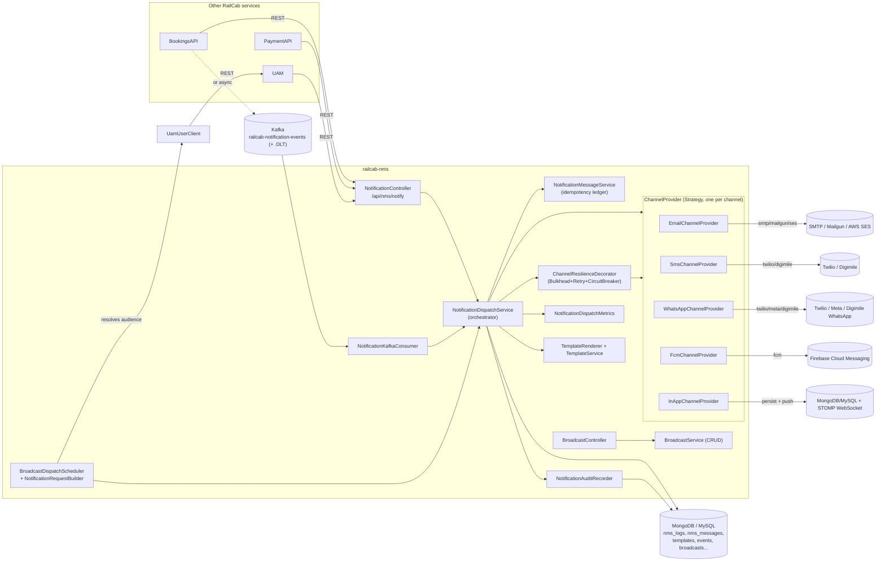

# NMS (Notification Management Service) — High-Level Design

## 1. Purpose & Role

`railcab-nms` (Gradle group `com.railcab`, Java package root `com.railcab.nms`) is the platform-wide
**multi-channel notification dispatch service** for RailCab. It is the single place any other RailCab
service goes to notify an end user — passenger, driver, or admin — over email, SMS, WhatsApp, push, or
in-app, without needing to know which vendor sends that channel today or how retries/circuit-breaking
work.

Callers never talk to Twilio/AWS SES/Firebase/Meta directly. They send one generic
`event + variables + recipients` request to NMS (over REST or Kafka); NMS resolves the active template
for that event per channel, renders it, and fans the send out across every channel provider concurrently.
Confirmed callers in this codebase: **BookingsAPI**, **PaymentAPI**, and **UAM**, each via their own local
`NmsNotificationService` HTTP client hitting `POST /api/v1/nms/notify` (e.g.
`2026_RailCab_BookingsAPI/src/main/java/com/railcab/bookingsapi/shared/notification/NmsNotificationService.java`).

## 2. Features

- **Multi-channel notification dispatch** — EMAIL, SMS, WHATSAPP, FCM_PUSH, IN_APP, triggered by a single
  `NotificationRequest` (event + variables + per-channel recipient fields + optional channel override).
- **Template rendering** — event × channel templates (`NotificationTemplate`) store a Base64-encoded body
  with `{{variable}}` placeholders; `TemplateRenderer` decodes and substitutes at dispatch time. Email
  subjects are rendered inline (no Base64) by `NotificationDispatchService.renderInline`.
- **Broadcast dispatch to multiple recipients/channels** — `BroadcastService` (CRUD) +
  `BroadcastDispatchScheduler` (a `@Scheduled` sweep) resolve an audience segment (ALL/USERS/DRIVERS/ADMINS)
  against UAM and fan a single event out to every matching user across the broadcast's chosen channels.
- **Resilient per-channel delivery** — every `ChannelProvider.send()` call is wrapped in Resilience4j
  Bulkhead + CircuitBreaker + Retry (`ChannelResilienceDecorator`), one instance per channel
  (`email`, `sms`, `whatsapp`, `fcm_push`, `in_app`).
- **In-app notifications with live push** — `InAppChannelProvider` persists an `InAppNotification` and
  pushes it live over STOMP/WebSocket to `/user/{userId}/queue/notifications`; REST endpoints back it with
  history/unread-count/mark-read for clients that aren't connected.
- **Idempotent dispatch** — `NotificationMessageService` reserves a `messageId` in a `NotificationMessage`
  ledger (`PROCESSING`/`SENT`/`FAILED`) before dispatching, so retried/redelivered REST or Kafka calls with
  the same `messageId` are not resent (with stale-`PROCESSING`/failed-message reopen logic).
- **Delivery audit trail** — every per-recipient send attempt is recorded to `NotificationLog` (event,
  channel, provider, masked recipient, status, retry count, optional rendered body, error), queryable via
  `NotificationLogController` (`/logs`, `/logs/event`, `/logs/correlation/{id}`, `/logs/channel`,
  `/logs/range`, `/logs/stats`).
- **Configurable events & templates** — `EventController`/`TemplateController` provide full CRUD so new
  notification events and their channel-specific templates can be added without a code deploy;
  `DefaultNotificationTemplates` seeds a starter set (OTP, password reset, account created, payment
  success/failure) on first boot.
- **Async ingestion via Kafka** — `NotificationKafkaConsumer` consumes `railcab-notification-events` and
  funnels into the same `NotificationDispatchUseCase.dispatch()` the REST controller uses, with a
  Dead Letter Topic for poison messages.

## 3. Tech Stack

Read from `build.gradle`:

| Concern | Choice |
|---|---|
| Language / runtime | Java 21 (toolchain-pinned) |
| Framework | Spring Boot **4.1.0**, Spring Cloud `2025.1.0` BOM (compatibility verifier disabled — Spring Cloud only officially supports Boot 4.0.x) |
| Web | `spring-boot-starter-web`, `spring-boot-starter-validation`, `spring-boot-starter-security`, `spring-boot-starter-websocket` |
| Persistence | `spring-boot-starter-data-mongodb` (default) **or** `spring-boot-starter-data-jpa` + `mysql-connector-j` (`sql` profile — mutually exclusive with Mongo) |
| Messaging | `spring-boot-starter-kafka` (its own starter under Boot 4's modularization — plain `spring-kafka` no longer auto-configures Consumer/ProducerFactory) |
| Cache/stream bus | `spring-boot-starter-data-redis` — used only to publish search-index events onto a shared Redis Stream for SearchAPI, not for caching |
| Email | `spring-boot-starter-mail` (JavaMail/SMTP), AWS SDK `sesv2` (via `software.amazon.awssdk:bom:2.25.60`), Mailgun REST API via WebClient |
| SMS / WhatsApp | `com.twilio.sdk:twilio:10.4.1`; Meta WhatsApp Cloud API and Digimile bulk-SMS/WhatsApp via `spring-boot-starter-webclient` |
| Push | `com.google.firebase:firebase-admin:9.4.1` (FCM) + `google-auth-library-oauth2-http` |
| Resilience | `io.github.resilience4j:resilience4j-spring-boot4:2.4.0` (Bulkhead + CircuitBreaker + Retry) |
| Service discovery | `spring-cloud-starter-netflix-eureka-client` |
| Observability | `spring-boot-starter-actuator`, `micrometer-registry-prometheus`, `spring-boot-starter-opentelemetry` (OTLP tracing) |
| Security | Spring Security + a custom `NmsAuthenticationFilter` (internal API key or JWT bearer), JJWT `0.12.6` |
| API docs | `springdoc-openapi-starter-webmvc-ui:2.6.0` |
| Boilerplate | Lombok `1.18.30`, AspectJ weaver (search-index `@Aspect`) |
| Build | Gradle, `bootJar`; plain `jar` task disabled |

## 4. Architecture Style

- **Hexagonal / ports-and-adapters**, explicitly enforced by an ArchUnit test
  (`src/test/java/com/railcab/nms/architecture/NmsArchitectureTest.java`): `domain` (pure model + repository
  ports) ← `application` (port.in use-case interfaces, port.out ports, usecase implementations, DTOs) ←
  `adapters.in` (web controllers, Kafka consumer) / `adapters.out` (persistence, channel vendor
  implementations, UAM integration client), with `infrastructure` wiring beans across every layer.
- **Strategy pattern, twice over**: `ChannelProvider` (one Strategy per `NotificationChannel`, auto-collected
  as `List<ChannelProvider>` and selected by `NotificationDispatchService.findProvider`) and
  `RecipientResolver` (one Strategy per channel's recipient-field extraction) — a javadoc comment on
  `RecipientResolver` explicitly calls this "the same Strategy pattern already used for `ChannelProvider`".
- **Nested Strategy/Adapter per channel**: each `ChannelProvider` (EMAIL/SMS/WHATSAPP/FCM_PUSH) is itself a
  thin dispatcher that picks among 2-3 vendor-specific `*Provider` adapters (e.g. `EmailProvider`:
  `SmtpEmailProvider`/`MailgunEmailProvider`/`AwsSesEmailProvider`) by name, via `nms.provider.*` config —
  see LLD §3 for the full matrix.
- **Decorator**: `ChannelResilienceDecorator` composes Resilience4j Bulkhead → Retry → CircuitBreaker
  around every raw `provider.send()` call via `decorateSupplier`, replacing a former hand-rolled
  `ConcurrentHashMap` circuit breaker + `Semaphore`.
- **Builder**: `NotificationRequestBuilder` (new this session) — a hand-written fluent builder assembling a
  `NotificationRequest` field-by-field with channel-conditional recipient targeting, used only by
  `BroadcastDispatchScheduler.dispatchToRecipient()`.
- **Hybrid synchronous/asynchronous entry**: REST (`NotificationController`) and Kafka
  (`NotificationKafkaConsumer`) both converge on the same `NotificationDispatchUseCase.dispatch()`.
  Per-channel sends run concurrently via `CompletableFuture.supplyAsync` on a virtual-thread executor
  (`DispatchConfig`).
- **Dual persistence stack**: every aggregate (log, message, template, event, device token, in-app
  notification, broadcast) has a persistence-agnostic domain model plus parallel Mongo and JPA adapters,
  selected by `spring.profiles.active`/`nms.persistence.type` — only one backend is active per deployment.

## 5. External Dependencies

- **AWS SES** (`AwsSesEmailProvider`) — optional email vendor, active when `nms.provider.email=ses`. Lazily
  builds a `SesV2Client` from `nms.ses.*` credentials.
- **SMTP** (`SmtpEmailProvider`, JavaMail) — default email vendor (`nms.provider.email=smtp`).
- **Mailgun** (`MailgunEmailProvider`) — third email vendor option, called via the shared `WebClient`.
- **Twilio** (`com.twilio.sdk`) — default SMS and WhatsApp vendor (`nms.provider.sms=twilio`,
  `nms.provider.whatsapp=twilio`).
- **Digimile** — alternate bulk-SMS gateway (`DigimileSmsProvider`) and a *separate* WhatsApp product
  (`DigimileWhatsAppProvider`, distinct API/config from the bulk-SMS gateway).
- **Meta WhatsApp Cloud API** (`MetaWhatsAppProvider`) — alternate WhatsApp vendor, called via `WebClient`
  with a bearer token against `graph.facebook.com`.
- **Firebase Admin SDK / FCM** (`FirebasePushProvider`) — sole push vendor, gated by `nms.firebase.enabled`.
- **UAM** (`UamUserClient` + `UamServiceTokenProvider`) — the only sibling service NMS calls outbound to,
  used exclusively to resolve broadcast audiences (paged `GET /users`, filtered client-side by role for
  USERS/DRIVERS/ADMINS segments).
- **MongoDB** (default) or **MySQL** (`sql` profile) — persistence.
- **Kafka** — `railcab-notification-events` topic (+ `.DLT`) for async dispatch triggers.
- **Redis Stream** (`railcab:search:index-stream`) — publishes `NotificationTemplate` change events for
  SearchAPI to index; not used as a cache here.
- **Eureka** (`railcab-service-registry`) — service discovery registration.
- **Callers into NMS**: BookingsAPI, PaymentAPI, and UAM each embed a local `NmsNotificationService` +
  `CommonNmsRequest`/`NmsNotificationRequest` DTO pair (kept as local copies per `NMS_INTEGRATION.md`'s
  "no shared contract module" rule) and POST to `/api/v1/nms/notify`.

## 6. Component Diagram

## 7. Deployment

- **Container**: single-stage `Dockerfile` — `eclipse-temurin:21-jre-alpine`, copies a pre-built
  `build/libs/railcab-nms-0.0.1.jar`, `EXPOSE 8087`, runs `java -jar app.jar`.
- **docker-compose.yml**: maps `8087:8087`, brings up a `mongo:7` sidecar (`railcab-nms-mongo`), joins the
  shared external `railcab-net` network so other RailCab compose stacks (service registry, etc.) can
  resolve it by container name.
- **Known port mismatch** (also called out in `README.md`): `server.port=9005` in every `application*.properties`
  file does not match the Docker `EXPOSE 8087`/compose `8087:8087` mapping — the container will not serve on
  the mapped host port unless `SERVER_PORT` is set explicitly at runtime.
- **Kubernetes** (`ops/k8s/deployment.yaml`): `Deployment`, `replicas: 3`, container port `9005` (named
  `http`, inconsistent with the Dockerfile's `8087`), env vars for `MONGO_URI`/`KAFKA_BOOTSTRAP`/
  `NMS_INTERNAL_API_KEY`/Firebase project id + credentials path sourced from a `railcab-nms-secrets`
  Secret, readiness probe (`/actuator/health`, 20s initial delay, 10s period) and liveness probe (60s
  initial delay, 20s period), resource requests `250m CPU / 512Mi` and limits `1 CPU / 1Gi`. Prometheus
  scrape annotations (`prometheus.io/scrape`, `/path=/actuator/prometheus`, `/port=9005`) are set directly
  on the Pod template. A matching `Service` exposes port `9005`.
- Because dispatch state (idempotency ledger, circuit breaker/bulkhead counters) is per-instance (in-memory
  Resilience4j registries, no shared Redis-backed state), horizontally scaling beyond one replica risks
  independent circuit-breaker flapping per pod and — per the README's own "Known Issues" — the broadcast
  scheduler has no distributed lock, so more than one replica risks double-sending a broadcast on the same
  sweep.

## 8. Non-Functional

- **Resilience per channel** (`application.properties`, `resilience4j.*`): CircuitBreaker sliding window 10,
  minimum calls = `nms.circuit-breaker.failure-threshold` (default 5), 50% failure-rate threshold, open-wait
  = `nms.circuit-breaker.reset-timeout-ms` (default 60s), 3 half-open trial calls — one instance per
  channel (`email`, `sms`, `whatsapp`, `fcm_push`, `in_app`). Bulkhead max-concurrent-calls per channel from
  `nms.rate-limit.*-concurrency` (email 20, sms 10, whatsapp 10, push 50, in-app 50). Retry attempts/backoff
  from `nms.retry.attempts` (default 3) / `nms.retry.backoff-ms` (default 500ms), shared `default` config
  across channels.
- **Delivery guarantees**: at-least-once for Kafka-triggered dispatch (`DefaultErrorHandler` +
  `FixedBackOff` retries, then `DeadLetterPublishingRecoverer` to `<topic>.DLT`). REST dispatch is
  synchronous best-effort — the caller gets a per-channel success/failure list in the response, no retry
  beyond what Resilience4j's Retry does inside a single `dispatch()` call.
- **Idempotency**: a `messageId`-keyed `NotificationMessage` ledger prevents duplicate dispatch on
  redelivery; a stale `PROCESSING` row older than `nms.idempotency.processing-timeout-minutes` (default 30)
  is reopened rather than left stuck, and a previously `FAILED` message is retried if
  `nms.idempotency.retry-failed-messages=true` (default).
- **Audit/PII**: `NotificationAuditRecorder` masks recipients to their last 4 characters by default
  (`nms.audit.mask-recipients=true`) and only stores the rendered body when
  `nms.audit.store-rendered-body=true` (off by default). Log/message retention is a scheduled purge
  (`RetentionCleanupScheduler`) — a no-op on Mongo (native TTL indexes handle expiry) and an actual bulk
  delete on JPA/MySQL.
- **Security**: `nms.security.enabled` (off by default) gates an internal API key (`X-NMS-API-Key`) or JWT
  bearer via `NmsAuthenticationFilter`; when enabled, `/api/nms/logs/**`, `/api/nms/messages/**`, and
  `/api/nms/broadcasts/**` require `ROLE_NMS_ADMIN`, and template/event mutation (POST/PUT/DELETE) requires
  the same role. `/actuator/**` and the WebSocket handshake path are always open (auth for the socket
  happens at STOMP CONNECT via `WebSocketAuthChannelInterceptor` instead).
- **No automatic provider failover**: despite 2-3 vendor implementations existing per channel
  (email/SMS/WhatsApp), a circuit opening on the configured provider does not fail over to an alternate —
  it simply fails that send (flagged as a known gap in `README.md`).
