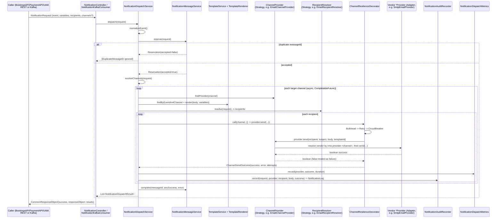

# NMS (Notification Management Service) — Low-Level Design

All paths are relative to `2026_RailCab_NMS/src/main/java/com/railcab/nms/` unless stated otherwise.
Line numbers are from the current working tree at the time of writing.

## 1. Package Structure

```
com.railcab.nms
├── RailCabNmsApplication.java         — @SpringBootApplication, @EnableConfigurationProperties(NmsProperties),
│                                         @EnableAsync, @EnableScheduling
├── domain/
│   ├── model/                        — persistence-agnostic POJOs: NotificationTemplate, NotificationLog,
│   │                                    NotificationMessage, NotificationEventDefinition, DeviceToken,
│   │                                    InAppNotification, Broadcast, NotificationChannel/DeliveryStatus/
│   │                                    NotificationMessageStatus/BroadcastStatus/BroadcastSegment (enums),
│   │                                    DefaultNotificationTemplates (seed data)
│   └── repository/                   — port interfaces (IBroadcastRepository, IDeviceTokenRepository,
│                                        IEventDefinitionRepository, IInAppNotificationRepository,
│                                        INotificationLogRepository, INotificationMessageRepository,
│                                        ITemplateRepository) + PageQuery/PageResult
├── application/
│   ├── dto/                          — NotificationRequest, NotificationDispatchResult, ChannelSendOutcome,
│   │                                    CreateBroadcastRequest, EventConfigResponse,
│   │                                    NotificationChannelStatsResponse, UamUserSummary
│   ├── port/in/                      — use-case interfaces (NotificationDispatchUseCase, BroadcastUseCase,
│   │                                    TemplateUseCase, EventDefinitionUseCase, NotificationLogUseCase,
│   │                                    DeviceTokenUseCase, InAppNotificationUseCase,
│   │                                    NotificationMessageQueryUseCase)
│   ├── port/out/                     — ChannelProvider, RecipientResolver, BroadcastAudienceResolver
│   │                                    (Strategy interfaces the application layer depends on)
│   └── usecase/                      — service implementations + support/ (collaborators split out of
│                                        NotificationDispatchService/BroadcastDispatchScheduler)
│       └── support/                  — ChannelResilienceDecorator, NotificationRequestBuilder,
│                                        NotificationAuditRecorder, NotificationDispatchMetrics,
│                                        TemplateRenderer, {Email,Fcm,InApp,Sms,WhatsApp}RecipientResolver
├── adapters/
│   ├── in/
│   │   ├── web/                      — one controller package per feature (dispatch, broadcast, device,
│   │   │                                event, inapp, log, message, template) + WebPaginationSupport
│   │   └── messaging/                — NotificationKafkaConsumer
│   └── out/
│       ├── channel/                  — email/ sms/ whatsapp/ fcm/ inapp/, each a ChannelProvider
│       │                                dispatcher + a vendor-neutral *Provider SPI + one package per
│       │                                vendor (see §3.1)
│       ├── integration/uam/          — UamUserClient (BroadcastAudienceResolver adapter), UamServiceTokenProvider
│       └── persistence/              — PaginationMapper + jpa/ and mongo/ (parallel adapters, 7 aggregates × 2 backends)
├── infrastructure/config/            — NmsProperties (@ConfigurationProperties), DispatchConfig (virtual-thread
│                                        executor), KafkaConfig (topics + DLT error handler), FcmConfig,
│                                        NmsBeans (ObjectMapper/WebClient), NmsSecurityConfig +
│                                        NmsAuthenticationFilter + JwtSupport, WebSocketConfig +
│                                        WebSocketAuthChannelInterceptor, MongoPoolConfig,
│                                        RetentionCleanupScheduler, CorrelationIdFilter
├── search/                           — SearchIndexable, SearchIndexAspect, SearchEventPublisher (Redis
│                                        Stream publisher for SearchAPI, triggered after ITemplateRepository saves)
└── shared/                           — CommonRequestObject/CommonResponseObject envelope, CommonRequestMapper,
                                         GlobalExceptionHandler, FieldValidationError, enums (CRUDEnum,
                                         CheckerEnum, MessageEnum, SortDirectionEnum)
```

Package boundaries are enforced by `src/test/java/com/railcab/nms/architecture/NmsArchitectureTest.java`
(ArchUnit): `domain.model` must not depend on any framework/adapter type, and dependencies across
`domain`/`application`/`adapters.in`/`adapters.out`/`infrastructure` must only point inward (adapters may
depend on domain+application+infrastructure; application may depend on domain+infrastructure's typed config
only; nothing may depend on adapters).

## 2. Key Classes

| Class | File : lines | Responsibility |
|---|---|---|
| `NotificationDispatchService` | `application/usecase/NotificationDispatchService.java:48-207` | Core orchestrator: reserves idempotency, resolves target channels + template, renders body/subject, resolves recipients, dispatches per channel concurrently via `CompletableFuture`, delegates resilience/metrics/audit |
| `ChannelResilienceDecorator` | `application/usecase/support/ChannelResilienceDecorator.java:30-86` | Wraps one `provider.send()` call in Resilience4j Bulkhead→Retry→CircuitBreaker (`decorateSupplier` composition), converting a `false` return into a retry-eligible exception |
| `NotificationRequestBuilder` | `application/usecase/support/NotificationRequestBuilder.java:21-79` | Hand-written fluent Builder assembling a `NotificationRequest` for one broadcast recipient, with channel-conditional recipient-field population (`recipientsFor`) |
| `BroadcastDispatchScheduler` | `application/usecase/BroadcastDispatchScheduler.java:31-85` | `@Scheduled` sweep (`nms.broadcast.dispatch-fixed-delay-ms`, default 60s) of `PENDING` broadcasts; resolves audience via `BroadcastAudienceResolver`, builds one `NotificationRequest` per recipient via `NotificationRequestBuilder`, dispatches via `NotificationDispatchUseCase` |
| `BroadcastService` | `application/usecase/BroadcastService.java:23-66` | Broadcast CRUD only (create/list/get/cancel) — deliberately split from scheduled dispatch |
| `NotificationMessageService` | `application/usecase/NotificationMessageService.java:19-91` | Idempotency ledger: `reserve()` inserts a `PROCESSING` row, catching `DataIntegrityViolationException` on duplicate `messageId` to detect retries/stale/failed messages and decide reopen vs. reject; `complete()` finalizes status |
| `NotificationAuditRecorder` | `application/usecase/support/NotificationAuditRecorder.java:24-55` | Persists one `NotificationLog` per send attempt; masks recipient PII to last 4 chars by default |
| `NotificationDispatchMetrics` | `application/usecase/support/NotificationDispatchMetrics.java:21-38` | Micrometer `Timer`/`Counter` per channel/provider/success outcome |
| `TemplateRenderer` | `application/usecase/support/TemplateRenderer.java:17-51` | Base64-decodes template body, substitutes `{{key}}` placeholders via regex |
| `ChannelProvider` | `application/port/out/ChannelProvider.java:14-19` | Strategy port: `getChannel()` + `send(recipient, subject, body, templateId)` |
| `RecipientResolver` | `application/port/out/RecipientResolver.java:13-18` | Strategy port: `channel()` + `resolve(request)` → recipient list. Javadoc explicitly calls this "the same Strategy pattern already used for `ChannelProvider`" |
| `NotificationController` | `adapters/in/web/dispatch/NotificationController.java:30-65` | `POST /api/nms/notify` (+ `/api/v1/nms/notify`) |
| `NotificationKafkaConsumer` | `adapters/in/messaging/NotificationKafkaConsumer.java:27-68` | `@KafkaListener` on `railcab-notification-events`; maps the common envelope the same way the REST controller does, then calls the same `dispatch()` |
| `EmailChannelProvider` / `SmsChannelProvider` / `WhatsAppChannelProvider` / `FcmChannelProvider` | `adapters/out/channel/{email,sms,whatsapp,fcm}/*ChannelProvider.java` | Per-channel `ChannelProvider` impl that resolves the active vendor `*Provider` by name (`nms.provider.*`) from an injected `List<XProvider>` |
| `InAppChannelProvider` | `adapters/out/channel/inapp/InAppChannelProvider.java:26-72` | Only `ChannelProvider` with no vendor SPI — persists `InAppNotification` then pushes via `SimpMessagingTemplate.convertAndSendToUser` |
| `UamUserClient` | `adapters/out/integration/uam/UamUserClient.java:32-116` | `BroadcastAudienceResolver` adapter: pages through UAM's `GET /users`, filters client-side by role for `USERS`/`DRIVERS`/`ADMINS` segments |
| `NmsProperties` | `infrastructure/config/NmsProperties.java:10-286` | `@ConfigurationProperties(prefix="nms")` — one nested static class per vendor/concern (Twilio, Meta, Firebase, Mailgun, Ses, Digimile, DigimileWhatsApp, Provider, Kafka, Retry, Security, Http, RateLimit, Audit, Idempotency, CircuitBreaker, Integration, Broadcast) |
| `GlobalExceptionHandler` | `shared/GlobalExceptionHandler.java:13-44` | `@RestControllerAdvice`; maps validation/`IllegalArgumentException`/generic exceptions to `CommonResponseObject` |

## 3. Design Patterns

### 3.1 Adapter — one vendor-neutral SPI per channel, multiple vendor adapters

Each externally-delivered channel (EMAIL, SMS, WHATSAPP, FCM_PUSH) has its own small vendor-neutral
interface, each with 1-3 concrete adapters wrapping a real vendor SDK/HTTP API, selected at runtime by name
via `nms.provider.<channel>`:

| Channel | SPI | Adapters (`getName()` key) | Vendor call |
|---|---|---|---|
| EMAIL | `EmailProvider` (`adapters/out/channel/email/EmailProvider.java:8-14`) | `SmtpEmailProvider` (`smtp`, default), `MailgunEmailProvider` (`mailgun`), `AwsSesEmailProvider` (`ses`, `adapters/out/channel/email/ses/AwsSesEmailProvider.java:27-93`) | JavaMail SMTP / Mailgun REST via `WebClient` / AWS `SesV2Client.sendEmail` |
| SMS | `SmsProvider` (`adapters/out/channel/sms/SmsProvider.java`) | `TwilioSmsProvider` (`twilio`, default), `DigimileSmsProvider` (`digimile`) | Twilio Java SDK / Digimile bulk-SMS HTTP GET |
| WHATSAPP | `WhatsAppProvider` (`adapters/out/channel/whatsapp/WhatsAppProvider.java`) | `TwilioWhatsAppProvider` (`twilio`, default), `MetaWhatsAppProvider` (`meta`, `adapters/out/channel/whatsapp/meta/MetaWhatsAppProvider.java:21-68`), `DigimileWhatsAppProvider` (`digimile`) | Twilio SDK / Meta Graph API via `WebClient` / Digimile WhatsApp API v2 |
| FCM_PUSH | `PushProvider` (`adapters/out/channel/fcm/PushProvider.java`) | `FirebasePushProvider` (`fcm`, only impl) | Firebase Admin SDK |
| IN_APP | *(none — no vendor)* | `InAppChannelProvider` itself | Mongo/JPA persist + STOMP/WebSocket push |

Each `*ChannelProvider` (`EmailChannelProvider.java:23-55`, `SmsChannelProvider.java:23-55`,
`WhatsAppChannelProvider.java:23-55`, `FcmChannelProvider.java:23-55`) is a thin `ChannelProvider`
implementation that injects `List<XProvider>` (Spring auto-collects every `@Component`/`@Component("name")`
bean implementing the SPI) and does `providers.stream().filter(p -> p.getName().equalsIgnoreCase(key)).findFirst()`
where `key` comes from `NmsProperties.Provider` (e.g. `props.getProvider().getEmail()`). This is a nested
Adapter-selected-by-Strategy: the outer `ChannelProvider` Strategy (§3.2) picks a channel; the inner
vendor-provider lookup picks an Adapter within that channel.

### 3.2 Strategy — `ChannelProvider` and `RecipientResolver`

`ChannelProvider` (`application/port/out/ChannelProvider.java:14`) is a Strategy interface with 5
implementations (`EmailChannelProvider`, `SmsChannelProvider`, `WhatsAppChannelProvider`,
`FcmChannelProvider`, `InAppChannelProvider`), auto-collected by Spring as `List<ChannelProvider>` and
injected into `NotificationDispatchService`, which selects the right one per channel via
`findProvider(channel)` (`NotificationDispatchService.java:178-183`) rather than a `switch`/`if` chain.

`RecipientResolver` (`application/port/out/RecipientResolver.java:13`) mirrors this exactly — one
implementation per channel (`EmailRecipientResolver`, `SmsRecipientResolver`, `WhatsAppRecipientResolver`,
`FcmRecipientResolver`, `InAppRecipientResolver`), selected via `recipientsFor(channel, request)`
(`NotificationDispatchService.java:159-165`). `FcmRecipientResolver` (`application/usecase/support/FcmRecipientResolver.java:20-39`)
is notable: it prefers explicit `fcmTokens` on the request but falls back to a `userIds` → device-token
repository lookup, so push can be triggered by user id alone. The `RecipientResolver` javadoc explicitly
states this is "the same Strategy pattern already used for `ChannelProvider`" — confirmed on this read.

Adding a new channel means adding one new `ChannelProvider` + one new `RecipientResolver` bean; no existing
class needs modification (Open/Closed in practice).

### 3.3 Decorator — `ChannelResilienceDecorator`

`ChannelResilienceDecorator` (`application/usecase/support/ChannelResilienceDecorator.java:30-86`) wraps
every `ChannelProvider.send()` call:

```java
Supplier<Boolean> decorated = Bulkhead.decorateSupplier(bulkhead,
        Retry.decorateSupplier(retry,
                CircuitBreaker.decorateSupplier(circuitBreaker, countedFailFastOnFalse)));
```

`countedFailFastOnFalse` (lines 51-57) converts a `false` return from the raw `sendCall` into a thrown
`ChannelSendFailedException` — since `ChannelProvider#send`'s boolean contract has no room for a
"retry-safe" vs. "not" distinction, both a thrown exception and a `false` return count identically as a
circuit-breaker failure / retry trigger. `call()` (lines 44-75) catches `CallNotPermittedException`
(circuit open), `BulkheadFullException` (at capacity), and the wrapper exception, translating each into a
`ChannelSendOutcome(success, error, attempts)` — the caller (`NotificationDispatchService.dispatchChannel`)
never sees a raw Resilience4j exception. Registries (`CircuitBreakerRegistry`/`RetryRegistry`/
`BulkheadRegistry`) are looked up per-channel by `channel.name().toLowerCase()` (e.g. `"email"`,
`"fcm_push"`), matching the `resilience4j.*.instances.<name>` keys in `application.properties`. This
replaces a previous hand-rolled `ConcurrentHashMap` circuit breaker + raw `Semaphore` (per the class
javadoc and `README.md`'s change history).

### 3.4 Builder — `NotificationRequestBuilder` (new this session)

`NotificationRequestBuilder` (`application/usecase/support/NotificationRequestBuilder.java:21-79`) is a
genuine, hand-written fluent Builder (not Lombok `@Builder`) wrapping `NotificationRequest`:

```java
NotificationRequest request = NotificationRequestBuilder.newRequest()
        .messageId(UUID.randomUUID().toString())
        .correlationId(broadcast.getId())
        .event(broadcast.getEvent())
        .variables(broadcast.getVariables())
        .channels(channels)
        .recipientsFor(channels, recipient)
        .build();
```

(`BroadcastDispatchScheduler.dispatchToRecipient`, `application/usecase/BroadcastDispatchScheduler.java:70-77`).
It exists specifically because broadcast fan-out — unlike the REST/Kafka entry points, which receive an
already-populated `NotificationRequest` from the caller — must assemble one request **per recipient**,
field-by-field, with channel-conditional targeting: `recipientsFor()` (lines 62-74) only sets `toEmail` if
`EMAIL` is in the channel list *and* the recipient has an email, only sets `toPhone` if `SMS`/`WHATSAPP` is
requested *and* the recipient has a phone number, and only sets `userIds` if `IN_APP`/`FCM_PUSH` is
requested — mirroring exactly which field each `RecipientResolver` reads (§3.2). This replaces what would
otherwise be ad-hoc conditional field assembly inline in the scheduler, keeping
`BroadcastDispatchScheduler` focused on orchestration (fetch due broadcasts → resolve audience → dispatch
→ update status) rather than DTO plumbing. It is a static-factory Builder (`newRequest()`, no public
constructor) with no validation step — `build()` simply returns the internally-accumulated
`NotificationRequest`. Deliberately hand-written instead of Lombok `@Builder` to avoid disturbing
`NotificationRequest`'s existing Jackson (de)serialization shape (a Lombok builder would require an
`@Builder`-compatible constructor Jackson would need to be told how to use).

### 3.5 Facade / Single Responsibility split

`NotificationDispatchService` (the sole `NotificationDispatchUseCase` implementation) delegates every
cross-cutting concern to a dedicated collaborator instead of inlining it: resilience → 
`ChannelResilienceDecorator`, metrics → `NotificationDispatchMetrics`, audit persistence → 
`NotificationAuditRecorder`, idempotency → `NotificationMessageService`, rendering → `TemplateRenderer`.
Its own method body (`dispatch()`/`dispatchChannel()`) is orchestration only — this is stated directly in
its class javadoc.

## 4. REST API Contract

Base paths are dual-registered (`/api/nms/...` and `/api/v1/nms/...` alias) on every controller. All
non-file endpoints use the `CommonRequestObject`/`CommonResponseObject` envelope
(`{"success", "message", "responseObject", "errorCode", "timestamp"}`), decoded via `CommonRequestMapper.requireRequestObject`.

### `POST /api/nms/notify` — `NotificationController` (`adapters/in/web/dispatch/NotificationController.java:30-65`)

Request: `CommonRequestObject` wrapping a `NotificationRequest`:

```json
{
  "messageID": "bookings:RIDE_COMPLETED:rideId",
  "requestObject": {
    "event": "RIDE_COMPLETED",
    "variables": { "bookingId": "rideId", "amount": "450" },
    "toEmail": ["user@example.com"],
    "toPhone": "9876543210",
    "fcmTokens": ["fcm-token"],
    "userIds": ["user-123"],
    "channels": ["EMAIL", "SMS", "FCM_PUSH"]
  }
}
```

- `event` — required, non-blank; normalized to uppercase/trimmed before lookup.
- `variables` — `Map<String,String>` template substitutions.
- `toEmail`/`toPhone`/`fcmTokens`/`userIds` — channel-specific recipient fields (only the ones relevant to
  the requested channels need be populated); `toPhone` must match `^[6-9]\d{9}$` (10-digit Indian mobile).
- `channels` — optional; if empty/absent, every channel with an active template for `event` is attempted.
- `messageId`/`correlationId` — optional; if `messageId` is blank, it's backfilled from the envelope's
  `messageID`.

Response: `200` with `CommonResponseObject.success("Notification dispatched", List<NotificationDispatchResult>)`
if any channel succeeded, else `CommonResponseObject.failure("All channels failed")`. `NotificationDispatchResult`
is `(NotificationChannel channel, boolean success, String error)` per channel attempted. `400` on missing
`requestObject`/`event` or bean-validation failure (`VALIDATION_ERROR`). `500` on unhandled exceptions.

### Kafka contract — `NotificationKafkaConsumer` (`adapters/in/messaging/NotificationKafkaConsumer.java:27-68`)

Topic `${nms.kafka.topic.notification-events:railcab-notification-events}`, consumer group
`${spring.kafka.consumer.group-id:railcab-nms-group}`. Payload: the same `CommonRequestObject`-wrapped
`NotificationRequest` JSON as the REST body (or a bare `NotificationRequest` if `requestObject` is absent —
`readNotificationRequest`, lines 51-67). On any exception, rethrows `IllegalStateException`, which triggers
`KafkaConfig`'s `DefaultErrorHandler` (fixed backoff, `nms.kafka.retry.attempts`/`backoff-ms`, default 3
attempts / 1000ms) and, on exhaustion, `DeadLetterPublishingRecoverer` publishes to
`<topic>.DLT` (same partition scheme).

### Other endpoints

| Controller | Routes | Notes |
|---|---|---|
| `TemplateController` | `POST/GET /templates`, `GET /templates/event/{event}`, `GET /templates/event/{event}/channel/{channel}`, `GET/PUT/DELETE /templates/{id}` | DELETE soft-deactivates (`active=false`), does not remove the row |
| `EventController` | `GET/POST /events`, `PUT/DELETE /events/{id}`, `GET /events/{event}/attributes`, `GET /events/config`, `POST /events/reset-defaults` | `/config` returns every event + label + attribute list in one call for admin UIs |
| `NotificationLogController` | `GET /logs`, `/logs/event`, `/logs/correlation/{id}`, `/logs/channel`, `/logs/range`, `/logs/stats` | All paged except `/stats` (success/failure counts per channel) |
| `NotificationMessageController` | `GET /messages` | Idempotency ledger query, optional `status`/`correlationId` filters |
| `DeviceTokenController` | `POST/DELETE /devices/fcm-token` | Registers/unregisters an FCM token for the authenticated caller (`Authentication.getName()`) |
| `InAppNotificationController` | `GET /in-app/notifications`, `/unread-count`, `PATCH /{id}/read`, `PATCH /read-all` | Scoped to the authenticated caller only |
| `BroadcastController` | `POST/GET /broadcasts`, `GET /broadcasts/{id}`, `PATCH /broadcasts/{id}/cancel` | Admin-only when `nms.security.enabled=true` (`ROLE_NMS_ADMIN`) |

### WebSocket

STOMP endpoint `/api/nms/in-app/ws` (SockJS fallback), broker destinations `/topic`/`/queue`
(in-memory simple broker by default, optional STOMP-relay to an external broker via
`nms.websocket.relay.*` for multi-replica delivery). Auth happens at the STOMP `CONNECT` frame via
`WebSocketAuthChannelInterceptor`, not the HTTP handshake (which is always `permitAll`).

## 5. Domain Model

| Model | Key fields | Notes |
|---|---|---|
| `NotificationTemplate` (`domain/model/NotificationTemplate.java:23-100`) | `event`, `channel`, `name`, `subject`, `body` (Base64), `externalTemplateId`, `active` | One row per event × channel; `getSearchIndexFields()` implements `SearchIndexable` for SearchAPI (never indexes `body`) |
| `NotificationLog` (`domain/model/NotificationLog.java:17-47`) | `messageId`, `correlationId`, `event`, `channel`, `providerName`, `status` (`SENT`/`FAILED`/`SKIPPED`), `recipient` (masked), `success`, `retryCount`, `errorMessage`, `renderedBody`, `sentAt` | Lombok `@Builder(toBuilder=true)`; one row per (channel × recipient) send attempt |
| `NotificationMessage` (`domain/model/NotificationMessage.java:10-29`) | `messageId`, `correlationId`, `event`, `status` (`PROCESSING`/`SENT`/`FAILED`), `errorMessage`, timestamps | Idempotency ledger, unique on `messageId` at the persistence layer (triggers `DataIntegrityViolationException` on duplicate insert) |
| `NotificationEventDefinition` (`domain/model/NotificationEventDefinition.java:12-33`) | `value`, `label`, `attributes` (allowed placeholders), `active` | Configurable event catalogue; `DefaultNotificationTemplates`/`NotificationEvent` seed the defaults |
| `DeviceToken` (`domain/model/DeviceToken.java:8-19`) | `userId`, `token`, `platform` | FCM token registry, looked up by `FcmRecipientResolver` |
| `InAppNotification` (`domain/model/InAppNotification.java:8-21`) | `userId`, `title`, `message`, `read`, `createdAt` | Persisted by `InAppChannelProvider`, also pushed live over WebSocket |
| `Broadcast` (`domain/model/Broadcast.java:26-55`) | `title`, `event`, `variables`, `segment` (`BroadcastSegment`), `channels`, `scheduledAt`, `status` (`BroadcastStatus`), `recipientCount`, `createdBy`, timestamps | `event`/`variables` handed to `dispatch()` as-is per resolved recipient — a matching `NotificationTemplate` must already exist for `event` × each channel |
| `NotificationChannel` (enum) | `EMAIL, SMS, WHATSAPP, FCM_PUSH, IN_APP` | |
| `DeliveryStatus` (enum) | `SENT, FAILED, SKIPPED` | |
| `NotificationMessageStatus` (enum) | `PROCESSING, SENT, FAILED` | |
| `BroadcastStatus` (enum) | `PENDING, SENT, CANCELLED, FAILED` | |
| `BroadcastSegment` (enum) | `ALL, USERS, DRIVERS, ADMINS` | No `VENDORS` segment and no city/last-active filtering — documented as a deliberate scope cut, since UAM (the only identity source NMS may depend on) never modeled vendor identities or those fields |

Every aggregate above has a parallel Mongo (`adapters/out/persistence/mongo/*Document.java` +
`*MongoRepositoryAdapter`) and JPA (`adapters/out/persistence/jpa/*Entity.java` + `*JpaRepositoryAdapter`)
implementation of its domain-layer repository port — only one set is active per deployment, selected by
`spring.profiles.active`/`nms.persistence.type`.

## 6. Sequence Diagrams

### 6.1 Single notification dispatch — Strategy (`ChannelProvider`/`RecipientResolver`) + Decorator (`ChannelResilienceDecorator`)



### 6.2 Broadcast dispatch — `BroadcastDispatchScheduler` fan-out via `NotificationRequestBuilder`

```mermaid
sequenceDiagram
    participant Admin as Admin (via BroadcastController)
    participant Sched as BroadcastDispatchScheduler
    participant Repo as IBroadcastRepository
    participant Resolver as UamUserClient<br/>(BroadcastAudienceResolver)
    participant UAM as UAM service
    participant Builder as NotificationRequestBuilder
    participant Dispatch as NotificationDispatchUseCase

    Admin->>Repo: create Broadcast (event, segment, channels, scheduledAt=null/past)
    Note over Sched: @Scheduled fixedDelay (default 60s)
    Sched->>Repo: findDue(PENDING, now)
    Repo-->>Sched: List<Broadcast>
    loop each due broadcast
        Sched->>Resolver: resolveSegment(broadcast.segment)
        Resolver->>UAM: GET /users?page=n&size=m (paged, Bearer service token)
        UAM-->>Resolver: UamUserSummary page
        Resolver->>Resolver: filter client-side by role (USERS/DRIVERS/ADMINS) or none (ALL)
        Resolver-->>Sched: List<UamUserSummary>
        loop each recipient
            Sched->>Builder: newRequest().messageId(uuid).correlationId(broadcastId)<br/>.event(...).variables(...).channels(...)<br/>.recipientsFor(channels, recipient).build()
            Builder->>Builder: toEmail if EMAIL+recipient.email();<br/>toPhone if SMS/WHATSAPP+phone;<br/>userIds if IN_APP/FCM_PUSH
            Builder-->>Sched: NotificationRequest
            Sched->>Dispatch: dispatch(request)
            Dispatch-->>Sched: List<NotificationDispatchResult>
            Sched->>Sched: sent++ if any channel succeeded
        end
        Sched->>Repo: save(broadcast: recipientCount, status=SENT/FAILED, sentAt)
    end
```

## 7. Error Handling / Delivery-Failure Handling

- **Per-attempt failure isolation**: `dispatchChannel()` (`NotificationDispatchService.java:119-157`) never
  lets one recipient's or one channel's failure abort the whole request — each channel runs on its own
  `CompletableFuture`, and `joinDispatch()` (lines 185-192) catches any exception from `future.join()` and
  converts it into a failed `NotificationDispatchResult` rather than propagating.
- **Resilience4j translation**: `ChannelResilienceDecorator.call()` (lines 63-75) catches
  `CallNotPermittedException` → `"Provider circuit open"`, `BulkheadFullException` → `"Provider at
  capacity"`, the internal `ChannelSendFailedException` (thrown when `send()` returns `false`) → its
  message, and any other `RuntimeException` → its message — always returning a `ChannelSendOutcome`, never
  letting a Resilience4j exception type leak to the orchestrator.
- **Idempotent retry semantics**: `NotificationMessageService.reserve()` (lines 24-58) distinguishes three
  duplicate-insert cases via `DataIntegrityViolationException` handling: (1) existing message is `FAILED`
  and `nms.idempotency.retry-failed-messages=true` → reopen and retry; (2) existing message has been stuck
  `PROCESSING` past `processing-timeout-minutes` → treat as stale, reopen; (3) otherwise → reject as a true
  duplicate (`Reservation.duplicate`), and `dispatch()` returns a single synthetic
  `NotificationDispatchResult(null, true, "Duplicate messageID ignored")` without touching any channel.
- **Kafka delivery failures**: `NotificationKafkaConsumer.consume()` wraps any exception in
  `IllegalStateException` and rethrows; `KafkaConfig.notificationKafkaErrorHandler` (`infrastructure/config/KafkaConfig.java:46-57`)
  retries with a `FixedBackOff` (`nms.kafka.retry.backoff-ms`, `attempts-1` retries) then republishes to
  `<topic>.DLT` via `DeadLetterPublishingRecoverer` — no manual DLT replay tooling is present in this
  codebase.
- **Validation errors**: `GlobalExceptionHandler` (`shared/GlobalExceptionHandler.java:13-44`) converts
  `MethodArgumentNotValidException`/`ConstraintViolationException` into `400` + `CommonResponseObject.validationFailure`
  (per-field `FieldValidationError` list), `IllegalArgumentException` into `400` + a plain failure message
  (used for "not found"/"not cancellable" business errors, e.g. `BroadcastService.cancel`), and any other
  `Exception` into a generic `500` (logged with full stack trace, response body intentionally generic).
- **Broadcast-level failure**: `BroadcastDispatchScheduler.dispatch()` (lines 45-66) catches any exception
  from audience resolution or per-recipient dispatch at the broadcast level, marking the whole broadcast
  `FAILED`; a single recipient's dispatch exception is caught separately inside `dispatchToRecipient()`
  (lines 68-84) and only counts that recipient as not-sent, without failing the rest of the broadcast.
- **No automatic provider failover on circuit-open**: if a channel's circuit trips, that channel's sends
  fail outright for the remainder of the open-state window — there is no fallback to an alternate vendor
  `*Provider` for the same channel, even though 2-3 exist for EMAIL/SMS/WHATSAPP.
- **WebSocket push failure is non-fatal**: `InAppChannelProvider.send()` (lines 39-61) always persists the
  `InAppNotification` first; if the subsequent `messagingTemplate.convertAndSendToUser` throws (e.g. user
  not connected), it's caught and logged at `warn` only — the method still returns `true`, since the
  client can fall back to REST polling (`GET /in-app/notifications`) for anything missed live.
