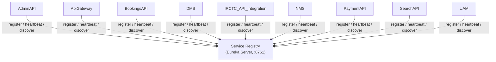

# Service Registry — High-Level Design

## 1. Purpose & Role

The Service Registry is the **service discovery backbone** of the RailCab platform. It is a
Spring Cloud Netflix **Eureka Server**: every other RailCab microservice registers itself here on
startup and queries this registry to locate its peers, instead of relying on hardcoded
hostnames/ports. It plays no business role of its own — no domain logic, no persistence, no
customer-facing API — its only job is to be the address book the rest of the platform depends on.

## 2. Features

- **Service registration** — client services (Eureka clients) register their instance metadata
  (host, port, app name, zone) with the registry on startup and renew that registration via
  periodic heartbeats.
- **Health-based deregistration** — instances that stop sending heartbeats are evicted from the
  registry after the configured lease expiry, so discovery queries stop returning dead instances.
  Eviction is moderated by Eureka's self-preservation mode (see §7).
- **Discovery client support** — any registered service can query the registry for the current,
  healthy instance list of any other registered application, enabling client-side load balancing
  and dynamic routing (used by ApiGateway and other inter-service callers).

## 3. Tech Stack

Read from `build.gradle`:

| Component | Version |
|---|---|
| Spring Boot | 4.0.7 |
| Spring Cloud (BOM) | 2025.1.0 |
| `spring-cloud-starter-netflix-eureka-server` | via Spring Cloud BOM |
| `spring-boot-starter-actuator` | via Spring Boot |
| Java toolchain | 21 |
| Lombok | compile-only / annotation processor (present but unused by the single class) |

The build stays on Spring Boot 4.0.x rather than a newer 4.1.0 line because Spring Cloud
2025.1.0's `CompatibilityVerifier` hard-fails against Boot 4.1.0 (a constraint the build.gradle
comment says is shared with ApiGateway).

## 4. Architecture Style

**This service is essentially zero custom code.** The entire application is one class:

```java
@SpringBootApplication
@EnableEurekaServer
public class RailCabServiceRegistryApplication {
    public static void main(String[] args) {
        SpringApplication.run(RailCabServiceRegistryApplication.class, args);
    }
}
```

All registry behavior — the instance registry map, heartbeat/lease-expiry processing, REST
endpoints (`/eureka/apps/**`), replication protocol, self-preservation heuristics, and the
built-in status dashboard — is supplied entirely by Spring Cloud Netflix Eureka Server's
auto-configuration, triggered by `@EnableEurekaServer`. There is no application-layer
architecture to describe beyond "one annotation turns this JVM into a Eureka server"; everything
configurable is done through `application.properties`, not code.

## 5. External Dependencies (Consumers)

Every other RailCab backend microservice is a **client** of this registry (confirmed via
`spring-cloud-starter-netflix-eureka-client` dependency in each service's `build.gradle`):

- AdminAPI
- ApiGateway
- BookingsAPI
- DMS
- IRCTC_API_Integration
- NMS
- PaymentAPI
- SearchAPI
- UAM

This registry has **no outbound dependency** on any of them — the relationship is strictly
one-directional (clients → registry), except in a multi-region peer topology where registry
nodes replicate to each other (see §7).

## 6. Component Diagram



## 7. Deployment

- **Dockerfile** (multi-stage):
  - Stage 1 (`eclipse-temurin:17-jdk-alpine`): pre-fetches Gradle dependencies, then builds a
    Spring Boot fat jar via `./gradlew bootJar -x test`.
  - Stage 2 (`eclipse-temurin:17-jre-alpine`): copies only the built jar, runs as a non-root
    `registry` user, exposes port `8761`.
  - JVM flags: `-Xms256m -Xmx512m -Djava.net.preferIPv4Stack=true -XX:+UseContainerSupport`.
- **docker-compose.yml**: defines a single `service-registry` service on the external
  `railcab-net` network (shared across every other RailCab service's compose file so containers
  can resolve each other by name), maps port `8761:8761`, and health-checks
  `http://localhost:8761/actuator/health`.
- **No Kubernetes manifest exists in this repo** (no `ops/k8s/deployment.yaml`, and the
  platform-wide `k8s-infra/` directory only contains manifests for Elasticsearch, Kafka,
  MongoDB, RabbitMQ, and Redis — nothing for the registry itself). Deployment today is
  Docker/Docker Compose only.

## 8. Non-Functional Characteristics

Read from `src/main/resources/application.properties`:

- **Self-preservation mode**: `eureka.server.enable-self-preservation=true` — the registry stops
  evicting instances when it detects it is losing heartbeats faster than expected, guarding
  against mass-eviction during network partitions.
- **Renewal threshold tuned down for platform size**: `eureka.server.renewal-percent-threshold=0.49`.
  The stock Eureka default assumes a much larger fleet; left at default, self-preservation would
  trip permanently with only a handful of RailCab services registered, so it's lowered to fit
  this platform's actual scale.
- **Single-node by default, peer-aware when configured**: `eureka.client.register-with-eureka` and
  `eureka.client.fetch-registry` both default to `false` (`REGISTRY_PEER_AWARE:false`) — a lone
  registry node never needs to register with or query itself. Setting `REGISTRY_PEER_AWARE=true`
  plus `REGISTRY_PEER_URLS` enables multi-region peer replication, with each region's identity
  set via `REGISTRY_ZONE`.
- **Configurable identity/networking**: `server.port` (default `8761`), `eureka.instance.hostname`,
  and `eureka.instance.metadata-map.zone` are all environment-overridable
  (`REGISTRY_PORT`, `REGISTRY_HOSTNAME`, `REGISTRY_ZONE`).
- **Observability**: `management.endpoints.web.exposure.include=health,info` with
  `management.endpoint.health.show-details=when-authorized`; Eureka/Discovery client logging is
  quieted to `WARN` while root logging stays at `INFO`.
