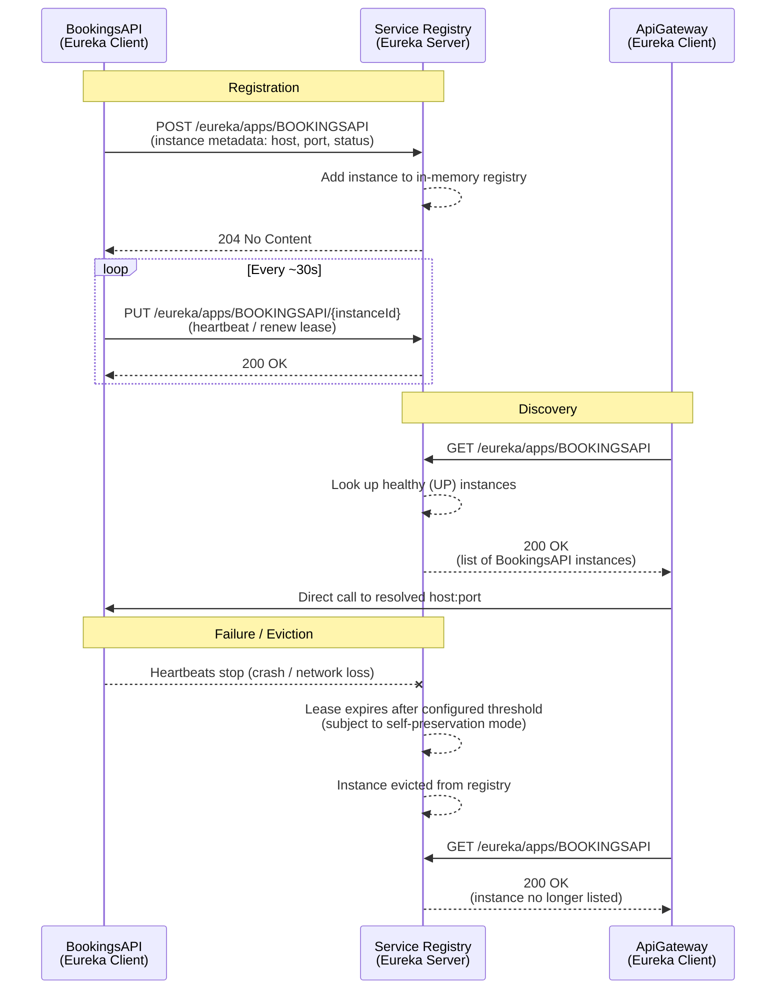

# Service Registry — Low-Level Design

## 1. Honest Scope Statement

This service has **one custom class and zero application-level design patterns**. Every piece of
registry behavior (registration, heartbeats, lease expiry, replication, self-preservation, REST
endpoints) is implemented inside the `spring-cloud-starter-netflix-eureka-server` framework
dependency, not in this codebase. There is no GoF pattern (Builder, Strategy, Factory, etc.) to
document here, and forcing one in would misrepresent the code. This LLD is intentionally short —
that brevity is itself the accurate finding for this repo.

## 2. The One Class

| Class | File | Lines |
|---|---|---|
| `RailCabServiceRegistryApplication` | `src/main/java/com/railcab/serviceregistry/RailCabServiceRegistryApplication.java:1-13` | 13 |

Its entire contents:

```java
@SpringBootApplication
@EnableEurekaServer
public class RailCabServiceRegistryApplication {
    public static void main(String[] args) {
        SpringApplication.run(RailCabServiceRegistryApplication.class, args);
    }
}
```

- `@SpringBootApplication` (line 7) — standard Spring Boot bootstrap: component scanning,
  auto-configuration, property support.
- `@EnableEurekaServer` (line 8, from `org.springframework.cloud.netflix.eureka.server`) — the
  single line that turns this JVM into a Eureka registry. It pulls in the framework's
  `EurekaServerAutoConfiguration`, which wires the in-memory instance registry, the REST resource
  layer under `/eureka/**`, the peer-replication client, and the status/dashboard UI.
- `main` (lines 10-12) — delegates straight to `SpringApplication.run`; no custom startup logic.

## 3. Key Configuration Properties

From `src/main/resources/application.properties` — these properties are what actually control
Eureka Server's behavior, since there is no code to configure it in:

| Property | Value (as configured) | What it controls |
|---|---|---|
| `spring.application.name` | `railcab-service-registry` | Service's own registered name / log identity. |
| `server.port` | `${REGISTRY_PORT:8761}` | Port the Eureka REST/dashboard endpoint listens on. |
| `eureka.instance.hostname` | `${REGISTRY_HOSTNAME:localhost}` | Hostname this instance advertises to peers/clients. |
| `eureka.instance.metadata-map.zone` | `${REGISTRY_ZONE:region1}` | This node's zone identity, used for multi-region peer topologies. |
| `eureka.client.service-url.defaultZone` | `${REGISTRY_PEER_URLS:http://localhost:8761/eureka/}` | The peer registry URL(s) this node talks to; defaults to itself in single-node/dev mode. |
| `eureka.client.register-with-eureka` | `${REGISTRY_PEER_AWARE:false}` | Whether this node registers itself with another registry (peer replication). Off by default — a lone node doesn't need to peer with itself. |
| `eureka.client.fetch-registry` | `${REGISTRY_PEER_AWARE:false}` | Whether this node fetches the registry from a peer. Same default reasoning as above. |
| `eureka.server.renewal-percent-threshold` | `0.49` | Minimum expected renewal rate before self-preservation kicks in; lowered from Eureka's stock default because that default assumes a much larger fleet than RailCab's handful of services. |
| `eureka.server.enable-self-preservation` | `true` | Whether the registry stops evicting instances when heartbeats drop faster than expected (network-partition safety net). |
| `management.endpoints.web.exposure.include` | `health,info` | Which actuator endpoints are exposed. |
| `management.endpoint.health.show-details` | `when-authorized` | Health endpoint detail visibility. |
| `logging.level.com.netflix.eureka` / `com.netflix.discovery` | `WARN` | Quiets framework-internal registry/discovery chatter; root stays at `INFO`. |

## 4. Sequence: Registration + Discovery (Standard Eureka Protocol)

This is standard Eureka client/server protocol behavior supplied entirely by the framework — not
custom logic in this repo. Shown generically using two example clients (e.g. BookingsAPI
registering, ApiGateway discovering it).


