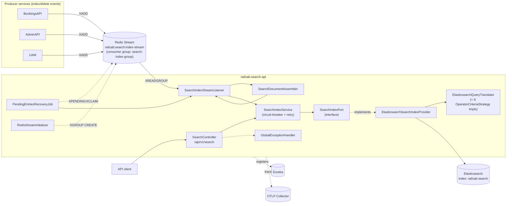

# Search API — High-Level Design

## 1. Purpose & Role

`railcab-search-api` (Gradle project `railcab-search-api`, Java package root `com.heuristiq.search`) is the
platform-wide **search and query capability** for RailCab. It maintains a single, engine-backed index of
domain entities that originate in *other* services — rides, drivers, vehicles, support tickets, refund
requests, users, roles, tenants, groups, documents, notification templates, and vendors (see
`com.heuristiq.search.model.SearchModel`) — and exposes a generic structured-query API over that index.

The service does not own any of the entities it indexes. It is a read/search side-car: producer services
(BookingsAPI, AdminAPI, UAM, and others) publish index/delete events describing *their* entities, mapped
into a generic slot-based schema, and Search API is solely responsible for persisting those slots into
Elasticsearch and translating client-supplied structured queries into engine-specific queries against them.

## 2. Features

- **Asynchronous document indexing from other services' change events.** `SearchIndexStreamListener`
  consumes `INDEX`/`DELETE` operations off a shared Redis Stream
  (`railcab:search:index-stream`, consumer group `search-index-group`), at-least-once, via Spring Data
  Redis's `StreamMessageListenerContainer` + consumer-group API. Failed events are left unacknowledged
  and picked up later by a fixed-delay recovery job (`PendingEntriesRecoveryJob`) that claims stale
  pending entries via `XPENDING`/`XCLAIM`.
- **Structured query translation.** Clients submit an engine-agnostic `SearchQuery` (a `SearchModel` plus
  an optional flat AND/OR `SearchGroup` of `SearchCondition`s). `ElasticsearchQueryTranslator` converts
  this DSL into a Spring Data Elasticsearch `CriteriaQuery`, dispatching per-operator behavior through a
  `Strategy` family (see LLD) rather than hand-rolled `switch` statements.
- **Search REST API.** `SearchController` exposes a POST search endpoint (paged) and a GET single-document
  lookup endpoint, both documented via springdoc/OpenAPI (`/swagger-ui.html`).
- **Resilience.** All index/search/delete operations run through `SearchIndexService`, wrapped in
  Resilience4j circuit-breaker + retry (`search-index` instance), falling back to a
  `SearchIndexUnavailableException` (mapped to HTTP 503) when Elasticsearch is unreachable.
- **Pluggable backend.** The Elasticsearch implementation is one interchangeable adapter behind
  `SearchIndexPort`, selected via `railcab.search.provider` (default `elasticsearch`) — the same
  `@ConditionalOnProperty` convention used elsewhere on the platform (e.g. PaymentAPI, DMS) for
  swappable backends.

## 3. Tech Stack

Read from `build.gradle` and `settings.gradle`:

| Concern | Choice |
|---|---|
| Language / runtime | Java 21 (toolchain-pinned) |
| Framework | Spring Boot 4.1.0 (`org.springframework.boot`), Spring Cloud `2025.1.0` BOM |
| Web | `spring-boot-starter-web`, `spring-boot-starter-validation` |
| Search engine client | `spring-boot-starter-data-elasticsearch` (Spring Data Elasticsearch's own Boot autoconfiguration wires `ElasticsearchClient`/`ElasticsearchOperations` directly from `spring.elasticsearch.*` properties — no hand-rolled `RestClient` config) |
| Elasticsearch server | `docker.elastic.co/elasticsearch/elasticsearch:9.4.2` (docker-compose), pinned to match the transitively-pulled `co.elastic.clients:elasticsearch-java:9.4.2` client — server 8.x under client 9.x breaks the `indices.exists` HEAD check |
| Messaging | `spring-boot-starter-data-redis` (Redis Streams, not a message broker product — consumer groups via `StreamMessageListenerContainer`) |
| Resilience | `io.github.resilience4j:resilience4j-spring-boot4:2.4.0` (circuit breaker + retry) |
| Service discovery | `spring-cloud-starter-netflix-eureka-client` |
| Observability | `spring-boot-starter-actuator`, `micrometer-registry-prometheus`, `spring-boot-starter-opentelemetry` (OTLP tracing) |
| API docs | `springdoc-openapi-starter-webmvc-ui:2.6.0` |
| Boilerplate | Lombok `1.18.30` (`@Data`, `@Builder`, `@RequiredArgsConstructor`, `@Slf4j`) |
| JSON | `jackson-databind` (deserializing Redis Stream string payloads into `Map<String,Object>`) |
| Build | Gradle, `bootJar` (plain `jar` task disabled) |

## 4. Architecture Style

- **Hexagonal/ports-and-adapters** for the search backend: `com.heuristiq.search.provider.SearchIndexPort`
  is the port; `com.heuristiq.search.provider.elasticsearch.ElasticsearchSearchIndexProvider` is the sole
  adapter today, gated by `@ConditionalOnProperty(prefix = "railcab.search", name = "provider",
  havingValue = "elasticsearch", matchIfMissing = true)`. `SearchIndexService`,
  `SearchController`, and `SearchDocumentAssembler` depend only on the port / the generic
  `SearchQuery`/`SearchDocument` model — never on Elasticsearch types.
- **Event-driven ingestion, synchronous query.** Writes into the index arrive asynchronously via Redis
  Streams (fire-and-forget from the producer's point of view); reads happen synchronously over the REST
  API.
- **EAV (entity-attribute-value) generic document schema.** Rather than one Elasticsearch mapping per
  domain entity, all entities share a single index (`railcab-search`) and a single document shape
  (`SearchDocument`) with generic typed slots (`text1..text15`, `amount1..amount5`, `number1..number5`,
  `date1..date5`, `datetime1..datetime5`). Each producer service owns the mapping from its own domain
  fields into these slots (its own `SearchDocumentMapper`, not present in this repo).
- **Thin resilience facade over a swappable adapter**, so cross-cutting concerns (circuit breaker,
  retry) live in exactly one place regardless of which engine is active.
- Design lineage: several classes' Javadoc explicitly reference a legacy source ("touidx") this service's
  design is modeled on, simplified for RailCab's scale (e.g. one Redis Stream instead of touidx's three
  parallel/sharded streams; no Solr fallback; no per-model `getCriteriaWithMerchantNo` special-casing —
  replaced by the generic `ownerKey` field).

## 5. External Dependencies

- **Elasticsearch cluster** — the actual search index store, `railcab-search` index, single shared
  mapping for all `SearchModel`s. Connection via `spring.elasticsearch.uris`
  (`ELASTICSEARCH_URL`, default `http://localhost:9200`), with optional basic-auth
  (`ELASTICSEARCH_USERNAME`/`ELASTICSEARCH_PASSWORD`, injected from a k8s Secret in
  `ops/k8s/deployment.yaml`).
- **Redis (Streams)** — a *shared cross-service message bus*, not a per-service cache. The stream key
  `railcab:search:index-stream` is published to by BookingsAPI, AdminAPI, and UAM (per code comments;
  the k8s manifest also mentions PaymentAPI) and consumed here under consumer group
  `search-index-group`. Configured via `SEARCH_REDIS_HOST`/`SEARCH_REDIS_PORT`, which must point at the
  *same* Redis instance across all publishing/consuming services — explicitly not each service's own
  cache Redis.
- **Eureka** (`spring-cloud-starter-netflix-eureka-client`) — service registry, `EUREKA_URL`.
- **OTLP tracing collector** — `OTLP_TRACING_ENDPOINT` (default `http://localhost:4318/v1/traces`),
  10% default sampling.
- **Prometheus** — scrapes `/actuator/prometheus` on the management port (annotated directly on the k8s
  Pod template).

Producers publish onto the shared stream; this service never calls back into them — coupling is
one-directional and asynchronous (event feed in, REST query API out).

## 6. Component Diagram

## 7. Deployment

- **Container**: multi-stage `Dockerfile` — `eclipse-temurin:21-jdk-alpine` builder stage (`gradlew
  bootJar -x test`), `eclipse-temurin:21-jre-alpine` runtime stage, non-root user (`search:railcab`).
  Exposes ports `9007` (HTTP) and `9107` (management/actuator). JVM heap bounded
  `-Xms256m -Xmx512m`, `-XX:+UseContainerSupport`.
- **docker-compose.yml** (local dev): brings up Elasticsearch `9.4.2` (single-node, security disabled),
  a standalone Redis `7.2-alpine` (explicitly documented as *local-dev only* — in a full multi-service
  run, services should point at one shared Redis instead of this one), and the search-api container
  itself, wired together with healthchecks and `depends_on: condition: service_healthy`.
- **Kubernetes** (`ops/k8s/deployment.yaml`): `Deployment` with `replicas: 3`, container ports `9007`
  (`http`) / `9107` (`management`), Elasticsearch credentials from a `railcab-search-api-secrets`
  Secret, `SEARCH_REDIS_HOST`/`SEARCH_REDIS_PORT` pointing at the shared bus, readiness probe
  (`/actuator/health`, 20s initial delay) and liveness probe (60s initial delay) both on the management
  port, resource requests `250m CPU / 512Mi` and limits `1 CPU / 1Gi`. A matching `Service` exposes both
  ports. Prometheus scrape annotations are set directly on the Pod template
  (`prometheus.io/scrape`, `/path`, `/port: "9107"`).
- Because the service is stateless (all persistent state lives in Elasticsearch/Redis), horizontal
  scaling (3 replicas) is safe without additional coordination — Redis Streams' consumer-group semantics
  already distribute stream entries across whichever instances are running under the same consumer
  group/name.

## 8. Non-Functional Notes

- **Delivery semantics**: at-least-once for indexing (Redis Streams `XREADGROUP` + explicit `XACK` only
  after successful processing; unacked messages are retried by `PendingEntriesRecoveryJob`). Indexing is
  therefore idempotent by construction — `SearchDocument.id` is a deterministic composite key
  (`"{model}:{modelKey}".toLowerCase()`), so a replayed `INDEX` event simply overwrites the same
  document.
- **Consistency**: eventually consistent with respect to the producer services — there is an
  unavoidable lag between a domain write and its visibility in search results, bounded by Redis Stream
  delivery latency plus (on failure) the recovery job's `min-idle-time-ms`/`recovery-interval-ms`
  (both default 60s).
- **Resilience**: every `SearchIndexPort` call goes through Resilience4j retry (max 2 attempts, 300ms
  wait) wrapped by a circuit breaker (sliding window 10, min calls 5, 50% failure threshold, 30s open
  wait, 3 half-open trial calls). On exhaustion, callers see a uniform `SearchIndexUnavailableException`
  → HTTP 503 with error code `SEARCH_INDEX_UNAVAILABLE`.
- **Validation**: request-level validation (`@Valid` on `SearchRequest`/`SearchQuery`/`SearchGroup`/
  `SearchCondition`) plus translator-level validation (unsupported operator/field combinations throw
  `IllegalArgumentException`, mapped to HTTP 400).
- **Extensibility**: swapping the search engine requires only a new `SearchIndexPort` implementation
  gated by a different `railcab.search.provider` value; adding a new operator requires only a new
  `OperatorCriteriaStrategy` implementation and a map entry, not touching the translator's dispatch
  logic. Adding a new indexed entity type requires only a new `SearchModel` enum constant and a
  producer-side mapper — no schema migration, since all entities share the same generic document shape.
- **Page size guardrail**: `SearchRequest.size` is capped at 200 via `@Max`, preventing unbounded result
  pages against the shared index.
