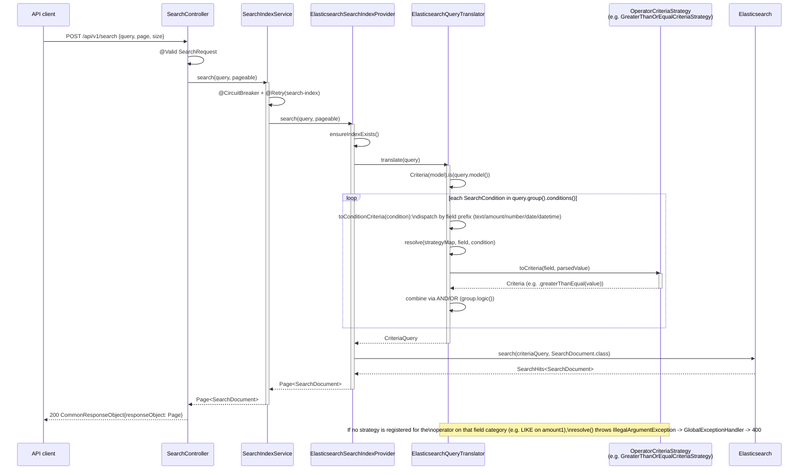

# Search API — Low-Level Design

All paths are relative to `2026_RailCab_SearchAPI/src/main/java/com/railcab/search/` unless stated
otherwise. Line numbers are from the current working tree at the time of writing.

## 1. Package Structure

```
com.heuristiq.search
├── RailCabSearchApiApplication.java     — @SpringBootApplication entry point
├── api/
│   ├── SearchController.java            — REST endpoints (/api/v1/search)
│   └── dto/SearchRequest.java           — inbound request DTO (query + paging)
├── common/dto/
│   ├── CommonResponseObject.java        — uniform success/failure envelope
│   └── FieldValidationError.java        — one field-level validation error
├── document/
│   └── SearchDocument.java              — the single generic Elasticsearch document (@Document)
├── indexing/                            — Redis Stream ingestion pipeline
│   ├── RedisStreamConfig.java           — wires the StreamMessageListenerContainer bean
│   ├── RedisStreamInitializer.java      — ensures stream + consumer group exist
│   ├── RedisStreamProperties.java       — @ConfigurationProperties(prefix="railcab.search.stream")
│   ├── SearchIndexStreamListener.java   — StreamListener; decodes + dispatches index/delete events
│   ├── SearchDocumentAssembler.java     — builds a SearchDocument from a slot-keyed payload map
│   └── PendingEntriesRecoveryJob.java   — @Scheduled XPENDING/XCLAIM recovery of stuck messages
├── model/
│   └── SearchModel.java                 — enum of every indexable entity type
├── provider/                            — hexagonal port + adapter(s)
│   ├── SearchIndexPort.java             — port interface (engine-agnostic)
│   └── elasticsearch/                   — the (currently sole) adapter package
│       ├── ElasticsearchSearchIndexProvider.java  — SearchIndexPort implementation
│       ├── ElasticsearchQueryTranslator.java      — SearchQuery -> CriteriaQuery
│       ├── OperatorCriteriaStrategy.java          — Strategy interface
│       ├── EqualsCriteriaStrategy.java            — EQ
│       ├── NotEqualsCriteriaStrategy.java         — NE
│       ├── GreaterThanCriteriaStrategy.java       — GT
│       ├── GreaterThanOrEqualCriteriaStrategy.java— GE
│       ├── LessThanCriteriaStrategy.java          — LT
│       ├── LessThanOrEqualCriteriaStrategy.java   — LE
│       ├── ContainsCriteriaStrategy.java          — LIKE
│       └── InCriteriaStrategy.java                — IN
├── query/                               — engine-agnostic query DSL (pure model, no Elasticsearch types)
│   ├── LogicOp.java                     — AND/OR
│   ├── Operator.java                    — EQ/NE/GE/GT/LE/LT/LIKE/IN
│   ├── SearchCondition.java             — one field/operator/value triple
│   ├── SearchFieldConstants.java        — slot-prefix + structural field name constants
│   ├── SearchGroup.java                 — flat AND/OR list of conditions (no nested sub-groups)
│   └── SearchQuery.java                 — model + optional group (request root)
├── service/
│   ├── SearchIndexService.java          — resilience-wrapped facade over SearchIndexPort
│   └── SearchIndexUnavailableException.java
└── shared/
    └── GlobalExceptionHandler.java      — @RestControllerAdvice, maps exceptions to CommonResponseObject
```

Package boundaries are the architecture: `query` and `document` are engine-agnostic and depend on
nothing Elasticsearch-specific; `provider.elasticsearch` is the only package importing
`org.springframework.data.elasticsearch.*`; `service`/`api` depend only on `provider.SearchIndexPort`,
never on `provider.elasticsearch.*` directly.

## 2. Key Classes

| Class | File : lines | Responsibility |
|---|---|---|
| `SearchController` | `api/SearchController.java:30-72` | `POST /api/v1/search` (paged query), `GET /api/v1/search/{model}/{modelKey}` (single doc lookup) |
| `SearchRequest` | `api/dto/SearchRequest.java:11-20` | `record(SearchQuery query, int page, int size)`, `size` capped at 200 |
| `CommonResponseObject` | `common/dto/CommonResponseObject.java:14-39` | Uniform envelope: `success`/`message`/`responseObject`/`errorCode`/`timestamp` |
| `SearchDocument` | `document/SearchDocument.java:26-127` | The one Elasticsearch document type shared by every `SearchModel` (see §5) |
| `SearchIndexStreamListener` | `indexing/SearchIndexStreamListener.java:31-83` | `StreamListener<String, MapRecord<String,String,String>>`; decodes `operation`/`model`/`modelKey`/`payload` fields, routes to `SearchIndexService.index`/`.delete`, ACKs only on success |
| `SearchDocumentAssembler` | `indexing/SearchDocumentAssembler.java:19-101` | `assemble(model, modelKey, payload)` — ~40 `setIfPresent` calls populate a `new SearchDocument()` (not the Lombok builder) from whatever slot keys are present in the payload map |
| `RedisStreamConfig` | `indexing/RedisStreamConfig.java:18-40` | Builds/starts the `StreamMessageListenerContainer` bean; calls `RedisStreamInitializer` synchronously first |
| `RedisStreamInitializer` | `indexing/RedisStreamInitializer.java:21-44` | `XGROUP CREATE`, tolerating `BUSYGROUP` (group already exists) by inspecting the Lettuce root cause, since Spring's `RedisSystemException.getMessage()` is generic |
| `PendingEntriesRecoveryJob` | `indexing/PendingEntriesRecoveryJob.java:28-74` | `@Scheduled` (default 60s) `XPENDING` scan + `XCLAIM` for entries idle ≥ `min-idle-time-ms`, then reprocesses and ACKs each via the listener |
| `SearchIndexPort` | `provider/SearchIndexPort.java:17-26` | Port: `index`, `findOne`, `delete`, `search(SearchQuery, Pageable)` |
| `ElasticsearchSearchIndexProvider` | `provider/elasticsearch/ElasticsearchSearchIndexProvider.java:33-77` | Sole adapter, `@ConditionalOnProperty(prefix="railcab.search", name="provider", havingValue="elasticsearch", matchIfMissing=true)`; lazily creates the index mapping (`ensureIndexExists`) before every write/read |
| `ElasticsearchQueryTranslator` | `provider/elasticsearch/ElasticsearchQueryTranslator.java:28-128` | `SearchQuery` → `CriteriaQuery`; dispatches by field-name prefix, then by `Operator` via two `Map<Operator, OperatorCriteriaStrategy>` lookups (see §4) |
| `SearchIndexService` | `service/SearchIndexService.java:24-79` | `@CircuitBreaker` + `@Retry` (instance `search-index`) around every port call; each has a matching `xFallback` throwing `SearchIndexUnavailableException` |
| `GlobalExceptionHandler` | `shared/GlobalExceptionHandler.java:16-53` | Maps `IllegalArgumentException`→400, `SearchIndexUnavailableException`→503, `MethodArgumentNotValidException`/`ConstraintViolationException`→400 (field errors), generic `Exception`→500 |

## 3. Design Patterns

### 3.1 Adapter / Hexagonal Port

`SearchIndexPort` (`provider/SearchIndexPort.java:17`) is the port. `SearchIndexService` depends only on
this interface — never on Elasticsearch types. `ElasticsearchSearchIndexProvider`
(`provider/elasticsearch/ElasticsearchSearchIndexProvider.java:33`) is the concrete adapter, activated
by `@ConditionalOnProperty(prefix = "railcab.search", name = "provider", havingValue = "elasticsearch",
matchIfMissing = true)` — i.e. it is the default and only implementation registered today, but a second
implementation (e.g. for Solr/OpenSearch) could be added with a different `havingValue` and no change to
`SearchIndexService`, `SearchController`, or the `query`/`document` model packages. This mirrors the
`railcab.search.provider` config switch used elsewhere on the platform (PaymentAPI, DMS) for pluggable
backends.

### 3.2 Strategy — `OperatorCriteriaStrategy` family

`OperatorCriteriaStrategy` (`provider/elasticsearch/OperatorCriteriaStrategy.java:16-19`) is a
single-method Strategy interface:

```java
interface OperatorCriteriaStrategy {
    Criteria toCriteria(String field, Object value);
}
```

Eight package-private, stateless, `final` implementations exist, one per `Operator` behavior actually
needed by any field category:

| Strategy class | Operator | Elasticsearch `Criteria` call | Used by |
|---|---|---|---|
| `EqualsCriteriaStrategy` | `EQ` | `.is(value)` | both maps (shared instance) |
| `NotEqualsCriteriaStrategy` | `NE` | `.not().is(value)` | both maps (shared instance) |
| `GreaterThanCriteriaStrategy` | `GT` | `.greaterThan(value)` | comparable map only |
| `GreaterThanOrEqualCriteriaStrategy` | `GE` | `.greaterThanEqual(value)` | comparable map only |
| `LessThanCriteriaStrategy` | `LT` | `.lessThan(value)` | comparable map only |
| `LessThanOrEqualCriteriaStrategy` | `LE` | `.lessThanEqual(value)` | comparable map only |
| `ContainsCriteriaStrategy` | `LIKE` | `.contains((String) value)` | text map only |
| `InCriteriaStrategy` | `IN` | `.in((Object[]) value.split(","))` (trims each element) | text map only |

`ElasticsearchQueryTranslator` (`provider/elasticsearch/ElasticsearchQueryTranslator.java:28-128`) owns
the dispatch:

- `TEXT_STRATEGIES` (`EnumMap<Operator, OperatorCriteriaStrategy>`, line 36) — `EQ`, `NE`, `LIKE`, `IN`
  only, populated in the static initializer (lines 44-47).
- `COMPARABLE_STRATEGIES` (line 41) — `EQ`, `NE`, `GE`, `GT`, `LE`, `LT`, shared identically by
  `numericCriteria` (amount*/number* fields) and `dateCriteria` (date*/datetime* fields), populated at
  lines 49-54.
- `EQUALS`/`NOT_EQUALS` (lines 32-33) are single shared static instances reused across both maps, since
  equality/inequality behavior doesn't depend on field type.
- `toConditionCriteria` (lines 80-99) dispatches on the condition's field-name **prefix**
  (`SearchFieldConstants.DATETIME_PREFIX`/`DATE_PREFIX`/`AMOUNT_PREFIX`/`NUMBER_PREFIX`/`TEXT_PREFIX`) to
  decide *which* map and *how to parse* `condition.value()` (as `Instant`, `Double`, `Long`, or raw
  `String`), then calls `resolve(...)` (lines 116-123) to look up the `Operator` in that map.
- `resolve` throws `IllegalArgumentException` ("Operator X is not supported for field Y") when the
  operator/field-category combination has no strategy — e.g. `LIKE` on an `amount*` field — which
  `GlobalExceptionHandler` maps to HTTP 400.
- Structural fields (`model`/`modelKey`/`ownerKey`, none of the five prefixes) bypass the strategy map
  entirely and get a hardcoded `new Criteria(field).is(condition.value())` (line 98) — always
  equality, regardless of the requested `Operator`.

This replaces what were three parallel `switch (operator) { ... }` blocks (`textCriteria`,
`numericCriteria`, `dateCriteria`) with two shared, reusable, independently-testable strategy objects per
operator. Adding a new operator now means adding one new `OperatorCriteriaStrategy` class and one map
entry, not editing three switch statements. Verified against `ElasticsearchQueryTranslatorTest` — all 8
operator-dispatch cases pass.

### 3.3 Facade

`SearchIndexService` (`service/SearchIndexService.java:24`) is a thin facade in front of
`SearchIndexPort`, adding only cross-cutting resilience behavior (`@CircuitBreaker` + `@Retry`, instance
name `search-index`) uniformly to every operation. `SearchController` and `SearchIndexStreamListener`
never call the port directly.

### 3.4 Builder (cosmetic)

`SearchDocument` (`document/SearchDocument.java:26-30`) carries Lombok's `@Data @Builder
@NoArgsConstructor @AllArgsConstructor`, but the only production code that constructs one
(`SearchDocumentAssembler.assemble`, `indexing/SearchDocumentAssembler.java:22`) uses `new
SearchDocument()` plus ~40 sequential setter calls guarded by `setIfPresent`, not the generated builder.
The `@Builder` annotation is present but effectively unused in the main indexing path — a builder-style
construction would require passing a variable, only-partially-populated set of ~40 fields, which is
exactly what the setter-based `assemble()` already does more clearly with its `Consumer<Object>` +
`setIfPresent` helper (lines 76-81).

### 3.5 Consumer/functional dispatch in `SearchDocumentAssembler`

`setIfPresent(Map<String,Object> payload, String key, Consumer<Object> setter)`
(`indexing/SearchDocumentAssembler.java:76-81`) is a small functional-parameter pattern: each of the ~40
call sites passes a lambda invoking one `SearchDocument` setter with a type-coerced value
(`asString`/`toDouble`/`toLong`/`toInstant`, lines 83-100), keeping null-checking logic in one place
rather than repeating `if (payload.get(x) != null) doc.setX(...)` forty times.

## 4. REST API Contract

Base path: `/api/v1/search` (`@RequestMapping`, `api/SearchController.java:27`). OpenAPI/Swagger UI at
`/swagger-ui.html`, raw spec at `/v3/api-docs` (springdoc).

### `POST /api/v1/search`

Runs a `SearchQuery` against the shared Elasticsearch index and returns a page of matching documents.

**Request body** (`SearchRequest`):

```json
{
  "query": {
    "model": "RIDE",
    "group": {
      "logic": "AND",
      "conditions": [
        { "field": "text3", "operator": "EQ", "value": "COMPLETED" },
        { "field": "amount1", "operator": "GE", "value": "100.0" }
      ]
    }
  },
  "page": 0,
  "size": 20
}
```

- `query` — required (`@NotNull`); `query.model` — required, must be a `SearchModel` enum value;
  `query.group` — optional (omit to match every document of that model).
- `query.group.logic` — required if `group` present: `AND` | `OR`.
- `query.group.conditions` — required non-empty list if `group` present. Each condition:
  `field` (`@NotBlank`, one of `text1..15`/`amount1..5`/`number1..5`/`date1..5`/`datetime1..5`, or a
  structural field), `operator` (`@NotNull`, one of `EQ`/`NE`/`GE`/`GT`/`LE`/`LT`/`LIKE`/`IN`), `value`
  (string; parsed per field-prefix — numeric string for amount/number, ISO-8601 instant string for
  date/datetime, comma-separated list for `IN`).
- `page` — zero-based (`@PositiveOrZero`).
- `size` — page size, `@Max(200)`.

**Responses:**

| Status | Body | Condition |
|---|---|---|
| 200 | `CommonResponseObject{success:true, responseObject: Page<SearchDocument>}` | Query executed (possibly zero hits) |
| 400 | `CommonResponseObject{success:false, errorCode:"VALIDATION_ERROR", responseObject:[FieldValidationError...]}` | Bean validation failure |
| 400 | `CommonResponseObject{success:false, message:"Operator X is not supported for field Y"}` | Unsupported operator/field combination (`IllegalArgumentException`) |
| 503 | `CommonResponseObject{success:false, errorCode:"SEARCH_INDEX_UNAVAILABLE"}` | Elasticsearch unreachable after retry/circuit-breaker exhaustion |

### `GET /api/v1/search/{model}/{modelKey}`

Fetches a single indexed document by model type + the owning entity's id (assigned by its
source-of-truth service, e.g. BookingsAPI's ride id for `model=RIDE`).

**Path params:** `model` (`SearchModel` enum, path-bound), `modelKey` (string, the source service's id).

**Responses:**

| Status | Body | Condition |
|---|---|---|
| 200 | `CommonResponseObject{success:true, responseObject: SearchDocument}` | Document found |
| 404 | `CommonResponseObject{success:false, message:"No <MODEL> document indexed for id <key>"}` | No document indexed for this model/modelKey |
| 503 | `CommonResponseObject{success:false, errorCode:"SEARCH_INDEX_UNAVAILABLE"}` | Elasticsearch unreachable |

### Envelope shape (all endpoints)

```json
{
  "success": true,
  "message": "Success",
  "responseObject": { "...": "..." },
  "errorCode": null,
  "timestamp": null
}
```
`errorCode`/`timestamp` are `null` (omitted, `@JsonInclude(NON_NULL)`) on success; `timestamp` is set to
`Instant.now()` on every failure path.

## 5. Domain Model — `SearchDocument`

`document/SearchDocument.java:26-127`. `@Document(indexName = "railcab-search")` — one physical index
shared by every `SearchModel`. Full field list:

| Field | Type | Elasticsearch mapping | Notes |
|---|---|---|---|
| `id` | `String` | `@Id` | Composite: `"{model}:{modelKey}"`, lowercased model (see `SearchIndexService.compositeId`, `service/SearchIndexService.java:76-78`) |
| `model` | `String` | `Keyword` | `SearchModel` enum name |
| `modelKey` | `String` | `Keyword` | Owning entity's id in its source-of-truth service |
| `ownerKey` | `String` | `Keyword` | Optional partition key (e.g. vendorId/customerId) for scoping results |
| `text1` .. `text15` | `String` (×15) | `Text` main + `.keyword` sub-field (`@MultiField`) | Generic string slots; `.keyword` sub-field lets `EQ`/`IN` match exact values while `LIKE` still matches the analyzed text field |
| `amount1` .. `amount5` | `Double` (×5) | `Double` | Generic decimal slots |
| `number1` .. `number5` | `Long` (×5) | `Long` | Generic integer slots |
| `date1` .. `date5` | `Instant` (×5) | `Date` | Generic date slots |
| `datetime1` .. `datetime5` | `Instant` (×5) | `Date` | Generic datetime slots (distinct prefix from `date*` purely for producer-side semantic labeling — both map to the same ES `Date` type and are handled identically by the translator) |
| `createdAt` | `Instant` | `Date` | Set once, from payload if present else `Instant.now()` on first assembly |
| `updatedAt` | `Instant` | `Date` | Always set to `Instant.now()` on every assembly (i.e. every re-index) |

Lombok: `@Data @Builder @NoArgsConstructor @AllArgsConstructor` (see §3.4 for builder-usage caveat).

The field-to-domain-meaning mapping (e.g. "for `RIDE`, `text3` means status") is **not** defined in this
service — it lives in each producer service's own `SearchDocumentMapper` (not part of this repo),
referenced only in comments/Javadoc here.

## 6. Sequence Diagrams

### 6.1 Index event ingestion: Redis Stream → SearchDocumentAssembler → ElasticsearchSearchIndexProvider

```mermaid
sequenceDiagram
    participant Producer as Producer service<br/>(BookingsAPI/AdminAPI/UAM)
    participant Stream as Redis Stream<br/>(railcab:search:index-stream)
    participant Listener as SearchIndexStreamListener
    participant Assembler as SearchDocumentAssembler
    participant Service as SearchIndexService
    participant Port as ElasticsearchSearchIndexProvider
    participant ES as Elasticsearch

    Producer->>Stream: XADD {operation, model, modelKey, payload}
    Stream->>Listener: XREADGROUP (consumer group: search-index-group)
    activate Listener
    Listener->>Listener: process(record): parse operation/model/modelKey
    alt operation == INDEX
        Listener->>Listener: objectMapper.readValue(payload, Map)
        Listener->>Assembler: assemble(model, modelKey, payloadMap)
        activate Assembler
        Assembler->>Assembler: new SearchDocument(); id, model, modelKey,\nupdatedAt=now, createdAt (from payload or now)
        Assembler->>Assembler: ~40x setIfPresent(payload, key, doc::setX)
        Assembler-->>Listener: SearchDocument
        deactivate Assembler
        Listener->>Service: index(document)
        activate Service
        Service->>Service: @CircuitBreaker + @Retry(search-index)
        Service->>Port: index(document)
        activate Port
        Port->>Port: ensureIndexExists()
        Port->>ES: save(document)
        ES-->>Port: SearchDocument
        deactivate Port
        Service-->>Listener: SearchDocument
        deactivate Service
    else operation == DELETE
        Listener->>Service: delete(model, modelKey)
        Service->>Port: delete(model, modelKey)
        Port->>ES: delete(compositeId)
    end
    Listener->>Stream: XACK (only on success)
    deactivate Listener

    Note over Listener,Stream: On exception, message is NOT acked --\nstays pending, later reclaimed by\nPendingEntriesRecoveryJob (XPENDING/XCLAIM)
```

### 6.2 Query request: ElasticsearchQueryTranslator per-operator Strategy dispatch → Elasticsearch



## 7. Error Handling Approach

All exceptions are centralized in `GlobalExceptionHandler` (`shared/GlobalExceptionHandler.java`,
`@RestControllerAdvice`), which always responds with the `CommonResponseObject` envelope:

| Exception | HTTP status | `errorCode` | Raised where |
|---|---|---|---|
| `IllegalArgumentException` | 400 | *(none, message only)* | `ElasticsearchQueryTranslator.unsupported()` — unsupported operator/field combination; also a blank/missing condition field |
| `SearchIndexUnavailableException` | 503 | `SEARCH_INDEX_UNAVAILABLE` | `SearchIndexService`'s `indexFallback`/`findOneFallback`/`deleteFallback`/`searchFallback`, invoked by Resilience4j once retry + circuit breaker are exhausted |
| `MethodArgumentNotValidException` | 400 | `VALIDATION_ERROR` | Bean Validation failures on `@RequestBody @Valid SearchRequest` (field-level errors collected into `FieldValidationError` list) |
| `ConstraintViolationException` | 400 | `VALIDATION_ERROR` | Method/path-parameter-level Bean Validation failures (e.g. `@PathVariable` constraints) |
| `Exception` (catch-all) | 500 | *(none)* | Anything unhandled; logged at `error` with full stack trace, response body deliberately generic ("An unexpected error occurred") to avoid leaking internals |

Additional layers:

- **Stream-ingestion errors don't propagate as HTTP errors** — they never reach a controller.
  `SearchIndexStreamListener.onMessage` catches all exceptions, logs them, and deliberately does *not*
  acknowledge the message, relying on `PendingEntriesRecoveryJob` to retry it later
  (`indexing/SearchIndexStreamListener.java:43-51`). A message that keeps failing (e.g. a permanently
  malformed payload) will be retried indefinitely on every recovery cycle — there is no dead-letter
  handling or max-retry-count cutoff observed in this code.
- **Resilience4j fallback methods** (`indexFallback`, `findOneFallback`, `deleteFallback`,
  `searchFallback` in `SearchIndexService`) each log at `error` before rethrowing a fresh
  `SearchIndexUnavailableException`, so a caller always gets one exception type regardless of which
  operation failed or why (timeout, connection refused, ES 5xx, etc. are not distinguished).
- **Consumer-group bootstrap errors are selectively swallowed**: `RedisStreamInitializer` treats a
  `BUSYGROUP` failure (group already exists — expected on every restart after the first) as benign by
  inspecting `RedisSystemException.getMostSpecificCause()`, since Spring's own exception message is
  generic ("Error in execution"); any other `RedisSystemException` is rethrown and fails application
  startup.
