# RailCab Web — High-Level Design

> Repo: `2026_RailCab_Web` · Angular 21 customer-facing portal · one of 14 RailCab platform projects.
> Generated from a full read of `src/app/**`, `angular.json`, `package.json`, `federation.config.mjs`,
> and the environment files. Documentation only — no source was modified.

## 1. Purpose & Role

`2026_RailCab_Web` is the **customer-facing web portal** for RailCab. It is the browser
counterpart to the CustomerApp/DriverApp mobile clients and to `2026_RailCab_AdminWeb`. Its
responsibilities:

- Self-service **account lifecycle**: registration (mobile/email OTP), login (password, Google
  Firebase sign-in, TOTP-MFA challenge), forgot/change password.
- **Payments**: initiate a payment session against `2026_RailCab_PaymentAPI` (via the gateway) and
  hand off to the selected payment gateway's checkout UI (Razorpay / Cashfree / PayU / Toucan /
  Pine Labs), then show the invoice/receipt.
- **Notifications**: real-time in-app notifications pushed over STOMP/WebSocket from
  `2026_RailCab_NMS`, plus Firebase Cloud Messaging (FCM) push for background/native notifications.
- **Profile & security self-service**: profile edit, preferences, sessions, trusted devices, MFA
  (TOTP) enrollment, login-security summary, personal audit trail — all against `2026_RailCab_UAM`.
- **Vendor onboarding portal** (`/vendor/**`): a phone/OTP-only identity separate from the
  customer `AuthService`, for cab-vendor business registration and KYC document upload.
- **Access-management console** (`/access-management/**`) and **notification-template console**
  (`/nms-templates/**`): admin-style CRUD screens embedded directly in this app (not gated behind
  a role check today — `canActivate` on the shell route is commented out, see §8).
- Hosts `2026_RailCab_AdminWeb` as a **Module Federation remote** at `/admin/**` so operations staff
  can reach the admin console from the same shell shown to customers.

## 2. Features / Routes (feature modules found)

| Module (folder) | Mounted at | Purpose |
|---|---|---|
| `auth/` | `/auth/**` | Login (account + vendor modes), Register (OTP), Forgot Password, Change Password |
| `home/` | `/home` | Landing page after login |
| `payments/` | `/payments/**` | Make Payment (gateway selection + checkout), Payment Invoice/receipt |
| `notifications/` | `/notifications` | In-app notification inbox (paged, filterable) |
| `profile/` | `/profile` | Self-service profile, preferences, sessions, devices, MFA, login security, audit log |
| `access-management/` | `/access-management/**` | Users, Roles, Groups, Organizations, Applications, API Clients, Security Policies, Notification Templates, Audit Logs (UAM admin CRUD) |
| `nms-templates/` | `/nms-templates/**` | Notification template landing/list/create/edit, Events & Attributes catalog |
| `vendor-portal/` | `/vendor/**` (top-level, outside the authenticated shell) | Vendor Register (4-step wizard), Vendor Documents (KYC upload) |
| `railcab-admin` (federation remote) | `/admin/**` | `2026_RailCab_AdminWeb`, loaded live via Module Federation (`loadRemoteModule`) |
| `my-bookings` | `/my-bookings` | Placeholder — currently redirects to `HomeModule` until a real booking screen exists |

Route table with guards is detailed in `LLD.md` §4.

## 3. Tech Stack

Read from `package.json` / `angular.json`:

- **Angular 21.2** (`@angular/core` `^21.2.0`), NgModule-based (`standalone: false` is the project
  default in `angular.json`'s schematics config) — not the standalone-component style.
- **Zoneless change detection**: `provideZonelessChangeDetection()` in `app-module.ts` (no `zone.js`
  reliance for CD, though `zone.js@0.16` is still a dependency).
- **RxJS ~7.8** — `BehaviorSubject`s throughout services for reactive state.
- **Angular Material 21.2** (`@angular/material`, `@angular/cdk`) — dialogs, tables, form fields,
  used alongside **Bootstrap 5.3 + Bootstrap Icons** for general layout/utility classes.
- **@angular-architects/native-federation-v4** — Module Federation host, configured in
  `federation.config.mjs` / `federation.manifest.json` (maps `railcab-admin` remote → AdminWeb).
- **@stomp/stompjs 7.3 + sockjs-client 1.6** — STOMP-over-SockJS client for the in-app notification
  push channel.
- **firebase 10.14** — Firebase Auth (Google sign-in) and Firebase Cloud Messaging (push).
- **ngx-image-cropper**, **ngx-quill/quill** — image cropping (document/photo upload) and rich text
  editing (notification template body).
- **Vitest** (`@angular/build:unit-test`) is the configured test runner (`ng test`), not
  Karma/Jasmine.
- **TypeScript ~5.9**.

## 4. Architecture Style

- **NgModule-based, feature-module architecture.** Each business area is its own lazy-loaded
  `NgModule` (`loadChildren: () => import(...)`), wired from `app-routing-module.ts`. There is a
  shell `Layout` component (`layout/layout.ts`) with `Header` + `Sidebar` wrapping every
  authenticated feature route; `auth` and `vendor-portal` are mounted **outside** the shell.
- **Micro-frontend host via Module Federation** — the `/admin` route lazy-loads a *remote* Angular
  application (`railcab-admin`) at runtime rather than importing it at build time. Shared
  singletons (`@angular/core`, `@angular/platform-browser` incl. `/animations`) are declared in
  `federation.config.mjs` to avoid duplicate-framework issues between host and remote.
- **Thin, single-purpose HTTP service layer** — one `@Injectable({ providedIn: 'root' })` service
  per backend (`ApiService`, `UamService`, `PaymentService`, `DocumentService`,
  `InAppNotificationService`, `NmsTemplatesService`), each owning its own base URL and
  response-envelope unwrapping. Components never call `HttpClient` directly.
- **Reactive state via RxJS `BehaviorSubject`**, not NgRx/Akita — `AuthService.userSubject`,
  `ToastService._toasts$`, `InAppNotificationService.notifications$`/`unreadCount$`. See LLD for the
  Observer-pattern write-up.
- **Functional route guards & interceptors** (Angular's `CanActivateFn`/`HttpInterceptorFn` style,
  not class-based) — `authGuard`, `permissionGuard`, `pendingChangesGuard`, `authInterceptorFn`.

## 5. External Dependencies

All backend calls go through the same **API Gateway** (`2026_RailCab_ApiGateway`, `localhost:8999`
in both `environment.ts` and `environment.development.ts` — production host is still a `TODO`):

| Environment key | Backend | Notes |
|---|---|---|
| `apiUrl` (`/api`) | Gateway root | Used by generic `ApiService` for DMS (`/dms/documents`) and NMS device/FCM endpoints (`/nms/devices/fcm-token`) |
| `uamApiUrl` (`/api/uam`) | `2026_RailCab_UAM` | Auth (`/identity/auth/**`), profile/preferences/sessions/devices/MFA, and every access-management CRUD entity. Every write is wrapped in a `CommonRequestObject` envelope |
| `paymentApiUrl` (`/api/payment`) | `2026_RailCab_PaymentAPI` | `create-session`, `check-status`, `getByPaymentId` — JWT bearer passthrough, not gateway-injected headers |
| `wsUrl` (`/api/nms/in-app/ws`) | `2026_RailCab_NMS` | STOMP-over-SockJS in-app notification channel |
| `bookingApiUrl` (`localhost:9001`, unconfirmed) | Bookings API | Declared in environment but not yet consumed by any service found in the tree |

Third-party / browser-injected SDKs (loaded on demand, not npm dependencies):

- **Razorpay Checkout** (`checkout.razorpay.com/v1/checkout.js`) — modal checkout.
- **Cashfree SDK v3** (`sdk.cashfree.com/js/v3/cashfree.js`) — in-page Drop-in modal.
- **PayU** and **Toucan/Pine Labs** — no client SDK; PayU uses an auto-submitting hidden HTML form
  POST, Toucan/PineLabs use a plain `redirectUrl` navigation.
- **Firebase** (Auth + Cloud Messaging) — `firebase-messaging-sw.js` service worker at `public/`.

## 6. Component Diagram

```mermaid
flowchart TB
    subgraph Shell["App Shell (Layout + Header + Sidebar)"]
        Home["home/"]
        Payments["payments/ (make-payment, invoice)"]
        Notifications["notifications/ (in-app inbox)"]
        Profile["profile/"]
        AccessMgmt["access-management/ (Users/Roles/Groups/Orgs/Clients/Policies/AuditLogs)"]
        NmsTemplates["nms-templates/"]
        AdminRemote["railcab-admin (Module Federation remote)"]
    end

    Auth["auth/ (Login/Register/Forgot/Change Password)"]
    Vendor["vendor-portal/ (Register, Documents)"]

    subgraph Services["Shared Service Layer"]
        AuthSvc["AuthService (BehaviorSubject userSubject)"]
        UamSvc["UamService"]
        PaySvc["PaymentService"]
        ApiSvc["ApiService (DMS/NMS generic)"]
        DocSvc["DocumentService"]
        InAppSvc["InAppNotificationService (notifications$/unreadCount$)"]
        NmsSvc["NmsTemplatesService"]
        DialogSvc["AppDialogService (Facade over MatDialog)"]
        ToastSvc["ToastService / NotificationService"]
        FcmSvc["FcmService"]
        VendorAuthSvc["VendorAuthService"]
    end

    Interceptor["authInterceptorFn (bearer token + 401 refresh)"]

    Gateway["2026_RailCab_ApiGateway :8999"]
    UAM["2026_RailCab_UAM"]
    PaymentAPI["2026_RailCab_PaymentAPI"]
    DMS["2026_RailCab_DMS"]
    NMS["2026_RailCab_NMS (REST + STOMP/WS)"]
    Firebase["Firebase Auth / FCM"]
    Checkout["Razorpay / Cashfree SDKs, PayU form-POST, Toucan/PineLabs redirect"]
    AdminWebRemote["2026_RailCab_AdminWeb (remoteEntry.json)"]

    Home --> Services
    Payments --> PaySvc
    Payments --> Checkout
    Notifications --> InAppSvc
    Profile --> UamSvc
    Profile --> DialogSvc
    AccessMgmt --> UamSvc
    NmsTemplates --> NmsSvc
    Auth --> AuthSvc
    Auth --> Firebase
    Vendor --> VendorAuthSvc
    Vendor --> DocSvc

    AuthSvc -. HTTP .-> Interceptor
    UamSvc -. HTTP .-> Interceptor
    PaySvc -. HTTP .-> Interceptor
    ApiSvc -. HTTP .-> Interceptor
    Interceptor --> Gateway

    Gateway --> UAM
    Gateway --> PaymentAPI
    Gateway --> DMS
    Gateway --> NMS
    InAppSvc -. STOMP/WS .-> NMS
    FcmSvc --> Firebase

    AdminRemote -. loadRemoteModule .-> AdminWebRemote
```

## 7. Deployment

- **No `Dockerfile` or nginx config was found in this repo** (checked repo root, `public/`, and the
  broader `rail-cab` workspace — other services like `2026_RailCab_ApiGateway`,
  `2026_RailCab_PaymentAPI`, `2026_RailCab_NMS` do have `docker-compose.yml`, but `2026_RailCab_Web`
  does not). The Angular CLI build (`ng build`, `@angular-architects/native-federation-v4:build`
  builder) emits static output to `dist/realboom-web/browser/`, which is what a container/CDN would
  need to serve — packaging is not yet wired up.
- **`public/federation.manifest.json`** hardcodes the AdminWeb remote entry point as
  `http://localhost:4201/remoteEntry.json` — this must be replaced with a real deployed URL before
  a production build is meaningful; it is loaded at runtime by `initFederation()` in `src/main.ts`,
  so no rebuild is required to repoint it, just an edit to this manifest per environment.
- Environment values (`environment.ts` for `production: true` / `environment.development.ts`) are
  swapped via `fileReplacements` in `angular.json`'s `esbuild.development` configuration; both
  currently point at `localhost:8999` with a `TODO` to fill in the real gateway host.
- Firebase config (`apiKey`, `vapidKey`, etc.) is checked into both environment files (shared with
  `AdminWeb`, same Firebase project `gateway-2a04c`).
- Build budgets are set in `angular.json` (`2MB`/`5MB` initial, `250kB`/`150kB` per-component-style).

## 8. Non-Functional Notes

- **Auth interceptor behavior** (`shared/interceptors/auth-interceptor.ts`): attaches
  `Authorization: Bearer <access_token>` from `localStorage` to every request; on a `401` from an
  authenticated API (gateway/UAM/PaymentAPI base URLs, excluding the login/refresh/google auth
  routes themselves) it triggers a **single shared token refresh** — concurrent 401s queue on a
  module-level `refreshedToken$` `BehaviorSubject` instead of each firing their own refresh call —
  and force-logs-out (clears storage, redirects to `/auth/login`) if refresh fails or no refresh
  token exists.
- **Route guards are currently disabled at the shell level**: `app-routing-module.ts` has
  `canActivate: [authGuard]` commented out on both the authenticated shell route and the `/admin`
  remote route ("temporarily disabled while debugging the redirect-to-login issue"). `authGuard`
  itself, `permissionGuard`, and `pendingChangesGuard` (used on the NMS template create/edit routes)
  are implemented and still applied at the individual-route level (e.g. `change-password`).
- **Theme / dark-mode support**: `ThemeService` (`shared/services/theme-service.ts`) supports four
  themes (`light`, `dark`, `ocean`, `forest`), persisted to `localStorage`
  (`railcab_web_theme`) and applied via a `data-theme` attribute on `<html>`; defaults to the OS
  `prefers-color-scheme` on first visit. The Razorpay checkout even reads the active theme's CSS
  custom properties to recolor its own modal (`resolveRazorpayThemeColor()`).
- **Zoneless change detection** is opted into app-wide, meaning components/services must
  trigger CD explicitly where Angular's zone patching would previously have done it implicitly
  (see manual `ChangeDetectorRef.detectChanges()` calls in `notifications/in-app/in-app.ts`).
- **Password policy**: enforced client-side only via `Validators.minLength(13)` on new/changed
  passwords (login, register-adjacent change-password, forgot-password reset) plus a live strength
  meter (`shared/utils/password-strength.ts`); no visible complexity (upper/lower/digit/symbol)
  validators beyond length were found client-side — server-side `SecurityPolicy.passwordPolicy`
  (see UAM models) is presumably authoritative.
- **Resilience for payment status**: `PaymentInvoice` proactively calls `checkStatus()` (gateway
  reconciliation) when a transaction is still `CREATED`/`PENDING`, because gateway webhooks cannot
  reach `localhost` in local development.
