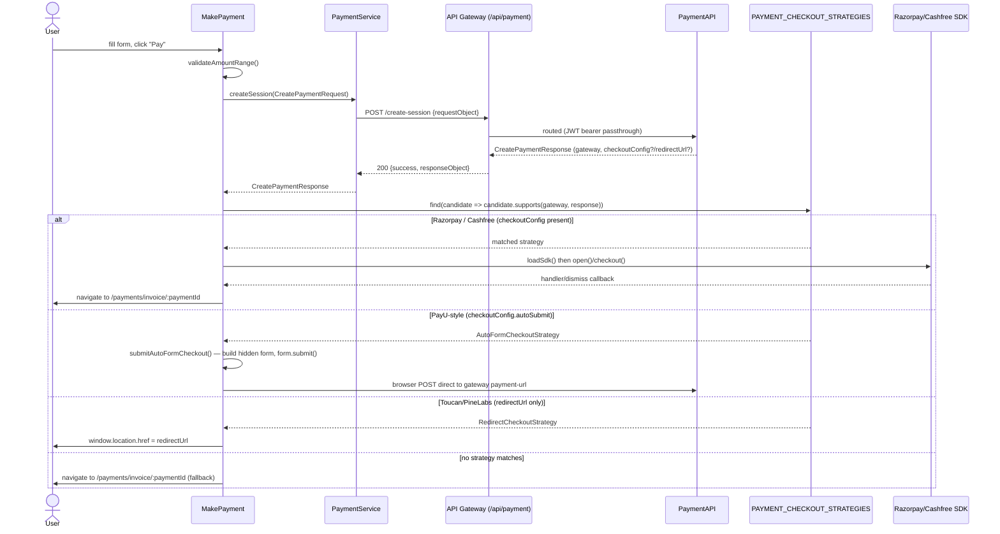
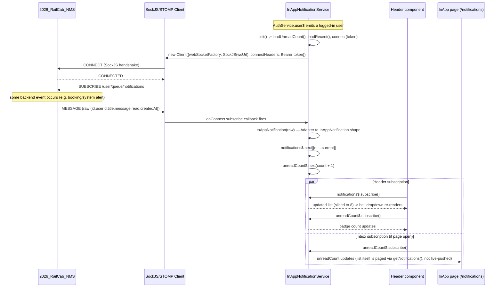

# RailCab Web — Low-Level Design

> Grounded in a fresh read of `src/app/**` on 2026-07-24. All file:line citations refer to files
> under `2026_RailCab_Web/` (paths relative to the repo root). Documentation only — no source
> changed.

## 1. Module / Folder Structure (annotated)

```
src/
  app/
    app-module.ts                 # Root NgModule: BrowserModule, zoneless CD, HTTP + auth interceptor
    app-routing-module.ts         # Top-level routes: auth, vendor, Layout-wrapped shell, admin remote
    layout/                       # Shell chrome
      layout.ts / .html / .scss   # Sidebar collapse, mobile nav, route-driven page title/breadcrumbs
      header/                     # Top bar: user menu, search, notification bell, theme toggle
      sidebar/                    # Left nav, section grouping, role-based visibility (isVisible())
    auth/                         # Login (account+vendor), Register (OTP), Forgot/Change Password
      auth-guard.ts, permission-guard.ts
    payments/                     # Make Payment (gateway select+checkout), Payment Invoice
      make-payment/payment-checkout-strategy.ts   # Strategy pattern (this session's change)
    notifications/                # In-app notification inbox page
    profile/                      # Self-service profile/preferences/sessions/devices/MFA/audit
    access-management/            # UAM admin CRUD: users, roles, groups, orgs, apps, clients,
                                   # security-policies, notification-templates, audit-logs
      access-management-configs.ts, uam-option-loaders.ts   # Declarative AdminCrudConfig per entity
    nms-templates/                 # Notification template CRUD + event/attribute catalog
    vendor-portal/                 # Vendor identity (separate from AuthService), register + KYC docs
    shared/
      services/                    # One HTTP service per backend (see §2)
      interceptors/auth-interceptor.ts
      guards/pending-changes.guard.ts
      dialogs/app-dialog/          # Generic confirm/prompt/form dialog (Facade target)
      components/                  # page-header, toast-host, common-table, admin-crud-form-dialog,
                                    # phone-number-input, address-input, doc-upload
      models/                      # models.ts, payment.models.ts, uam.models.ts
      validators/, utils/          # password.validators.ts, password-strength.ts
      material-module.ts           # Central Angular Material import/export surface
      shared-module.ts              # Declares/exports shared components + MaterialModule
  environments/                    # environment.ts (prod), environment.development.ts
  main.ts, bootstrap.ts            # Module-federation init, then AppModule bootstrap
federation.config.mjs              # Native-federation host config (shares @angular/core etc.)
public/federation.manifest.json    # railcab-admin remote URL
```

## 2. Key Classes / Services (file:line)

| Class / Const | File:line | Role |
|---|---|---|
| `AuthService` | `src/app/shared/services/auth-service.ts:27` | Customer identity: `userSubject` BehaviorSubject, login/loginWithGoogle/refresh/logout, session persistence in `localStorage` |
| `authInterceptorFn` | `src/app/shared/interceptors/auth-interceptor.ts:14` | Functional `HttpInterceptorFn`; bearer-token injection + shared 401 refresh queue |
| `InAppNotificationService` | `src/app/shared/services/in-app-notification-service.ts:11` | STOMP/SockJS client to NMS; `notifications$`/`unreadCount$` BehaviorSubjects; `toAppNotification()` adapter |
| `ToastService` | `src/app/shared/services/toast-service.ts:14` | `toasts$` BehaviorSubject queue, auto-dismiss via `setTimeout` |
| `NotificationService` | `src/app/shared/services/notification-service.ts:5` | Thin facade over `ToastService` (`success/error/warning/info`) |
| `AppDialogService` | `src/app/shared/services/app-dialog-service.ts:7` | Facade over `MatDialog`: `confirm()/prompt()/form()` |
| `ApiService` | `src/app/shared/services/api-service.ts:19` | Generic DMS/NMS HTTP client; `unwrap()` handles 2 possible envelope shapes |
| `UamService` | `src/app/shared/services/uam-service.ts:31` | UAM HTTP client; `wrap()`/`unwrap()` for the mandatory `CommonRequestObject` envelope; ~50 methods across users/roles/groups/orgs/clients/sessions/devices/MFA/preferences/audit |
| `PaymentService` | `src/app/shared/services/payment-service.ts:23` | PaymentAPI client: `createSession/getByPaymentId/checkStatus`, its own `wrap()/unwrap()` |
| `DocumentService` | `src/app/shared/services/document-service.ts:21` | DMS client: `upload/getMetadata/uploadAndAttach/getDownloadUrl/deleteDocument` |
| `FcmService` | `src/app/shared/services/fcm-service.ts:16` | Firebase Cloud Messaging setup/cleanup, service-worker registration, token dedupe |
| `GoogleAuthService` | `src/app/shared/services/google-auth-service.ts:14` | Firebase Auth popup sign-in, returns ID token for `AuthService.loginWithGoogle` |
| `ThemeService` | `src/app/shared/services/theme-service.ts:8` | 4-theme (`light/dark/ocean/forest`) state, `localStorage`-backed, `data-theme` attribute |
| `VendorAuthService` | `src/app/vendor-portal/services/vendor-auth-service.ts:42` | Separate vendor session (`vendor_access_token`/`vendor_data` keys); phone/OTP only, no password |
| `PaymentCheckoutStrategy` (+4 impls) | `src/app/payments/make-payment/payment-checkout-strategy.ts:7-62` | Strategy family for gateway checkout dispatch (see §3.5) |
| `MakePayment` | `src/app/payments/make-payment/make-payment.ts:18` | Payment form component; resolves + invokes a `PaymentCheckoutStrategy` |
| `authGuard` | `src/app/auth/auth-guard.ts:5` | `CanActivateFn`; redirects to `/auth/login` if not authenticated |
| `permissionGuard` | `src/app/auth/permission-guard.ts:5` | `CanActivateFn`; reads `route.data['permission']`, delegates to `AuthService.canAccess()` |
| `pendingChangesGuard` | `src/app/shared/guards/pending-changes.guard.ts:9` | `CanDeactivateFn<PendingChangesAware>`; used on NMS template create/edit routes |
| `Layout` / `Header` / `Sidebar` | `src/app/layout/layout.ts:20`, `header/header.ts:20`, `sidebar/sidebar.ts:20` | Shell chrome; `Header` wires `InAppNotificationService` + `FcmService` lifecycles to `AuthService.user$` |

## 3. Design Patterns

### 3.1 Observer — RxJS `BehaviorSubject`s
The dominant reactive-state idiom across the app. Components subscribe to service-level
`BehaviorSubject`s and re-render on emission; there is no NgRx/store — each service is its own
tiny observable-state container.

- `AuthService.userSubject` (`auth-service.ts:28`) → exposed as `user$` (`:29`), consumed by
  `Header.ngOnInit` (`header.ts:62`) to drive `FcmService.setup()/cleanup()`, and by `Sidebar`/
  `Header` getters reading `auth.currentUser` synchronously.
- `InAppNotificationService.notifications$` / `.unreadCount$` (`in-app-notification-service.ts:17-18`)
  — updated both by the STOMP `onConnect` subscription handler (`:48-57`) and by REST calls
  (`loadRecent`, `loadUnreadCount`, `markAsRead`, `markAllAsRead`). Consumed by `Header` (bell
  dropdown, badge count) and by the `InApp` page (`notifications/in-app/in-app.ts:36`).
- `ToastService._toasts$` (`toast-service.ts:16`) → rendered by `ToastHost`
  (`shared/components/toast-host/toast-host.ts`).

### 3.2 Facade — `AppDialogService`
`shared/services/app-dialog-service.ts:7` wraps Angular Material's verbose `MatDialog.open(...)`
API behind three narrow, purpose-shaped calls — `confirm(data): Observable<boolean>`,
`prompt(data): Observable<string|null>`, `form(data): Observable<Record<string,string>|null>`
(`:10-22`) — all funneling through a single private `open()` (`:24`) that fixes width, focus
handling, and panel class once. Callers (e.g. `Profile.revokeAllSessions()`,
`profile.ts:296`) never touch `MatDialog` or `AppDialogData` construction details directly.

### 3.3 Adapter — response/shape translation
- `InAppNotificationService.toAppNotification()` (`in-app-notification-service.ts:75`) — NMS's raw
  push payload (`{ id, userId, title, message, read, createdAt }`) has no `adminUserId`/`type`
  fields; this adapts it into the richer `InAppNotification` shape the rest of the app (header bell,
  `/notifications` page) expects, hardcoding `type: 'SYSTEM_ALERT'` for socket-delivered events.
- Envelope-unwrapping adapters in every HTTP service, each normalizing a different backend's success
  wrapper into a plain payload: `ApiService.unwrap()` (`api-service.ts:36`, handles either
  `status`/`success` + `data`/`responseObject`), `PaymentService.unwrap()` (`payment-service.ts:49`,
  `{success, responseObject}`), `UamService.unwrap()` (`uam-service.ts:48`, throws using
  `message` on `!success`), `DocumentService.unwrap()` (`document-service.ts:63`),
  `AuthService.unwrapUamResponse()` (`auth-service.ts:120`), `VendorAuthService.unwrap()`
  (`vendor-auth-service.ts:111`).

### 3.4 Chain of Responsibility — `authInterceptorFn` (single link)
`shared/interceptors/auth-interceptor.ts:14`, registered via
`provideHttpClient(withInterceptors([authInterceptorFn]))` (`app-module.ts:35`). Only one
interceptor is chained today, but it is structured as a link that both mutates the request (adds
`Authorization` header, `:19-21`) and can short-circuit/retry via `next()` on error (`:23-37`) — the
canonical CoR shape, just a chain of length one, ready for more links (logging, retry) to be added
without touching call sites.

### 3.5 Strategy — `PaymentCheckoutStrategy` family *(added this session, verified on this read)*
`src/app/payments/make-payment/payment-checkout-strategy.ts`:
- Interface (`:7-10`): `supports(gateway, response): boolean` + `execute(component, response): void`.
- Four concrete strategies (`:12-55`): `RazorpayCheckoutStrategy` (gateway === `'RAZORPAY'` +
  `checkoutConfig`), `CashfreeCheckoutStrategy` (gateway === `'CASHFREE'` + `checkoutConfig`),
  `AutoFormCheckoutStrategy` (any gateway whose `checkoutConfig.autoSubmit` is true — covers PayU's
  hosted-form pattern), `RedirectCheckoutStrategy` (fallback: any response with a bare
  `redirectUrl` — covers Toucan/PineLabs/generic).
- Registry: `PAYMENT_CHECKOUT_STRATEGIES` (`:57-62`), an ordered `readonly` array — order matters
  because `AutoFormCheckoutStrategy`/`RedirectCheckoutStrategy` are broad fallbacks checked last.
- Resolution site: `MakePayment.makePay()` (`make-payment.ts:107-113`) — `.find()`s the first
  matching strategy and calls `.execute(this, response)`, replacing what the code comment
  describes as a former if/else gateway-branching chain. `execute()` calls back into public methods
  on `MakePayment` (`openRazorpayCheckout`, `openCashfreeCheckout`, `submitAutoFormCheckout`,
  `make-payment.ts:161/194/240`), so the component is the Strategy's "context" object.

### 3.6 Other patterns observed
- **Config-driven generic component** (not strictly GoF, but a recurring idiom): `AdminCrudConfig`
  (`shared/components/admin-crud/admin-crud.types.ts:30`) is a declarative descriptor (columns,
  fields, resource path) consumed by a single generic `AdminCrudFormDialog` component; each entity
  screen (`access-management-configs.ts`) just supplies data, not behavior — effectively a
  Template-Method-by-configuration rather than by subclassing.
- **Guard functions as light Strategy/Predicate objects**: `authGuard`, `permissionGuard`,
  `pendingChangesGuard` are all `CanActivateFn`/`CanDeactivateFn` closures injected into route
  config data — Angular's own functional-guard convention, not a custom pattern, but worth noting
  for anyone expecting class-based guards from older Angular versions.
- No Builder pattern was found in this repo (the string "Builder" only matches Angular's
  `FormBuilder` usage in `login.ts`, `register.ts`, `change-password.ts`, `forgot-password.ts`,
  `vendor-register.ts` — framework API, not an app-authored Builder).

## 4. Route Table

| Path | Component | Guard(s) | Notes |
|---|---|---|---|
| `/` | — | — | `redirectTo: 'home'` (`app-routing-module.ts:8`) |
| `/auth/login` | `Login` | — | Dual-mode: account (password/Google/TOTP) or vendor (phone/OTP) |
| `/auth/register` | `Register` | — | 2-step: details → phone/email OTP verify |
| `/auth/change-password` | `ChangePassword` | `authGuard` | (`auth-routing-module.ts:12`) |
| `/auth/forgot-password` | `ForgotPassword` | — | Email OTP → reset |
| `/vendor/register` | `VendorRegister` | — | 4-step wizard (business/tax/fleet/bank) |
| `/vendor/documents` | `VendorDocuments` | — | KYC upload; default redirect target of `/vendor` |
| `/home` | `Home` | *(shell `canActivate` commented out)* | Inside `Layout` shell |
| `/notifications` | `InApp` | *(shell-level, disabled)* | Paged inbox, all/unread tabs |
| `/admin/**` | `AdminRemoteEntryModule` (federation remote) | *(shell + remote-route `canActivate` both commented out)* | `loadRemoteModule('railcab-admin', './AdminRoutes')` |
| `/access-management` | — | — | `redirectTo: 'users'` |
| `/access-management/users` | `UsersList` | — | |
| `/access-management/users/:id` | `UserDetail` | — | |
| `/access-management/roles` | `RolesList` | — | + `RoleFormDialog` |
| `/access-management/groups` | `GroupsList` | — | |
| `/access-management/groups/:id` | `GroupDetail` | — | |
| `/access-management/organizations` | `OrganizationsList` | — | |
| `/access-management/applications` | `ApplicationsList` | — | |
| `/access-management/clients` | `ClientsList` | — | |
| `/access-management/security-policies` | `SecurityPoliciesList` | — | |
| `/access-management/notification-templates` | `NotificationTemplatesList` | — | |
| `/access-management/audit-logs` | `AuditLogs` | — | + `AuditLogDetailDialog` |
| `/nms-templates` | `TemplateLanding` | — | |
| `/nms-templates/events` | `TemplateEvents` | — | |
| `/nms-templates/list` | `TemplateList` | — | |
| `/nms-templates/create` | `TemplateFormComponent` | `pendingChangesGuard` (canDeactivate) | |
| `/nms-templates/edit/:id` | `TemplateFormComponent` | `pendingChangesGuard` (canDeactivate) | |
| `/profile` | `Profile` | *(shell-level, disabled)* | |
| `/payments` | — | — | `redirectTo: 'make-payment'` |
| `/payments/make-payment` | `MakePayment` | *(shell-level, disabled)* | |
| `/payments/invoice/:paymentId` | `PaymentInvoice` | *(shell-level, disabled)* | |
| `/my-bookings` | `Home` (placeholder) | — | Reuses `HomeModule` until a real booking screen exists |
| `**` | — | — | `redirectTo: 'home'` |

**Guard status caveat**: `app-routing-module.ts:20` and `:26` both comment out
`canActivate: [authGuard]` on the `Layout`-wrapped shell and the `/admin` remote route
respectively — every route under the authenticated shell is currently reachable unauthenticated at
the routing layer (the backend APIs still enforce their own auth via the bearer token / 401 flow).
`permissionGuard` exists but no route in this app currently references it in `data.permission`.

## 5. Data Model (TypeScript interfaces)

### `shared/models/models.ts`
`User`, `LoginResponse`, `Pagination<T>`, `InAppNotificationType` (union),
`InAppNotification`, `InAppNotificationPage`, `DocumentResponse` (mirrors DMS
`DocumentResponse` field-for-field), `DocumentDownloadUrlResponse`.

### `shared/models/payment.models.ts`
Mirrors `2026_RailCab_PaymentAPI`'s checkout/status/domain DTOs field-for-field:
`PaymentGateway` (`'RAZORPAY'|'PAYU'|'TOUCAN'|'PINELABS'|'CASHFREE'`),
`PaymentStatusState`, `CreatePaymentRequest`, `CreatePaymentResponse` (has the
`checkoutConfig?: Record<string,any>` blob strategies branch on), `PaymentStatusRequest`,
`PaymentTransaction` (full transaction/receipt record for the invoice page).

### `shared/models/uam.models.ts`
Largest model file — mirrors UAM's DTOs field-for-field. Envelope types
`UamCommonRequest`/`UamCommonResponse<T>`, `SpringPage<T>`, `OperationResult`; nested value types
`RPhoneNumber`, `RName`, `RUpload`, `AuditInfo`; entity types `UamUser`, `UamRole`, `Permission`,
`Group`, `Tenant`, `Application`, `ApiClient`/`ApiClientCreated`, `SecurityPolicy` (with
`PasswordPolicy`/`LoginPolicy`/`SessionPolicy`/`MfaPolicy`/`ApiSecurityPolicy`/`AccountPolicy`
sub-shapes), `NotificationTemplate`; account-security types `UserMfa`, `UserSession`, `UserDevice`,
`UserLoginSecurity`, `CredentialSummary`, `RefreshToken`, `PasswordHistory`; preferences
(`UserPreference` composed of `UiPreference`/`NotificationPreference`/`DashboardPreference`/
`AccessibilityPreference`/`RegionalPreference`); `AuditLog`/`FieldChange`; customer
registration/OTP types (`CustomerRegisterRequest`, `RegistrationResponse`, `PhoneOtpRequest`,
`EmailOtpRequest`, `VerifyPhoneOtpRequest`, `VerifyEmailOtpRequest`, `OtpSentResponse`,
`AppLoginResponse`, `MfaChallengeRequiredResponse`, `MfaEnrollTotpResponse`).

## 6. Sequence Diagrams

### 6.1 Make-Payment flow through `PaymentCheckoutStrategy` resolution



### 6.2 STOMP-driven in-app notification arrival → BehaviorSubject → UI update



## 7. Error Handling / Validation Approach

- **HTTP envelope errors are normalized to a common throw shape** across every service:
  `throw { error: { detail, message, errorCode? } }` (see `ApiService.unwrap()`,
  `UamService.unwrap()`, `PaymentService.unwrap()`, `AuthService.unwrapUamResponse()`,
  `VendorAuthService.unwrap()`). Components then read `err?.error?.detail || err?.error?.message`
  uniformly (e.g. `make-payment.ts:118`, `login.ts:145`, `register.ts:71/96/121`,
  `payment-invoice.ts:48`) so the UI-facing error string never depends on which backend replied.
- **401 handling is centralized in `authInterceptorFn`**, not per-component: components' own
  `error` callbacks only handle *business* failures (invalid OTP, amount out of range, etc.);
  session-expiry retry/refresh/logout is entirely interceptor-owned (§HLD.md §8).
- **Client-side form validation** is Angular Reactive Forms (`Validators.required`, `.email`,
  `.minLength(13)` for passwords) plus two custom validators:
  `matchPasswords(newKey, confirmKey)` (`shared/validators/password.validators.ts:3`, a
  cross-field `ValidatorFn` used by `ChangePassword` and `ForgotPassword`) and phone-number
  validation embedded in `PhoneNumberInput`'s own `NG_VALIDATORS` provider (referenced from
  `register.ts:36-38` and `login.ts:54-56` comments — required + Indian mobile pattern
  `^[6-9]\d{9}$`).
- **Live password-strength feedback**: `shared/utils/password-strength.ts`'s
  `getPasswordChecks()`/`getPasswordStrength()` drive a strength meter on Register/Change/Forgot
  password screens; this is presentational only, not a submission gate beyond the length validator.
- **Payment amount validation** is bespoke to `MakePayment`: `validateAmountRange()`
  (`make-payment.ts:156`) rejects `< ₹1` or `> ₹1,00,00,000`, formatted/parsed through a custom
  Indian-numbering-system formatter (`formatIndianAmount`) rather than a generic Angular validator.
- **`CanDeactivate` guard for unsaved changes**: `pendingChangesGuard`
  (`shared/guards/pending-changes.guard.ts:9`) calls back into the leaving component's own
  `hasPendingChanges()`/`confirmDiscardChanges()` (the `PendingChangesAware` contract), applied to
  the NMS template create/edit routes so navigating away with unsaved edits prompts for
  confirmation.
- **Best-effort / fire-and-forget error suppression**: several non-critical calls intentionally
  swallow errors with `error: () => {}` — e.g. `InAppNotificationService.loadRecent()/loadUnreadCount()`
  (in-app inbox degrades to empty rather than blocking), `AuthService.logout()`'s server-side
  logout call, and most of `Profile`'s secondary-panel loaders (sessions/devices/MFA/login-security/
  audit-logs) so one failing panel doesn't break the whole profile page.
